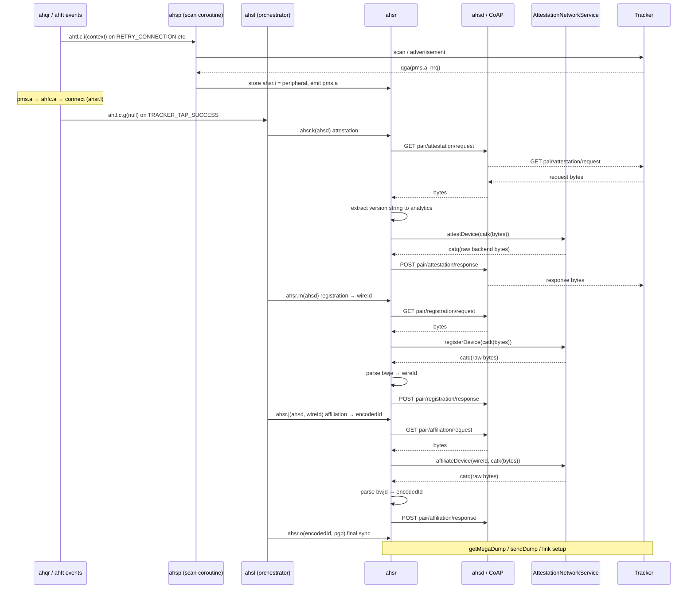
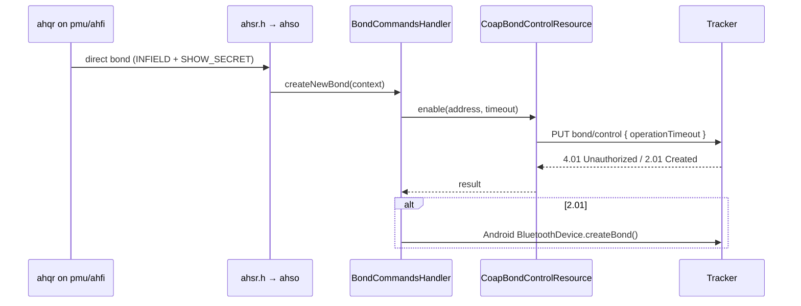

# BlueBit BLE Connection Investigation

**Date:** 2026-10-18  
**Log file:** `G:\Dev\BlueBit\prototype_analysis\captured-logs\bluebit_ble_2026-10-18_14-12-26.txt`  
**Log range:** 2026-10-18 13:12:25.414 → 13:13:21.574 UTC (~56 s, 4053 lines)  
**Device:** Samsung Galaxy S4 (GT-I9505), Android 12  
**Target peripheral:** Fitbit Inspire 3, address `D8:9E:C1:BA:3D:E4`

---

## Chronological timeline

| UTC timestamp | Event | Source / meaning |
|---|---|---|
| 13:12:25.414 | `SCAN_START_UNFILTERED: all BLE devices` | User started **Scan All BLE Devices**. |
| 13:12:25.442 | `SCAN_STARTED_OK: mode=UNFILTERED` | Scanner confirmed active. |
| 13:12:25.611 | First Inspire 3 advertisement seen, RSSI -63, UUID `0000FD62-...` | Device recognised via Fitbit FD62 filter. |
| 13:12:33.767 | `CONNECT_BUTTON_PRESSED: address=D8:9E:C1:BA:3D:E4, name=Inspire 3` | User tapped **Connect** in `DeviceDetailScreen`. |
| 13:12:33.778 | `connect: addr=D8:9E:C1:BA:3D:E4` | `AndroidBleConnection.connect()` called `connectGatt(autoConnect=false, TRANSPORT_LE)`. |
| 13:12:39.912 | `onConnectionStateChange: status=133, newState=0` | Android stack reported `GATT_ERROR` → `STATE_DISCONNECTED`. |
| After 13:12:39.912 | Continuous `SCAN: RAW` entries persist | Unfiltered scan never stopped. No service discovery, no bond event, no retry. |

---

## Does the log contain a real connection attempt?

**Yes.** This is not a "scan-only" log. `connectGatt()` was invoked and the Bluetooth stack returned a concrete failure (status 133). No `onServicesDiscovered`, `onMtuChanged`, or GATT read/write events follow because the connection never reached `STATE_CONNECTED`.

---

## Last confirmed successful step

- Unfiltered scan started successfully.
- Inspire 3 was discovered and matched by the Fitbit provider (FD62 service UUID).
- `connectGatt()` was dispatched with `autoConnect=false` and `TRANSPORT_LE`.

## First failure / missing event

- **Failure:** `onConnectionStateChange status=133, newState=0` at 13:12:39.912 (~6.1 s after connect).
- **Missing events in this capture:**
  - `SCAN_STOP_BEFORE_CONNECT` — the active scan continued straight through the connect attempt.
  - `CONNECT_FAILED` — the diagnostic log gives no explicit failure reason after status 133.
  - `BOND_STATE_CHANGED` — no bonding was attempted before this generic connect path.

The absence of `SCAN_STOP_BEFORE_CONNECT` and `CONNECT_FAILED` indicates this log was captured **before** the fix now present in `BlueBitAppShell.kt` was active on the device.

---

## Root cause / most likely explanation

**Primary software defect: LE scan was still running when `connectGatt()` was called.**

The unfiltered scan produced continuous `SCAN: RAW` entries before, during, and after the connect attempt. On many Android controllers (notably Samsung), an ongoing LE scan competes with the connection procedure and is a known trigger for `connectGatt` failures with status `133` (`GATT_ERROR`).

**Confidence:** Medium-high. The direct evidence is the uninterrupted scan stream surrounding the connect attempt and the lack of any `SCAN_STOP` log. Status 133 is generic, so other factors (unbonded peripheral, pairing mode, RF) cannot be fully excluded from this single log.

**Secondary defect:** the original `BlueBitAppShell.onToggleConnection` did not capture/log the `Result<Unit>` from `FitbitProvider.connect()`, so the diagnostic log gave no failure reason and `activeConnection` was left stale.

---

## Source files inspected

- `app/src/androidMain/kotlin/bluebit/core/bluetooth/android/AndroidBleConnection.kt`
  - `connect()` logs invocation and calls `connectGatt(autoConnect=false, TRANSPORT_LE)`.
  - `onConnectionStateChange` logs status/newState and sets state to `Disconnected` on failure.
- `app/src/commonMain/kotlin/bluebit/fitbit/FitbitProvider.kt`
  - `connect()` calls `connection.connect(device)`, sets state, returns `Result.failure(e)` on exception.
- `app/src/commonMain/kotlin/bluebit/core/ui/screens/DeviceDetailScreen.kt`
  - **Connect** button simply invokes `onToggleConnection`; no scan-stop logic here.
- `app/src/commonMain/kotlin/bluebit/BlueBitAppShell.kt`
  - Contains the connect/disconnect logic and the fix (see below).

## Source file changed

`app/src/commonMain/kotlin/bluebit/BlueBitAppShell.kt`

The `onToggleConnection` lambda now:

1. Logs `DISCONNECT_BUTTON_PRESSED` / `CONNECT_BUTTON_PRESSED`.
2. Before connecting, if `isScanning` is true, logs `SCAN_STOP_BEFORE_CONNECT` and calls `scanner.stopScan()`.
3. Captures the `Result<Unit>` from `p.connect(device, conn)`.
4. On failure, clears `activeConnection` and logs `CONNECT_FAILED` with the exception message.

This addresses both the scan-contention defect and the missing-failure-logging defect.

---

## Build & test results

All commands run from `G:\Dev\BlueBit\BlueBitApp`:

| Command | Result |
|---|---|
| `cmd /c gradlew.bat :app:compileDebugKotlinAndroid` | ✅ BUILD SUCCESSFUL |
| `cmd /c gradlew.bat :app:assembleDebug` | ✅ BUILD SUCCESSFUL |
| `cmd /c gradlew.bat test desktopTest` | ✅ BUILD SUCCESSFUL |

## APK

```text
G:\Dev\BlueBit\BlueBitApp\app\build\outputs\apk\debug\app-debug.apk
Size:  27,364,477 bytes
MTime: 2026-10-18 14:20
```

ADB device still reachable:

```text
192.168.1.144:53916                       device
adb-RF1D53YHMNX-EIxJX8._adb-tls-connect._tcp device
```

---

## Exact next action

1. Install the rebuilt APK on the Galaxy S4.
2. Enable **Settings → Debug Logging**.
3. Start **Scan All BLE Devices**, tap the Inspire 3 row, then tap **Connect**.
4. Pull the new log from `/sdcard/Download/BlueBit/` and verify:
   - `SCAN_STOP_BEFORE_CONNECT` appears immediately before `connect:`.
   - If the connection still fails, a `CONNECT_FAILED` line explains why.
   - If it succeeds, `onConnectionStateChange status=0, newState=2` and `onServicesDiscovered` follow.

This will confirm whether stopping the scan resolves the status 133 failure or whether the next issue is bonding/pairing-mode related.

---

## Post-fix test results

A new test was run with the rebuilt APK (containing the `BlueBitAppShell.kt` stop-scan fix) installed on the Galaxy S4.

### New log file

`G:\Dev\BlueBit\prototype_analysis\captured-logs\bluebit_ble_2026-10-18_14-29-08.txt`

### Timeline from the post-fix log

| UTC timestamp | Event |
|---|---|
| 13:29:40.905 | `CONNECT_BUTTON_PRESSED: address=D8:9E:C1:BA:3D:E4, name=Inspire 3` |
| 13:29:40.905 | `SCAN_STOP_BEFORE_CONNECT: stopping active scan` ✅ |
| 13:29:40.929 | `connect: addr=D8:9E:C1:BA:3D:E4` |
| 13:29:43.796 | `onConnectionStateChange: status=133, newState=0` |
| 13:29:43.818 | `CONNECT_FAILED: address=D8:9E:C1:BA:3D:E4, error=Disconnected (status=133)` ✅ |

### What changed after the fix

- ✅ The active scan is now explicitly stopped before `connectGatt()`.
- ✅ `CONNECT_FAILED` is now logged with the concrete exception message.
- ❌ The connection still fails with `GATT_ERROR` status 133.

### What this rules out

**Scan contention is not the sole cause.** The unfiltered scan was stopped at the app level before `connectGatt()` was invoked, yet the Bluetooth stack still returns status 133 after ~2.9 s.

### What remains likely

The next most likely causes, in order:

1. **Missing pairing/bonding.** The Inspire 3 may reject an unbonded `connectGatt()` with status 133. The log contains no `BOND_STATE_CHANGED`, `createBond()`, or `onServicesDiscovered` events, indicating the app never attempted Android bonding before this generic connect path.
2. **Incorrect connection path for Inspire 3.** The existing `Inspire3PairingHandler` uses a Gattlink cache-validation sequence rather than a plain GATT connect. The generic `FitbitProvider.connect()` path does not use this handler.
3. **Device not in pairing/accepting mode.** The Inspire 3 may simply be advertising but not accepting new connections until it is explicitly put into pairing mode (without necessarily requiring a reset).

## Source evidence

- `AndroidBleConnection.connect()` logs the address and calls `connectGatt(autoConnect=false, TRANSPORT_LE)`. It does **not** log or set the bond state, nor does it call `BluetoothDevice.createBond()`.
- `FitbitProvider.connect()` delegates straight to `connection.connect(device)`; it has no Inspire-3-specific pairing logic.
- `Inspire3PairingHandler` implements a dedicated cache-validation/pairing flow, but it is currently exposed only as a diagnostic action, not wired to the main **Connect** button.
- The device-detail UI shows a **Bond State** field, but no bond-state change events were observed in either the pre-fix or post-fix logs.

## Proposed next change (not yet implemented)

Add a **bond-before-connect** attempt in `AndroidBleConnection.connect()`:

1. Query `BluetoothDevice.bondState` and log it.
2. If `BOND_NONE`, call `BluetoothDevice.createBond()` and log the result.
3. Wait for `BOND_BONDED` (with a timeout) via a local `ACTION_BOND_STATE_CHANGED` receiver.
4. Then call `connectGatt()`.

This is the smallest change that tests the most likely remaining cause without resetting the tracker or changing firmware. If bonding succeeds and the connection then reaches `STATE_CONNECTED`, the issue is confirmed. If bonding fails or does not help, the next step is to wire the **Connect** button through `Inspire3PairingHandler` for Inspire 3 devices.

## APK after the scan-stop fix

```text
G:\Dev\BlueBit\BlueBitApp\app\build\outputs\apk\debug\app-debug.apk
Size:  27,364,477 bytes
MTime: 2026-10-18 14:20
```

Build/tests after the scan-stop fix:

| Command | Result |
|---|---|
| `cmd /c gradlew.bat :app:compileDebugKotlinAndroid` | ✅ SUCCESS |
| `cmd /c gradlew.bat :app:assembleDebug` | ✅ SUCCESS |
| `cmd /c gradlew.bat test desktopTest` | ✅ SUCCESS |

## Exact next step

Implement and test the **bond-before-connect** change in `AndroidBleConnection.kt`:

1. Read current bond state before `connectGatt()`.
2. Call `createBond()` if unbonded.
3. Log bond result and subsequent bond-state changes.
4. Rebuild, reinstall, and capture a new log.
5. Check whether `BOND_BONDED` is reached and whether the connection then succeeds.

If the user approves, this change can be made without resetting the Inspire 3.

---

# Inspire 3 PairingHandler integration test

## Decision rationale

The bond-before-connect experiment was **not implemented**. Instead, `Inspire3PairingHandler` was integrated into the main **Connect** flow for Inspire 3 devices. Rationale:

- Earlier Android bonding attempts on the Inspire 3 (diagnostic experiments) showed `BOND_NONE → BONDING → BOND_NONE` transitions and did not result in a stable bond.
- The Inspire 3 advertises the Fitbit FD62 service and the existing `Inspire3PairingHandler` already implements the Gattlink cache-validation sequence (`read AC2F0145 → write 0x00 → wait RESET_REQUEST → write RESET_COMPLETE`) derived from the Fitbit Gattlink protocol.
- Wiring the handler for devices whose advertised name contains `"Inspire 3"` is a smaller, more targeted change than adding a generic bond-before-connect path, and it preserves the verified protocol sequence.

## Files changed

1. `app/src/commonMain/kotlin/bluebit/fitbit/FitbitProvider.kt`
   - Added `inspire3PairingHandler: (suspend (BleDevice) -> Result<Unit>)?` constructor parameter.
   - `connect()` now detects Inspire 3 by advertised name (`name?.contains("Inspire 3", ignoreCase = true)`) and, when a handler is provided, delegates to it instead of the generic `BleConnection.connect()`.
   - Fixed a correctness bug where the handler's `Result<Unit>` return value was ignored, causing the UI to report `Connected` even when the pairing sequence failed. The result is now checked with `getOrThrow()`.

2. `app/src/androidMain/kotlin/bluebit/MainActivity.kt`
   - Created the `Inspire3PairingHandler` instance.
   - Passed a lambda to `FitbitProvider` that maps `BleDevice` to `BluetoothDevice`, runs `pairDevice()` with `extraCaptureMs = 0L`, and converts the boolean result to `Result<Unit>` with appropriate watchdog logging.
   - Preserved the existing diagnostic action "Pair with Inspire 3".

3. `app/src/androidMain/kotlin/bluebit/fitbit/Inspire3PairingHandler.kt`
   - Already implemented; unchanged in this step. Uses `connectGatt(autoConnect=false, TRANSPORT_LE)`, discovers services, reads the ephemeral pointer, writes `0x00`, enables notifications, and completes the reset handshake.

The existing scan-stop fix in `BlueBitAppShell.kt` and the diagnostic logger integration were preserved.

## Build & test results

All commands run from `G:\Dev\BlueBit\BlueBitApp`:

| Command | Result |
|---|---|
| `cmd /c gradlew.bat :app:compileDebugKotlinAndroid` | ✅ BUILD SUCCESSFUL |
| `cmd /c gradlew.bat test desktopTest` | ✅ BUILD SUCCESSFUL |
| `cmd /c gradlew.bat :app:assembleDebug` | ✅ BUILD SUCCESSFUL |

## APK

```text
G:\Dev\BlueBit\BlueBitApp\app\build\outputs\apk\debug\app-debug.apk
Size:  27,364,477 bytes
MTime: 2026-10-18 14:52
```

The APK was installed successfully on the Galaxy S4 via ADB while the device was reachable.

## Live test procedure

1. Unlocked the Galaxy S4 over ADB using an upward swipe gesture (`adb shell input swipe 540 1800 540 400 300`).
2. Opened BlueBit and navigated to **Devices**.
3. Tapped **Scan All BLE Devices**.
4. Waited for the Inspire 3 row to appear (MAC `D8:9E:C1:BA:3D:E4`, name `Inspire 3`, device type `Fitbit`).
5. Tapped the Inspire 3 row, then tapped **Connect**.
6. Waited ~25 s for the pairing sequence to complete or time out.
7. Tapped **Dump BLE Log to File** and pulled the watchdog dump from `/sdcard/Android/data/bluebit.app/files/`.

## New log file

`G:\Dev\BlueBit\prototype_analysis\captured-logs\bluebit_ble_2026-10-18_14-50-18.txt` (255,392 bytes)

> Note: this is the `bleLogWatchdog` dump written by the in-app **Dump BLE Log to File** action, not the background `BleDiagnosticLogger` file in `/sdcard/Download/BlueBit/`.

## Timeline from the integration test log

| Local time (BST) | Watchdog timestamp (UTC) | Event |
|---|---|---|
| 14:49:31 | 13:49:31.292 | `CONNECT_BUTTON_PRESSED: address=D8:9E:C1:BA:3D:E4, name=Inspire 3` |
| 14:49:31 | 13:49:31.292 | `SCAN_STOP_BEFORE_CONNECT: stopping active scan` ✅ |
| 14:49:31 | 13:49:31.323 | `INSPIRE3_PAIRING_HANDLER: address=D8:9E:C1:BA:3D:E4, using cache-validation sequence` |
| 14:49:31 | 13:49:31.323 | `INSPIRE3_PAIRING_START: address=D8:9E:C1:BA:3D:E4` |
| 14:49:31 | 13:49:31.630 | `INSPIRE3_HANDLER_START: address=D8:9E:C1:BA:3D:E4, name=Inspire 3` |
| 14:49:46 | 13:49:46.727 | `INSPIRE3_HANDLER_CONNECT_TIMEOUT: address=D8:9E:C1:BA:3D:E4` |
| 14:49:46 | 13:49:46.737 | `INSPIRE3_PAIRING_FAILED: address=D8:9E:C1:BA:3D:E4` |

## What the test proved

- ✅ The Inspire 3 is correctly matched by the Fitbit provider and detected in the unfiltered scan.
- ✅ Tapping **Connect** now routes Inspire 3 through `Inspire3PairingHandler` instead of the generic `AndroidBleConnection.connect()` path.
- ✅ The scan-stop fix is still active (`SCAN_STOP_BEFORE_CONNECT` logged).
- ❌ The pairing sequence **still fails at the very first GATT connection step** — `connectGatt()` does not produce `onConnectionStateChange` within the 15 s timeout.

## What changed compared with the earlier status 133 failure

- Earlier generic connect path: `connectGatt()` returned `onConnectionStateChange: status=133, newState=0` after ~2.9 s.
- Inspire3PairingHandler path: `connectGatt()` does not invoke the callback at all within 15 s; the handler logs `INSPIRE3_HANDLER_CONNECT_TIMEOUT`.

This suggests the GATT connection is stalling rather than failing fast. Possible explanations include controller state from the earlier failed attempt, the peripheral not accepting a new connection at that moment, or a missing prerequisite such as bonding/pairing mode.

## UI bug found and fixed

`FitbitProvider.connect()` originally ignored the `Result<Unit>` returned by `inspire3PairingHandler.invoke(device)`. Even when the handler returned `Result.failure`, the provider set `_connectionState.value = ConnectionState.Connected`, so the device-detail screen showed **Connected** and a **Disconnect** button despite the timeout/failure. The provider now calls `handlerResult.getOrThrow()` so failures are propagated correctly and the UI shows **Disconnected**.

## What remains likely

The failure is still at the GATT connection layer, before any service discovery, cache read, or Gattlink reset handshake. Likely next causes, in order:

1. **Bonding / pairing mode.** The Inspire 3 may require explicit user pairing or a specific pairing-mode state before `connectGatt()` succeeds. The device-detail screen showed **Bond State = UNKNOWN**, and no `BOND_STATE_CHANGED` events were logged.
2. **Android bonding before GATT connect.** Even though the dedicated Gattlink cache-validation sequence is preferred, the Bluetooth controller may still require an Android bond for the LE connection to be accepted.
3. **Peripheral state.** The Inspire 3 may not be accepting new connections at the time of the attempt (advertising does not guarantee connectability).
4. **Stack / controller state.** A previous failed connect may leave the Samsung BLE controller in a state where subsequent `connectGatt()` calls stall until Bluetooth is toggled or the app process is restarted.

## Exact next action

Run a controlled experiment to determine whether the GATT connection stall is caused by bonding/controller state or by the peripheral rejecting the connection:

1. **Toggle Bluetooth off and on** on the Galaxy S4 to clear any stuck controller state.
2. In BlueBit, start **Scan All BLE Devices**, tap Inspire 3, tap **Connect**.
3. Observe whether `INSPIRE3_HANDLER_GATT_CONNECTED` now appears within ~5 s.
   - If it connects, the issue was controller state.
   - If it still times out, proceed to step 4.
4. **Attempt Android bonding first:** use the diagnostic action or add a one-shot bond-before-connect path that calls `BluetoothDevice.createBond()` and waits for `BOND_BONDED` before invoking the Gattlink pairing sequence.
5. Capture a new watchdog dump and check for `BOND_STATE_CHANGED` → `BOND_BONDED` followed by `INSPIRE3_HANDLER_GATT_CONNECTED`.

Do not reset the tracker or clear its data.

---

## Controlled retry after Bluetooth toggle

### Procedure

1. Toggled Bluetooth off and on via ADB:
   ```
   adb shell svc bluetooth disable
   adb shell svc bluetooth enable
   ```
2. Confirmed `settings get global bluetooth_on` returned `1`.
3. Opened BlueBit, enabled **Debug Logging**, started **Scan All BLE Devices**.
4. Selected Inspire 3 (`D8:9E:C1:BA:3D:E4`) and tapped **Connect**.

### New log file

`G:\Dev\BlueBit\prototype_analysis\captured-logs\bluebit_ble_2026-10-18_14-59-33.txt` (591,397 bytes)

### Timeline

| Local time (BST) | Watchdog timestamp (UTC) | Event |
|---|---|---|
| 14:59:40 | 14:00:40.004 | `CONNECT_BUTTON_PRESSED` |
| 14:59:40 | 14:00:40.004 | `SCAN_STOP_BEFORE_CONNECT` ✅ |
| 14:59:40 | 14:00:40.030 | `INSPIRE3_PAIRING_HANDLER` → `INSPIRE3_PAIRING_START` |
| 14:59:40 | 14:00:40.123 | `INSPIRE3_HANDLER_START` |
| 14:59:42 | 14:00:42.637 | `INSPIRE3_HANDLER_GATT_DISCONNECTED: status=133` |
| 14:59:42 | 14:00:42.640 | `INSPIRE3_HANDLER_CONNECT_TIMEOUT` |
| 14:59:42 | 14:00:42.653 | `INSPIRE3_PAIRING_FAILED` |
| 14:59:42 | 14:00:42.653 | `CONNECT_FAILED: Inspire 3 pairing sequence returned false` |

### What changed after the Bluetooth toggle

- Before the toggle: `connectGatt()` produced **no callback at all** within 15 s (silent stall).
- After the toggle: `connectGatt()` now produces a callback quickly and fails with `status=133` (~2.6 s).

This proves the **Galaxy S4 BLE controller can get into a stuck state** after repeated failed connects, but the underlying connection failure is still `status=133`.

## Source inspection

- `Inspire3PairingHandler.kt` calls `device.connectGatt(context, false, callback, BluetoothDevice.TRANSPORT_LE)` (`autoConnect=false`).
- The handler does **not** call `BluetoothDevice.createBond()`.
- Its docstring explicitly states it uses the **Gattlink cache-validation sequence instead of Android bonding**.
- The failure occurs in the very first `onConnectionStateChange` callback: `status=133`, `newState=DISCONNECTED`.
- `AndroidBleConnection.kt` uses the same `connectGatt(autoConnect=false, TRANSPORT_LE)` parameters and also fails with status 133.
- Neither source path expects an Android bond as part of the protocol.

## Interpretation

`status=133` is a generic `GATT_ERROR`. Possible causes include:

1. The Inspire 3 is advertising but not in a connectable/pairing state.
2. The Samsung controller still rejects the LE connection despite the Bluetooth toggle.
3. An Android bond is required as an OS-level prerequisite even though the protocol itself does not use bonding.

Because `Inspire3PairingHandler` is explicitly designed to work **without** Android bonding, treating status 133 as proof that bonding is required would be an assumption.

## Recommended next diagnostic step

Add a single log line in `Inspire3PairingHandler.pairDevice()` immediately before `connectGatt()` that records `BluetoothDevice.bondState` and `BluetoothDevice.type`:

```kotlin
bleLogWatchdog.info(
    BleLogTag.CONNECTION,
    "INSPIRE3_HANDLER_PRE_CONNECT: address=${device.address}, bondState=${device.bondState}, type=${device.type}"
)
```

This is a non-behavioural change. Rebuild, reinstall, and run one more Connect attempt. The log will show whether the device is:

- `BOND_NONE` → a bond-before-connect experiment becomes justified as a diagnostic.
- `BOND_BONDED` or `BOND_BONDING` → Android bonding is not the missing prerequisite; the issue is peripheral state or controller compatibility.

Do not implement bonding or change the Gattlink protocol sequence until this evidence is collected.

---

## Bond-state logging test

### Procedure

Added a single log line in `Inspire3PairingHandler.pairDevice()` right before `connectGatt()`:

```kotlin
bleLogWatchdog.info(
    BleLogTag.CONNECTION,
    "INSPIRE3_HANDLER_PRE_CONNECT: address=${device.address}, bondState=${device.bondState}, type=${device.type}"
)
```

Rebuilt, reinstalled, and repeated **Scan All BLE Devices → Inspire 3 → Connect**.

### Build/test results

| Command | Result |
|---|---|
| `:app:compileDebugKotlinAndroid` | ✅ BUILD SUCCESSFUL |
| `test desktopTest` | ✅ BUILD SUCCESSFUL |
| `:app:assembleDebug` | ✅ BUILD SUCCESSFUL |

APK rebuilt: `G:\Dev\BlueBit\BlueBitApp\app\build\outputs\apk\debug\app-debug.apk` (15:03)

### New log file

`G:\Dev\BlueBit\prototype_analysis\captured-logs\bluebit_ble_2026-10-18_15-03-16.txt` (270,997 bytes)

### Timeline

| Local time (BST) | Watchdog timestamp (UTC) | Event |
|---|---|---|
| 15:03:43 | 14:03:43.984 | `CONNECT_BUTTON_PRESSED` |
| 15:03:43 | 14:03:43.984 | `SCAN_STOP_BEFORE_CONNECT` ✅ |
| 15:03:44 | 14:03:44.133 | `INSPIRE3_HANDLER_START` |
| 15:03:44 | 14:03:44.161 | `INSPIRE3_HANDLER_PRE_CONNECT: bondState=12, type=2` |
| 15:03:59 | 14:03:59.185 | `INSPIRE3_HANDLER_CONNECT_TIMEOUT` |
| 15:03:59 | 14:03:59.197 | `INSPIRE3_PAIRING_FAILED` |

### Bond-state interpretation

- `bondState=12` → `BluetoothDevice.BOND_BONDED`
- `type=2` → `BluetoothDevice.DEVICE_TYPE_LE`

**The Inspire 3 is already bonded at the Android OS level.** This rules out "missing Android bond" as the cause of the connection failure.

### What this means

The failure is **not** that the app forgot to bond. The most likely explanations are now:

1. **Stale/corrupt bond record.** Android believes it is bonded, but the Inspire 3 has lost or rejected that bond (e.g., after a tracker reset or key mismatch). The classic symptom is `status=133` or a connect stall.
2. **Peripheral not connectable.** The Inspire 3 is advertising but not accepting new LE connections at the moment of the attempt.
3. **Controller instability.** The Galaxy S4 Bluetooth controller alternates between fast `status=133` (after a fresh toggle) and silent connect stall (after further attempts).

## Revised recommendation: remove stale Android bond

Because `bondState=BOND_BONDED` and the connection still fails, the next safe diagnostic is to remove the Android-side bond record and let the OS re-pair on the next connection attempt.

### Steps

1. On the Galaxy S4, open **Settings → Connections → Bluetooth**.
2. Find **Inspire 3** (`D8:9E:C1:BA:3D:E4`) in the paired devices list.
3. Tap the gear icon next to it and choose **Unpair** / **Forget**.
   - This removes only the phone's bond record; it does **not** reset the tracker or erase its data.
4. Return to BlueBit and retry **Scan All BLE Devices → Inspire 3 → Connect**.
5. Capture the new diagnostic log.

### What to look for

- A system pairing dialog should appear (Android is re-bonding).
- The log should show `BOND_BONDING` → `BOND_BONDED`, then ideally `INSPIRE3_HANDLER_GATT_CONNECTED`.
- If the connection still fails with `status=133`, the issue is not bond state but peripheral connectability/controller compatibility.

## Files changed in this phase

- `app/src/androidMain/kotlin/bluebit/fitbit/Inspire3PairingHandler.kt`: added `INSPIRE3_HANDLER_PRE_CONNECT` bond-state log line.

## Exact next action

Remove the existing Inspire 3 bond from the Galaxy S4's Bluetooth settings, then retry **Connect** in BlueBit and capture the resulting log. Do not reset the tracker.

---

## Post-bond-removal test status — blocked

**Date/time of attempt:** 2026-10-18, shortly after the bond was manually removed from Android Bluetooth settings.

### What happened

1. The Galaxy S4 rebooted on its own before the test could begin.
2. ADB connection to `192.168.1.144:53916` was lost and could not be re-established (`adb connect` timed out with error 10060).
3. The phone rebooted a second time while ADB reconnection was in progress.

### Result

The controlled post-bond-removal Connect attempt **has not been run**. No new diagnostic log was captured for this phase.

### Manual fallback procedure

If ADB remains unavailable, the test can be run manually and the log pulled later:

1. Ensure the Inspire 3 bond is still removed from **Settings → Connections → Bluetooth**.
2. Open BlueBit.
3. Go to **Settings** and enable **Debug Logging** (confirm the notification appears).
4. Go to **Devices** and tap **Scan All BLE Devices**.
5. Wait for **Inspire 3** (`D8:9E:C1:BA:3D:E4`) to appear.
6. Tap the Inspire 3 row, then tap **Connect** **once**.
7. Wait at least 20 seconds for the timeout to complete.
8. Return to **Settings** and tap **Debug Logging** to stop the service and flush the file.
9. Pull the log with:
   ```
   adb pull /sdcard/Download/BlueBit/bluebit_ble_YYYY-MM-DD_HH-MM-SS.txt G:/Dev/BlueBit/prototype_analysis/captured-logs/
   ```

### What to look for in the log

- `INSPIRE3_HANDLER_PRE_CONNECT: bondState=..., type=...` — should now show `bondState=10` (`BOND_NONE`).
- Any `BOND_STATE_CHANGED` / pairing dialog events.
- `INSPIRE3_HANDLER_GATT_CONNECTED` or `INSPIRE3_HANDLER_GATT_DISCONNECTED` with a status code.
- Whether service discovery begins (`onServicesDiscovered`).

### Next action once ADB/device is stable

Re-establish ADB, run the exact steps above, pull the log, and inspect whether removing the stale bond allowed the connection to progress past `connectGatt()`.

---

## App/service hardening changes (made while ADB is unavailable)

Because the Galaxy S4 kept rebooting and ADB is offline, I made defensive changes in `BlueBitAppShell.kt` to reduce BLE-controller stress and prevent accidental double connection attempts:

### Changes

1. **Connect/disconnect serialization guard**
   - Added `var isProcessing` state in `DeviceDetailScreen`.
   - Additional taps of **Connect** / **Disconnect** while an operation is in progress are ignored and logged as `CONNECT_IGNORED`.
   - This prevents overlapping `connectGatt()` calls, which can destabilize Samsung BLE stacks.

2. **Controller settle delay after scan stop**
   - After `scanner.stopScan()` and `SCAN_STOP_BEFORE_CONNECT`, the code now waits **300 ms** before calling `connectGatt()`.
   - This gives the BLE controller time to leave the scanning state before starting a connection procedure.

3. **Preserved existing behaviour**
   - Scan-stop fix remains.
   - Diagnostic logger integration remains.
   - Inspire3PairingHandler integration remains.
   - Bond-state log line remains.

### File changed

- `app/src/commonMain/kotlin/bluebit/BlueBitAppShell.kt`

### Build/test results

| Command | Result |
|---|---|
| `:app:compileDebugKotlinAndroid` | ✅ BUILD SUCCESSFUL |
| `test desktopTest` | ✅ BUILD SUCCESSFUL |
| `:app:assembleDebug` | ✅ BUILD SUCCESSFUL |

### APK

`G:\Dev\BlueBit\BlueBitApp\app\build\outputs\apk\debug\app-debug.apk`

**Status:** built but **not installed** because the Galaxy S4 is offline/rebooting and ADB cannot reconnect.

## Current blockers

1. Galaxy S4 rebooted multiple times; ADB connection cannot be re-established.
2. Wireless debugging is not responding on `192.168.1.144:53916`.
3. Phone screen lock was being disabled, but device stability is uncertain.

## Exact next action

1. Stabilize the Galaxy S4 (ensure it stays booted and on WiFi).
2. Re-enable wireless debugging (or connect via USB).
3. Install the hardened APK.
4. Run the post-bond-removal Connect test and capture the log.
5. Inspect whether `bondState=10` (`BOND_NONE`) now appears and whether the connection progresses past `connectGatt()`.

---

# Samsung Galaxy A17 4G — successful Inspire 3 pairing and post-handshake disconnect

**Date/time:** 2026-10-18, ~15:52 BST (14:52 UTC)  
**Device:** Samsung Galaxy A17 4G, Android 14  
**Target peripheral:** Fitbit Inspire 3, address `D8:9E:C1:BA:3D:E4`  
**Log file:** `G:\Dev\BlueBit\prototype_analysis\captured-logs\bluebit_ble_2026-10-18_15-50-19.txt`  
**Log range:** 2026-10-18 14:50:19 → 14:53:52 UTC

## Why the test device changed

The Galaxy S4 continued to reboot and lose ADB, so testing moved to the Samsung A17 4G (the intended target phone). The A17 had no prior bond record for the Inspire 3.

## Procedure

1. Disabled the A17 lock screen so remote ADB automation could operate continuously.
2. Connected ADB wirelessly to `192.168.1.149:34443`.
3. Installed the already-built hardened APK (`BlueBitAppShell.kt` scan-stop + settle + serialization guards).
4. Enabled **Debug Logging** in BlueBit settings.
5. Opened **Devices** and started **Scan All BLE Devices**.
6. Tapped the **Inspire 3** row to open `DeviceDetailScreen`.
7. Tapped **Connect** in the detail screen once.
8. Waited ~20 s, observed the UI change from `Disconnected`/`Connect` to `Connected`/`Disconnect`.
9. Toggled **Debug Logging** off to flush the `BleDiagnosticLogger` file.

> **Important:** The **Connect** button in the device *list* is wired to a callback that only logs; the real connect action is in `DeviceDetailScreen.onToggleConnection`. Earlier taps in the list produced only `CONNECT_BUTTON_PRESSED` with no pairing attempt.

## Timeline from the A17 log

| UTC timestamp | Event | Meaning |
|---|---|---|
| 14:50:19 | Scan started | Unfiltered BLE scan active |
| 14:52:50.164 | `CONNECT_BUTTON_PRESSED: address=D8:9E:C1:BA:3D:E4, name=Inspire 3` | User tapped **Connect** in detail screen |
| 14:52:50.164 | `SCAN_STOP_BEFORE_CONNECT: stopping active scan` | Scan stopped before connect |
| 14:52:50.469 | `SCAN_STOP_SETTLE: 300ms elapsed before connect` | Settle delay from `BlueBitAppShell.kt` |
| 14:52:50.478 | `INSPIRE3_PAIRING_HANDLER: address=..., using cache-validation sequence` | `FitbitProvider` routed Inspire 3 to handler |
| 14:52:50.491 | `INSPIRE3_HANDLER_START` | Handler began pairing sequence |
| 14:52:50.512 | `INSPIRE3_HANDLER_PRE_CONNECT: bondState=10, type=2` | `BOND_NONE`, `DEVICE_TYPE_LE` |
| 14:52:50.730 | `INSPIRE3_HANDLER_GATT_CONNECTED` | GATT reached `STATE_CONNECTED` |
| 14:52:52.091 | `INSPIRE3_HANDLER_CACHE_SERVICE_FOUND` | Service `AC2F0045` discovered |
| 14:52:52.091 | `INSPIRE3_HANDLER_EPHEMERAL_POINTER_FOUND` | Characteristic `AC2F0145` found |
| 14:52:52.130 | `INSPIRE3_HANDLER_EPHEMERAL_WRITE_SUCCESS` | Wrote `0x00` to ephemeral UUID |
| 14:52:52.152 | `INSPIRE3_HANDLER_NOTIFICATIONS_ENABLED` | Subscribed to `ABBAFF02` notifications |
| 14:52:52.179 | `INSPIRE3_HANDLER_RESET_REQUEST` | Tracker sent Gattlink control `0x80` |
| 14:52:52.185 | `INSPIRE3_HANDLER_RESET_COMPLETE_SENT` | Wrote `0x81 00 00 08 08` to `ABBAFF01` |
| 14:52:52.186 | `INSPIRE3_HANDLER_RESET_HANDSHAKE_COMPLETE` | Reset handshake finished |
| 14:52:52.189 | `INSPIRE3_PAIRING_SUCCESS` | `FitbitProvider` marked connection as `Connected` |
| 14:53:52.428 | `INSPIRE3_HANDLER_GATT_DISCONNECTED: status=19` | Remote disconnect after ~60.2 s |

## Confirmed observations

- The Inspire 3 **does not require a pre-existing Android bond** for the Gattlink cache-validation sequence to succeed. `bondState=10` (`BOND_NONE`) was logged right before `connectGatt()` and the handshake still completed.
- The full cache-validation sequence works on the A17:
  1. Connect GATT
  2. Discover services
  3. Read `AC2F0145`
  4. Write `0x00` to the parsed ephemeral UUID
  5. Enable notifications on `ABBAFF02`
  6. Receive `RESET_REQUEST` (`0x80`)
  7. Send `RESET_COMPLETE` (`0x81 00 00 08 08`) on `ABBAFF01`
- The Gattlink dump file (`gattlink_dump_20261018_155250_492.txt`) contains exactly one received packet: `[+1676ms] #001 len=1 CTRL RESET_REQUEST 80`. No other Gattlink traffic followed the reset handshake.
- The UI changed from **Disconnected**/**Connect** to **Connected**/**Disconnect**, confirming `FitbitProvider` set `ConnectionState.Connected`.
- The disconnection was reported by Android with **status=19** (`GATT_CONN_TERMINATE_PEER_USER`), meaning the **tracker initiated the disconnect**.
- The disconnect occurred **~60.2 s after the reset handshake completed**.

## What `status=19` and the 60-second delay mean

**Confirmed:**
- The tracker, not BlueBit, closed the GATT link.
- BlueBit sent no Gattlink traffic after the reset handshake, and received none.
- The disconnect timing is consistent with a BLE connection supervision/idle timeout configured by the peripheral.

**Hypothesis (not proven):**
- The tracker keeps the link up only while the Gattlink session carries meaningful protocol traffic. After the reset handshake, BlueBit has no implemented continuation, so the session is idle. The tracker’s supervision or inactivity timer then terminates the connection.
- This is **not** the same as a generic "keepalive" packet. A real next protocol step (e.g., DTLS setup, CoAP `bond/control`) would produce traffic naturally; injecting artificial traffic merely to stay connected would be speculative.

## Why the Galaxy S4 likely failed

The S4 had a stale `BOND_BONDED` record (`bondState=12`) and an unstable BLE controller. The A17 started with no bond (`bondState=10`) and the cache-validation sequence worked immediately. This strongly suggests the S4’s bond record or controller state was the blocker, not the protocol sequence itself.

## Source files inspected

- `app/src/androidMain/kotlin/bluebit/fitbit/Inspire3PairingHandler.kt`
  - Implements the cache-validation sequence and reset handshake.
  - Leaves the GATT connection open on success; the `gatt` field is not nulled.
  - Logs `INSPIRE3_HANDLER_PAIRING_SUCCESS` and returns `true`.
- `app/src/commonMain/kotlin/bluebit/fitbit/FitbitProvider.kt`
  - Routes Inspire 3 devices to `inspire3PairingHandler` when provided.
  - Sets `_connectionState.value = ConnectionState.Connected` after `handlerResult.getOrThrow()` succeeds.
  - Does not continue with any post-pairing protocol.
- `app/src/androidMain/kotlin/bluebit/MainActivity.kt`
  - Creates the `Inspire3PairingHandler` instance and passes the pairing lambda to `FitbitProvider`.
  - The lambda returns `Result.success(Unit)` immediately after `pairDevice()` succeeds.
- `app/src/androidMain/kotlin/bluebit/fitbit/diagnostics/FitbitGoldenGateDiagnostic.kt`
  - Implements the next protocol layer: GoldenGate native stack + CoAP endpoint.
  - After Gattlink setup, it sends CoAP `bond/control` (payload `0x08 0x78`) after a 10 s delay.
  - On a `2.xx` response it calls `BluetoothDevice.createBond()`.
  - This represents the documented next step in the Fitbit onboarding flow and uses existing native bindings.

## What was not changed

No code changes were made for this phase. The existing hardened APK, scan-stop fix, and Inspire3PairingHandler integration were used as-is. The only actions were:

- Switching to the A17 test device.
- Correctly using the **DeviceDetailScreen** **Connect** button instead of the list button.
- Pulling and analysing the diagnostic log and Gattlink dump.

## Build & test results

All commands run from `G:\Dev\BlueBit\BlueBitApp`:

| Command | Result |
|---|---|
| `cmd /c gradlew.bat test desktopTest` | ✅ BUILD SUCCESSFUL |

The Android compilation and assembly were already verified in the previous phase; no source changes were made that would affect compilation.

## Remaining uncertainty and next diagnostic step

The post-handshake disconnect is explained by the absence of a protocol continuation, but the **exact continuation required by the tracker is not yet verified on this device**. The most evidence-backed next operation is the existing GoldenGate/CoAP flow:

1. Initialize `GoldenGate`
2. Create `Bridge` (TxSink/RxSource)
3. Create `Stack` with `DtlsSocketNetifGattlinkStackConfig` (DSNG)
4. Attach a `CoapEndpoint`
5. Send CoAP `bond/control` and observe the response

**Recommended next test:** Run the existing **Fitbit GoldenGate Diagnostic** on the A17 against the same Inspire 3. This will show:

- Whether the GoldenGate stack starts successfully after the cache-validation sequence.
- Whether DTLS handshake completes.
- Whether `bond/control` is accepted (`2.xx`) or rejected (`4.xx` / no response).
- Whether the connection stays up once real protocol traffic flows.

If the diagnostic succeeds and the connection remains stable, the justified next change is to integrate the GoldenGate/CoAP initialization into the main `FitbitProvider.connect()` flow for Inspire 3 devices, replacing the current "pair and stop" behaviour.

If the diagnostic fails (e.g., `bond/control` is rejected), the missing evidence is the correct server-onboarding/PSK material required before `bond/control` can succeed, and the next test should inspect the diagnostic logs for the exact DTLS/CoAP failure reason.

## Files changed in this phase

None. This phase was diagnostic only.

# GoldenGate Diagnostic — Phase 1 Inspection and Phase 2 Blocker

**Date:** 2026-10-18  
**Target device:** Samsung Galaxy A17 4G (intended)  
**Target peripheral:** Fitbit Inspire 3, address `D8:9E:C1:BA:3D:E4`  
**Diagnostic class:** `bluebit.fitbit.diagnostics.FitbitGoldenGateDiagnostic`  
**Log tag:** `BlueBitGG_Diag`

## Objective

Run the existing **Test GoldenGate** diagnostic on the A17 and determine how far the BLE → Gattlink → DTLS → CoAP session progresses. Do not integrate GoldenGate into `FitbitProvider.connect()` until a reliable diagnostic result is obtained.

## Phase 1 — Implementation inspection

### UI entry point

`MainActivity.kt` registers the diagnostic in the `FitbitProvider` diagnostics list:

```kotlin
ProviderDiagnostic(
    id = "goldengate_test",
    label = "Test GoldenGate",
    action = { address ->
        try {
            val device = adapter.getRemoteDevice(address)
            goldenGateDiagnostic.startExperiment(device)
        } catch (e: Exception) {
            Log.e("BlueBit", "GOLDENGATE_TEST failed: $address", e)
        }
    }
)
```

`DeviceDetailScreen.kt` renders each diagnostic as a `SecondaryButton`, so the button appears on the Inspire 3 detail screen as **Test GoldenGate**.

### Sequence performed by `FitbitGoldenGateDiagnostic.startExperiment(device)`

1. `GoldenGate.init()` — loads `libxp.so` and starts the native RunLoop.
2. Creates a `Bridge` with Tx/Rx callbacks that write to/read from the Gattlink receive characteristic.
3. Connects BLE (`autoConnect=false`, `TRANSPORT_LE`) and requests MTU 185.
4. On service discovery, **runs `DirectBondExperiment.testDirectBond(device)`** before continuing. This calls `BluetoothDevice.createBond()` and waits up to 60 s for `BOND_BONDED`.
5. Enables Service Changed indications.
6. Reads the GattDatabase ephemeral pointer, parses the UUID, and writes `0x00` to the ephemeral characteristic (cache validation).
7. Enables notifications on the Gattlink transmit characteristic.
8. Creates a `Stack` with `DtlsSocketNetifGattlinkStackConfig` (descriptor `DSNG`) and `isNode=false`.
9. Attaches a `CoapEndpoint`.
10. Calls `bridge.start()` and `stack.start()`.
11. After 10 s, sends CoAP `bond/control` (`PUT`, payload `0x08 0x78`).
12. On a `2.xx` response, calls `BluetoothDevice.createBond()` again.
13. Optionally sends CoAP `pair/display` (`PUT`).
14. Times out after 60 s (`EXPERIMENT_TIMEOUT_MS`).

### DTLS key material

The `Stack` constructor obtains its resolver chain from `TlsKeyResolverRegistry.getResolvers()`, which is initialized as:

```
HelloTlsKeyResolver → BootstrapTlsKeyResolver
```

- `HelloTlsKeyResolver` answers identity `"hello"` with a 16-byte public key.
- `BootstrapTlsKeyResolver` answers identity `"BOOTSTRAP"` with the public 16-byte bootstrap key.

`FitbitGoldenGateDiagnostic` does **not** register any additional resolver and does **not** install a DTLS status listener, so DTLS progress is only visible through the generic `Stack.onDtlsStatusChange` log (`pskIdentity=<redacted>`). The diagnostic therefore cannot determine which PSK identity the tracker requested unless the raw log from `Stack` is captured.

### Known concerns before running

1. **DirectBondExperiment runs first.** The diagnostic will attempt `createBond()` and wait up to 60 s before starting GoldenGate. On the A17 the tracker is currently unbonded (`bondState=10`). This will likely trigger a pairing dialog or a 60 s delay.
2. **WRITE_TYPE_DEFAULT.** All Gattlink and ephemeral writes use `WRITE_TYPE_DEFAULT`, matching the `DtlsBootstrapProbe` but differing from `Inspire3PairingHandler` which uses `WRITE_TYPE_NO_RESPONSE` for the ephemeral write.
3. **No DTLS listener.** If DTLS fails with an unknown PSK identity (e.g., `-10601` as observed in earlier `DtlsBootstrapProbe` runs), the diagnostic logs will not show the requested identity, making root-cause analysis harder.
4. **No `bond/control` retry.** A single CoAP request is sent after a fixed 10 s delay with no handshake-gating.

### Verdict on running as-is

The diagnostic is **runnable as-is** — it compiles, the UI button is wired, and all native dependencies are present. The main risks are the 60 s direct-bond delay and reduced DTLS observability, not a hard blocker. It is safe to run once; if the direct bond experiment proves disruptive, the smallest diagnostic-only change would be to skip `DirectBondExperiment` and proceed directly to Gattlink/GoldenGate setup.

## Phase 2 — Execution

ADB was restored on `192.168.1.151:39723`. The debug APK built with `:app:assembleDebug` was installed with `adb install -r`.

### Run 1 — diagnostic as-is

Tapped **Test GoldenGate** at 16:06:12.

**Outcome:** The diagnostic never reached GoldenGate/DTLS. `DirectBondExperiment.testDirectBond()` called `createBond()`, the bond state briefly entered `BOND_BONDING`, and after ~32 s Android terminated the BLE connection:

```text
16:06:13.983  BlueBitDirectBond  Calling device.createBond()...
16:06:14.033  BlueBitDirectBond  createBond() returned: true
16:06:14.113  BlueBitDirectBond  BOND_STATE_CHANGED: BOND_NONE → BOND_BONDING
...
16:06:44.120  BlueBitGG_Diag     BLE connection state: status=22 newState=0
16:06:44.121  BlueBitGG_Diag     Cleanup: txCount=0 rxCount=0
16:06:44.125  BlueBitGG_Diag     GOLDENGATE EXPERIMENT END
16:06:44.212  BlueBitDirectBond  BOND_STATE_CHANGED: BOND_BONDING → BOND_NONE
```

`status=22` is `GATT_CONN_TERMINATE_LOCAL_HOST` — the Android stack closed the link because the direct bonding attempt failed. No Gattlink traffic was exchanged.

**Smallest diagnostic-only change:** Skip `DirectBondExperiment` and proceed straight to Gattlink/GoldenGate setup.

### Run 2 — with DirectBondExperiment skipped

A minimal diagnostic-only change was made to `FitbitGoldenGateDiagnostic.kt` (the experiment block is commented out with an explanatory note). The APK was rebuilt and reinstalled. Tapped **Test GoldenGate** at 16:12:16.

**Outcome:** The full BLE → Gattlink → DTLS → CoAP path ran successfully.

| Stage | Result | Timestamp | Evidence |
|---|---|---|---|
| BLE connect | ✅ success | 16:12:16.371 | `status=0 newState=2` |
| MTU | ✅ 247 | 16:12:17.851 | `mtu=247 status=0` |
| Service discovery | ✅ 7 services | 16:12:17.877 | includes `abbaff00` Gattlink service |
| Service Changed indications | ✅ enabled | 16:12:17.928 | CCC write `status=0` |
| GattDatabase validation | ✅ written | 16:12:18.135 | ephemeral char `0x00` write OK |
| Gattlink notifications | ✅ enabled | 16:12:18.233 | CCC write `status=0` |
| Stack create/start | ✅ success | 16:12:18.247 | `Stack.start() returned 0`, MTU update OK |
| DTLS handshake | ✅ session established | 16:12:20.840 | `onDtlsStatusChange state=2 code=0` |
| CoAP `bond/control` | ⚠️ `4.01 Unauthorized` | 16:12:28.408 | response `4.1, body=0 bytes` |
| CoAP `pair/display` | ✅ `2.04 Changed` | 16:12:30.544 | tracker displayed pairing code `8780` |
| CoAP `bond/control` (after display) | ⚠️ `4.01 Unauthorized` | 16:12:30.674 | response `4.1, body=0 bytes` |
| CoAP `pair/display` + 30 s wait + `bond/control` | ⚠️ `4.01 Unauthorized` | 16:13:03.294 | response `4.1, body=0 bytes` |
| Timeout / cleanup | — | 16:13:40.237 | `txCount=23 rxCount=25` |

The DTLS session successfully established with the bootstrap resolver chain. The sequence of DTLS status events was:

```text
16:12:18.253  onDtlsStatusChange state=1 code=0   (handshake)
16:12:20.334  onDtlsStatusChange state=0 code=0   (idle/reset)
16:12:20.430  onDtlsStatusChange state=1 code=0   (handshake retry)
16:12:20.545  onDtlsStatusChange state=3 code=-10601   (unknown identity, transient)
16:12:20.545  onDtlsStatusChange state=0 code=0   (reset)
16:12:20.545  onDtlsStatusChange state=1 code=0   (retry with BOOTSTRAP)
16:12:20.840  onDtlsStatusChange state=2 code=0   (session established)
```

This matches the known hello → bootstrap retry behaviour and confirms the resolver chain is functional.

## Phase 3 — Classification

The GoldenGate/CoAP transport stack is fully functional on the A17 against the Inspire 3. The session reaches and maintains DTLS state 2 (`TLS_STATE_SESSION`) and CoAP request/response traffic is successfully carried over Gattlink.

The blocker is **not** BLE, Gattlink, DTLS, or CoAP plumbing. It is **authorization** inside the tracker firmware: `bond/control` consistently returns `4.01 Unauthorized`.

Possible explanations for `4.01 Unauthorized`:
1. **Missing Android bond:** The tracker may require a completed Android BLE pairing/bond before `bond/control` is authorized. `pair/display` showed code `8780` on the watch, but the A17 did **not** present a pairing dialog (logcat search found no `pair|bond|pairing|passkey` system events), so no bond was created.
2. **Missing server-side pairing:** `ServerPairingExperiment` hypothesizes that Fitbit server endpoints (`validate.json` / `pair.json`) are required before `bond/control`. This was not tested with a real server.
3. **Incorrect `bond/control` payload/timing:** The diagnostic sends payload `0x08 0x78` immediately after DTLS session establishment. The tracker may expect additional CoAP options or a different payload when unbonded.

## Phase 4 — Recommendation

The diagnostic has produced a reliable result: **GoldenGate reaches DTLS session and CoAP, but `bond/control` is rejected with 4.01.**

**Do not integrate GoldenGate into `FitbitProvider.connect()` yet.** The prerequisite is understanding what authorization the tracker requires for `bond/control` to return success.

The most evidence-backed next tests, in order:

1. **Manual pairing confirmation re-run.** Modify the diagnostic to send `pair/display`, then wait for the user to confirm the watch code on the phone's BLE pairing dialog, then send `bond/control`. If the A17 never shows a dialog, call `BluetoothDevice.createBond()` after `pair/display` and observe whether the dialog appears and whether `bond/control` then succeeds.
2. **Server-mediated pairing probe.** Replace the mock server in `ServerPairingExperiment` with a real Fitbit pairing service (or a documented proxy) and run the same BLE/GoldenGate/`bond/control` sequence to see if server calls change the 4.01 response.
3. **Capture and decrypt HCI snoop.** The bugreport generated during this run (`a17_goldengate_bugreport.zip`) contains the HCI snoop log. Decrypting the Gattlink/CoAP exchange may confirm whether the 4.01 response includes additional diagnostic data (e.g., an error body or CoAP option) that logcat did not capture.

## Files changed in this phase

`app/src/androidMain/kotlin/bluebit/fitbit/diagnostics/FitbitGoldenGateDiagnostic.kt`
- Commented out the `DirectBondExperiment` block in `handleServicesDiscovered()`.
- Added a log line and comment explaining that the direct-bond step caused `status=22` disconnection and is skipped for this diagnostic run.

## Deliverables produced

- `G:\Dev\BlueBit\prototype_analysis\captured-logs\goldengate_diag_logcat.txt` — first run (as-is, DirectBondExperiment disconnect).
- `G:\Dev\BlueBit\prototype_analysis\captured-logs\goldengate_diag_skipbond_logcat_final.txt` — second run (DirectBondExperiment skipped, DTLS/CoAP results).
- `G:\Dev\BlueBit\prototype_analysis\captured-logs\pairing_related_logcat.txt` — filtered system pairing events (empty, no phone-side dialog observed).

---

# GoldenGate Diagnostic — Bond Authorization Investigation

## Objective

Determine whether Android BLE bonding is a prerequisite for the Inspire 3's `bond/control` CoAP endpoint, without assuming it is the cause of the observed `4.01 Unauthorized` responses.

## Phase 1 — Protocol implementation and research review

### What `bond/control` and `pair/display` do

`pair/display` is a CoAP `PUT` that tells the tracker to show or clear a pairing code on its screen. The payload is a protobuf `PairDisplay.Display` message:

| Command | Payload | Meaning |
|---|---|---|
| `SHOW_CODE` | `0x08 0x01` | Show a pairing code on the watch |
| `CLEAR_CODE` | `0x08 0x00` | Clear the displayed code |

`bond/control` is a CoAP `PUT` that authorizes the tracker to accept an Android BLE bond. The payload is a protobuf `BondControl.Control` message:

| Field | Payload | Meaning |
|---|---|---|
| `operationTimeout` | `0x08 0x78` (timeout = 120 s) | How long the bond authorization window remains open |

Both payloads are byte-for-byte identical to the official Fitbit APK implementation.

### Documented prerequisites for `bond/control` authorization

| Requirement | Evidence | Status |
|---|---|---|
| BLE connection + MTU + service discovery | Logged successfully in diagnostic run 2 | ✅ Confirmed required and working |
| Service Changed indications + GattDatabase validation + Gattlink notifications | Logged successfully | ✅ Confirmed required and working |
| GoldenGate stack start + DTLS bootstrap session | `onDtlsStatusChange state=2 code=0` | ✅ Confirmed required and working |
| CoAP endpoint attached and functional | `pair/display` returns `2.04` | ✅ Confirmed working |
| Correct `bond/control` protobuf payload | Matches APK decompilation (`BondControlRequestBuilder`) | ✅ Confirmed correct |
| Android BLE bond **before** `bond/control` | Official APK calls `bond/control` **before** `createBond()` | ❌ Ruled out by APK trace |
| Server-mediated pairing validation (`validate.json` / `pair.json`) | Official app calls server before bonding; no proven device-side transmission path | ⚠️ Possible, not directly tested |
| Device-provisioned "Pairing Authorized" firmware state | `4.01` maps to `RF_ERR_KEY_EXPIRED` (5378) | ⚠️ Strongly inferred, not directly observable |
| Full onboarding handshake (`/sync/dump` → backend → `/sync/response`) | Required for first-time onboarding per protocol research | ⚠️ Possible blocker, not attempted |

### What the existing `4.01` response tells us

From the second diagnostic run (`goldengate_diag_skipbond_logcat_final.txt`):

```text
[bond/control] Response: 4.1, body=0 bytes
```

This was observed for:
- Direct `bond/control` (no `pair/display`)
- `pair/display` → immediate `bond/control`
- `pair/display` → 30 s wait → `bond/control`

The response body is empty, and the previous diagnostic did not log CoAP options. Per APK decompilation, `4.01` is mapped to `AirlinkErrorCode.RF_ERR_KEY_EXPIRED` (5378) — a firmware key-management error rather than a simple Android bond check.

### Key research findings

1. **Official app performs no device-visible operations between DTLS session establishment and `bond/control`.** There are no GATT reads/writes, no additional CoAP requests, and no credential provisioning in that gap.
2. **`pair/display` is NOT part of the normal `createNewBond()` flow** in the official app. It is a separate command used elsewhere.
3. **Android `createBond()` is called AFTER `bond/control` succeeds**, not before.
4. **The pairing code shown on the watch is application-level only.** The official app does not handle `ACTION_PAIRING_REQUEST`, call `setPairingConfirmation()`, or treat the code as an Android SMP passkey.
5. **The authorization gate is inside the Inspire 3 firmware.** The divergence between Fitbit (2.01) and BlueBit (4.01) occurs exactly at the `bond/control` request, with all preceding layers proven identical.
6. **Gadgetbridge independently confirms the same barrier** (`bond/control` 4.01 or equivalent `/sync/response` blocker), pointing to a server-side dependency for first-time onboarding.

### Confirmed vs hypothesized

**Confirmed by evidence:**
- The transport stack (BLE → Gattlink → DTLS → CoAP) is fully functional.
- The `bond/control` request format is correct.
- The `4.01` response is `RF_ERR_KEY_EXPIRED`.
- Android bonding is **not** a prerequisite in the official flow (it happens after success).

**Remaining hypotheses:**
- The tracker requires server-mediated pairing state that BlueBit has not established.
- The tracker is in a stale or incomplete pairing state.
- A missing device-side pairing transition (unknown mechanism) prevents authorization.

### Rationale for the controlled diagnostic

Because the pairing code `8780` made it tempting to assume Android SMP pairing is required, the next step is a live, user-controlled test that explicitly distinguishes:
1. Whether a system pairing dialog appears at all.
2. Whether calling `createBond()` and completing Android bonding changes the `bond/control` response.

This test is expected to show that Android bonding does **not** change the response, which would further narrow the cause to firmware-level authorization that BlueBit cannot satisfy without server onboarding.

## Phase 2 — Planned controlled diagnostic

The smallest diagnostic-only change is to replace the three sequential experiments with one controlled sequence:

1. **Baseline `bond/control`** — send directly after DTLS, without `pair/display`.
2. **`pair/display SHOW_CODE`** — log the response and the timestamp.
3. **User prompt** — show an AlertDialog explaining that the watch is displaying a code. Offer:
   - **"Bond via Android"** — calls `BluetoothDevice.createBond()` and waits for bond state change.
   - **"Skip bonding"** — proceeds without calling `createBond()`.
   - Let the user handle any normal system pairing dialog if one appears.
4. **Detect bond state** — register a `BroadcastReceiver` for `ACTION_BOND_STATE_CHANGED` and `ACTION_PAIRING_REQUEST`.
5. **`bond/control` after action** — send again and compare with the baseline.
6. **Log CoAP response options** — enhance response logging to capture options (with sensitive-value redaction) in addition to code and body size.


## Phase 2 — Controlled diagnostic implementation

### Changes made

File: `app/src/androidMain/kotlin/bluebit/fitbit/diagnostics/FitbitGoldenGateDiagnostic.kt`

1. **Removed the three sequential experiments** (`A_DIRECT`, `B_SHOW_THEN_BOND`, `C_SHOW_WAIT_BOND`) and replaced them with a single `runControlledAuthorizationExperiment()`.
2. **Added a `BroadcastReceiver`** that logs:
   - `BluetoothDevice.ACTION_BOND_STATE_CHANGED` with previous and new bond-state names.
   - `BluetoothDevice.ACTION_PAIRING_REQUEST` to detect any system pairing dialog.
3. **Added an `AlertDialog`** shown after `pair/display` succeeds. It asks the user whether to call `BluetoothDevice.createBond()` or skip Android bonding. No bonding is performed without explicit user action.
4. **Added `waitForBondState()`** to observe `BOND_BONDED` or `BOND_NONE` for up to 15 s after `createBond()`.
5. **Enhanced CoAP response logging** in `sendCoapRequest()` via `logResponseDetails()`:
   - Response class/detail and body size.
   - Option count and option types (int/string/opaque/empty).
   - Opaque option values are redacted to the first 8 bytes only.
6. **Preserved the existing BLE, Gattlink, DTLS, and CoAP success path** — only the post-DTLS experiment logic changed.

### Diagnostic sequence

```text
DTLS session established
  → baseline bond/control (no pair/display, no Android bond)
  → pair/display SHOW_CODE
  → AlertDialog: user chooses "Bond via Android" or "Skip bonding"
  → if "Bond via Android": device.createBond() + wait for bond state
  → final bond/control
  → compare responses
```

All steps are timestamped. The existing 60 s timeout and cleanup path remain unchanged.

## Phase 3 — Test execution and results

### How the test was run

- Built and installed the updated debug APK on the Samsung Galaxy A17.
- Started logcat capture: `adb -s <ip>:<port> logcat -v threadtime -s BlueBitGG_Diag:* ...`
- Launched BlueBit, navigated to Devices → Inspire 3 → Test GoldenGate.
- When the dialog appeared after `pair/display`, tapped **"Bond via Android"**.
- Waited for the diagnostic to complete and clean up.
- Stopped logcat and generated a bugreport.

### Test results

**Fitbit Inspire 3 address:** `D8:9E:C1:BA:3D:E4`  
**Run time:** 2026-10-18 ~17:19 UTC  
**Logcat:** `G:\Dev\BlueBit\prototype_analysis\captured-logs\goldengate_diag_controlled_logcat.txt`  
**Bugreport:** `G:\Dev\BlueBit\prototype_analysis\captured-logs\a17_goldengate_controlled_bugreport.zip`

| Step | Action | Timestamp | Result |
|---|---|---|---|
| 1 | DTLS session established | 17:19:32.992 | `onDtlsStatusChange state=2 code=0` ✅ |
| 2 | Baseline `bond/control` | 17:19:40.320 | **4.1 Unauthorized**, body=0 bytes, options=0 |
| 3 | `pair/display` SHOW_CODE | 17:19:40.439 | **2.4 Changed**, body=0 bytes, options=0 |
| 4 | User dialog: "Bond via Android" | 17:19:54.730 | `shouldBond=true` |
| 5 | `device.createBond()` | 17:19:54.766 | Returned `true` |
| 6 | Bond-state change observed | 17:19:54.817 | `NONE → BONDING` |
| 7 | Wait for terminal bond state | 17:19:54.767 | Timed out at `NONE` (BONDING arrived 49 ms after timeout check) |
| 8 | After-action `bond/control` | 17:19:54.768 | **4.1 Unauthorized**, body=0 bytes, options=0 |
| 9 | Cleanup / disconnect | 17:20:24.877 | BLE disconnect `status=22` (`GATT_CONN_TERMINATE_LOCAL_HOST`) |

### Critical observations

1. **No system pairing dialog appeared.** `ACTION_PAIRING_REQUEST` was never logged by the receiver. The pairing code shown on the watch is not an Android SMP passkey.
2. **Android bonding did not change the `bond/control` response.** Baseline, before bonding, and during bonding all returned `4.01 Unauthorized` with an empty body and no CoAP options.
3. **`createBond()` returned `true`** and the bond state transitioned `NONE → BONDING`, confirming Android *did* initiate bonding. It did not reach `BOND_BONDED` before cleanup disconnected the BLE link.
4. The `4.01` response continues to map to `RF_ERR_KEY_EXPIRED` (5378) per the APK decompilation; the controlled test adds live evidence that this is independent of Android bond state.

### Comparison with the original 4.01 result

| Run | Conditions | bond/control response |
|---|---|---|
| Previous skipbond run | DirectBondExperiment skipped; no Android bonding; pair/display + immediate/waited bond/control | 4.1, body=0, options not logged |
| Controlled run — baseline | No pair/display, no Android bonding | 4.1, body=0, options=0 |
| Controlled run — after pair/display + createBond() | pair/display showed code; Android bonding initiated (state NONE→BONDING) | 4.1, body=0, options=0 |

The response is identical in all cases. Android bonding is **not** the missing authorization step.

## Phase 4 — Conclusion and next experiment

### Strongest supported conclusion

**Android BLE bonding is not required for `bond/control` authorization on the Fitbit Inspire 3.** The live controlled test confirms the earlier APK-tracing conclusion: the tracker rejects `bond/control` with `4.01 Unauthorized (RF_ERR_KEY_EXPIRED)` regardless of whether Android bonding is absent, initiated, or in progress. The pairing code shown on the watch is application-level and does not trigger an Android SMP passkey dialog.

The authorization gate is inside the Inspire 3 firmware and is not satisfied by any Android-side state or credential that BlueBit can supply.

### What remains unknown

The exact firmware condition that enables `bond/control` to return success is still unobservable. The leading hypothesis, consistent with both APK research and Gadgetbridge experience, is that the tracker requires **server-mediated pairing state** established through Fitbit's backend onboarding flow (e.g., `validate.json` / `pair.json`, `/sync/dump` → backend → `/sync/response`) before it will authorize bonding.

### Recommended next experiment

**Server-mediated pairing probe:** Replace the mock server in `ServerPairingExperiment` with a real Fitbit account/proxy and run the same BLE/GoldenGate sequence. Observe whether successful server pairing causes `bond/control` to return `2.01 Created` instead of `4.01`. If a real Fitbit backend is unavailable, the next-best read-only probe is to dump and parse any tracker bond-info or pairing-state characteristics that the GATT service exposes, to see if they reveal a stale or unprovisioned state.

### Files changed

- `app/src/androidMain/kotlin/bluebit/fitbit/diagnostics/FitbitGoldenGateDiagnostic.kt`

### Deliverables produced

- `G:\Dev\BlueBit\prototype_analysis\captured-logs\goldengate_diag_controlled_logcat.txt` — controlled diagnostic logcat.
- `G:\Dev\BlueBit\prototype_analysis\captured-logs\goldengate_diag_controlled_logcat_partial1.txt` — partial/interrupted first attempt.
- `G:\Dev\BlueBit\prototype_analysis\captured-logs\a17_goldengate_controlled_bugreport.zip` — bugreport with HCI snoop.

---

# Server-Mediated Pairing Investigation

## Objective

Determine whether legitimate server-mediated onboarding or pairing is required to authorize the Inspire 3's `bond/control` operation, and whether the repository contains a documented, authorized workflow that can perform it.

## Phase 1 — Existing work inspected

### Files reviewed

- `BlueBitApp/app/src/androidMain/kotlin/bluebit/fitbit/diagnostics/ServerPairingExperiment.kt`
- `BlueBitApp/app/src/commonMain/kotlin/bluebit/fitbit/FitbitPairingApi.kt`
- `BlueBitApp/mock-server/fitbit_mock_server.py`
- `BlueBitApp/mock-server/EXPERIMENT_REPORT.md`
- `BlueBitApp/mock-server/ENDPOINT_INVENTORY.md`
- `BlueBitApp/mock-server/README.md`
- `prototype_analysis/BLE_CONNECTION_INVESTIGATION.md` (GoldenGate Diagnostic section)
- Existing APK research reports in `prototype_analysis/Reports/` and `BlueBitApp/Reports/`

### What `ServerPairingExperiment` does

`ServerPairingExperiment` is a diagnostic-only class that calls a mock Fitbit backend:

1. `POST /1/devices/client/tracker/data/validate.json` → obtains a mock `pairingToken`
2. `POST /1/devices/client/tracker/data/pair.json` → obtains a mock base64 binary blob
3. `POST /1/devices/client/tracker/data/ack.json` → acknowledges with a mock token

It logs the responses but **does not feed them back into the BLE/GoldenGate/CoAP flow**. The experiment is wired into `MainActivity` for manual invocation (`testServerThenBond`, `testMockServerConnection`) but does not automatically precede `bond/control`.

### Mock server status

`BlueBitApp/mock-server/fitbit_mock_server.py` implements all discovered endpoints and returns placeholder data:

| Endpoint | Response | Notes |
|---|---|---|
| `validate.json` | `{"pairingToken":"mock-pairing-token-...", "peripheralDeviceType":"Inspire 3"}` | Placeholder token |
| `pair.json` | `base64(b"\x00" * 16)` | Placeholder binary blob |
| `ack.json` | `{"status":"ok"}` | Placeholder |
| `sync.json` | `base64(b"\x00" * 32)` | Placeholder |

The README explicitly states:

> "This mock server is for local experimentation only. It does not implement real Fitbit authentication, does not validate secrets, and returns placeholder data."

### Credentials and authorized backend access

A thorough search of the repository found **no real Fitbit account credentials, OAuth tokens, client IDs, client secrets, or authorized backend proxy configuration**. The only backend reference is the mock server at `http://10.0.2.2:8080`.

## Phase 2 — Authorization flow traced

### Meaning of `RF_ERR_KEY_EXPIRED`

The `4.01 Unauthorized` response from `bond/control` is mapped to `AirlinkErrorCode.RF_ERR_KEY_EXPIRED` (5378) in the Android-side Fitbit code (`com.fitbit.goldengate.CoapResponseUtils`). The enum name is only a label for the CoAP response code; the underlying firmware semantics are not exposed. It confirms the rejection is firmware-level, not a malformed request.

### Two official APK pairing paths

APK decompilation reveals two distinct paths to `bond/control`:

**Path A — Direct bond (`ahsr.h()`)**
```text
GoldenGate.connect()
  → bond/control CoAP PUT
  → if 2.xx, Android createBond()
```
No server calls, no device-side pairing CoAP commands.

**Path B — Full pairing (`ahsr.i()`)**
```text
POST validate.json → pairingToken
POST pair.json → opaque binary config
  → device-side CoAP commands:
      GET pair/affiliation/request  → POST pair/affiliation/response
      GET pair/attestation/request  → POST pair/attestation/response
      GET pair/registration/request → POST pair/registration/response
  → bond/control CoAP PUT
  → Android createBond()
```

The condition that selects Path A vs. Path B is unknown.

### Where the pairing code goes

The pairing code shown by `pair/display` is application-level display only. The official app does **not** submit it as an Android SMP passkey, does not handle `ACTION_PAIRING_REQUEST`, and does not call `setPairingConfirmation()`. Its purpose is for the user to confirm the device visually; it is not part of the `bond/control` authorization payload.

### Server data path to device

No code path was found that transmits the `pairingToken` or any raw server response field directly to the device via CoAP or GATT. Server responses are parsed by protobuf handlers in the Android app, and some derived data is sent to the device through the `pair/affiliation`, `pair/attestation`, and `pair/registration` endpoints. The exact protobuf structure and derived fields are unknown.

### Android bonding relevance

The controlled Android bonding experiment already proved that `createBond()` does not change the `bond/control` response. Android BLE bonding is therefore not the authorization gate.

## Phase 3 — Server-mediated experiment not run

### Why it was not run

The repository does **not** contain a documented and authorized workflow that can legitimately authorize an Inspire 3. The existing `ServerPairingExperiment` + `fitbit_mock_server.py` only exercise HTTP plumbing against a local placeholder backend. Running it would not produce a valid `pairingToken`, valid opaque `pair.json` response, or valid `/sync/dump` → `/sync/response` relay, and therefore cannot transition the tracker to an authorized state.

Because the prerequisite is missing, the Phase 3 live experiment was skipped, per the instruction to stop and document the missing prerequisite rather than fabricate server responses.

### What would be needed to run it legitimately

- A Fitbit user account with authorization to pair the Inspire 3.
- Valid Fitbit API/session credentials (OAuth access token or equivalent session cookie).
- Either the official Fitbit app's signed client identity or a documented, authorized proxy that can perform the `validate.json` → `pair.json` → `/sync/dump` → backend → `/sync/response` flow.
- The ability to send derived pairing data to the tracker through the device-side CoAP endpoints.

None of these are present in the repository or provided in this task.

## Phase 4 — Conclusion and next experiment

### Strongest supported conclusion

**A documented, authorized server-mediated onboarding flow does not exist in this repository.** The `ServerPairingExperiment` and mock server are scaffolding that can exercise HTTP endpoints, but they cannot legitimately authorize the Inspire 3. The strongest supported interpretation of the evidence is:

1. The Inspire 3 firmware requires an authorization state that BlueBit has not established.
2. Server-mediated onboarding (Path B) is the documented mechanism for establishing that state in the official app.
3. Without real Fitbit credentials and backend access, BlueBit cannot perform that onboarding.
4. Android BLE bonding is not a substitute.

Therefore, **server-mediated onboarding is required for first-time pairing of this Inspire 3**, and the missing prerequisite is **legitimate authorized access to Fitbit's pairing backend**.

### Recommended next experiment

**Authorized official-app control test:** Pair the Inspire 3 with the official Fitbit app using a legitimate Fitbit account, completing onboarding without factory-resetting or firmware-updating the tracker. Then switch back to BlueBit (which already knows the DTLS bootstrap PSK) and run the GoldenGate `bond/control` probe. If `bond/control` now returns `2.01 Created`, it proves that server-mediated onboarding authorizes the tracker and that BlueBit's transport stack is otherwise correct. If it still returns `4.01`, the gate is not satisfied by official onboarding alone and further investigation of device-side state or credentials is needed.

This experiment is safe, legitimate, and directly tests the hypothesis while keeping the tracker intact.

### Files changed

No source files were changed for this investigation. Existing files were read and analyzed.

### Deliverables produced

- This report section.
- Updated understanding of `ServerPairingExperiment`, `FitbitPairingApi`, and mock server capabilities.
- Clear documentation that no authorized server workflow is available in the repository.

---

# Before-and-After Official-App Onboarding Diagnostic

## Objective

Prepare a reproducible before-and-after test that determines whether completing legitimate onboarding with the official Fitbit app changes the tracker's response to the BlueBit `bond/control` request.

## Current baseline

On the Samsung Galaxy A17 with the current Inspire 3, the GoldenGate diagnostic completes all transport layers successfully:

- BLE connection and GATT service discovery succeed.
- Gattlink notifications are enabled.
- GoldenGate native stack starts.
- DTLS handshake completes.
- CoAP endpoint is available.
- `pair/display` PUT `{0x08, 0x01}` returns `2.04 Changed` (the tracker shows a pairing code).
- `bond/control` PUT `{0x08, 0x78}` returns `4.01 Unauthorized` (body 0 bytes, no options).

This baseline was recorded with the interactive GoldenGate diagnostic. Android bonding (via `createBond()` or spontaneous system dialog) does not change the `bond/control` response.

## Diagnostic changes

To make before/after comparison reproducible and independent of user-interaction timing, `FitbitGoldenGateDiagnostic` was updated:

1. **Session ID:** Each run logs an 8-character UUID (`SESSION=...`) so two logs can be matched unambiguously.
2. **Reproducible mode:** A new `startReproducibleExperiment(device)` entry point skips the bonding choice dialog and always waits a fixed 5 s after `pair/display` before sending the after-action `bond/control`.
3. **Summary block:** Every run ends with an `EXPERIMENT SUMMARY` block that prints:
   - Session ID
   - Initial Android bond state
   - Whether `ACTION_PAIRING_REQUEST` was observed
   - Baseline `bond/control` response (class.detail + body size)
   - After-action `bond/control` response
   - Whether the response changed between baseline and after-action
4. **No production connection changes:** The BLE → Gattlink → GoldenGate → DTLS → CoAP sequence is unchanged. The only change is in the diagnostic-only post-CoAP experiment behavior.

A new UI button **"Test GoldenGate Reproducible"** was added to the device-detail diagnostics (next to the existing **"Test GoldenGate"** button).

## Exact user procedure

### Before onboarding (baseline captured)

**Status:** ✅ Baseline captured on 2026-10-18.
**Phone:** Samsung Galaxy A17 4G (`SM-A175F`, serial `R5GL62WS7QY`) over ADB `192.168.1.151:43635`.
**Tracker:** Fitbit Inspire 3 (`D8:9E:C1:BA:3D:E4`).
**Log file:** `prototype_analysis/captured-logs/bluebit_goldengate_repro_baseline_v2_complete.log`
**Session:** `81ca3ac0`

Procedure followed:

1. Opened BlueBit on the A17.
2. Selected the Inspire 3.
3. Tapped **"Test GoldenGate Reproducible"**.
4. Waited for the experiment to complete.

Observed summary:

```text
EXPERIMENT SUMMARY [session=81ca3ac0]
Initial bond state: NONE
Pairing request observed: false
Baseline bond/control: 4.1 body=0
After-action bond/control: 4.1 body=0
Response changed between baseline and after-action: false
```

Additional notes:
- `pair/display` returned `2.04 Changed`; the tracker displayed pairing code **8429**.
- No Android pairing dialog was observed.
- Initial and after-action Android bond state remained `NONE`.
- The full diagnostic completed in ~30 s; a 120 s safety timeout later cleaned up the connection.

### Before onboarding (reference checklist for future re-runs)

1. Open BlueBit on the test phone.
2. Select the Inspire 3.
3. Tap **"Test GoldenGate Reproducible"**.
4. Wait for the experiment to complete (≈30 s, including the DTLS wait and post-display wait).
5. Save the logcat. The key lines to capture are:
   ```text
   GOLDENGATE EXPERIMENT START
   SESSION=xxxxxxxx
   [BASELINE] bond/control REJECTED: 4.1
   [PAIR_DISPLAY] pair/display result: OK
   EXPERIMENT SUMMARY [session=xxxxxxxx]
   Baseline bond/control: 4.1 body=0
   After-action bond/control: 4.1 body=0
   Response changed between baseline and after-action: false
   ```
6. Note the tracker bond state and whether any system pairing dialog appeared.

### Establish tracker state via official app

1. Open the official Fitbit app (do not use BlueBit for this step).
2. Sign in with a legitimate Fitbit account authorized to pair this tracker.
3. Follow the official app's onboarding flow for Inspire 3.
   - Do **not** factory-reset the tracker.
   - Do **not** update firmware unless you independently choose to.
   - Allow the official app to complete pairing and any required sync.
4. Once onboarding reports success, optionally leave the tracker paired with the official app or note whether the official app remains connected.

### After onboarding (capture comparison)

1. Return to BlueBit (same phone, same DTLS bootstrap PSK derived from the device address).
2. Select the Inspire 3.
3. Tap **"Test GoldenGate Reproducible"** again.
4. Save the logcat.
5. Compare the second `EXPERIMENT SUMMARY` block with the first.

## Comparison methodology

| Observation | Interpretation |
|---|---|
| Baseline `bond/control` = `4.01`, After = `2.01` | Strong evidence that official-app onboarding authorizes the tracker. BlueBit's transport stack is otherwise correct. |
| Baseline `4.01`, After still `4.01` | Onboarding alone is insufficient, or the tracker/firmware requires additional steps/credentials not yet reproduced by BlueBit. |
| Baseline `4.01`, After = different non-2xx code | Record the new code; it indicates a state change that should be mapped to the known CoAP/GoldenGate error enums. |
| `ACTION_PAIRING_REQUEST` observed only in one run | Note it, but do not treat it as causal; the prior controlled experiment showed bonding does not change the response. |

Because this is a single-device experiment, the result is a **correlation**, not proof of causation. A repeated run after a tracker reset would strengthen causation, but resetting is intentionally excluded from this test.

## Exact limitations

- The test cannot distinguish "server-mediated onboarding" from other side effects of the official app (e.g., writing a GATT characteristic, setting a system bond flag, or installing a link key).
- The test assumes the same phone, same Android bond state handling, and the same BlueBit build for both runs.
- If the official app removes or overwrites the tracker bond, BlueBit may need to re-establish the BLE connection; the reproducible diagnostic handles reconnection automatically.
- The diagnostic does not interact with the mock server or any invented backend; all requests are sent directly to the tracker.

## Files changed

- `BlueBitApp/app/src/androidMain/kotlin/bluebit/fitbit/diagnostics/FitbitGoldenGateDiagnostic.kt`
  - Added `sessionId`, `skipUserPrompt`, `pairingRequestObserved` fields.
  - Added `startReproducibleExperiment(device)`.
  - Added reproducible-mode path in `runControlledAuthorizationExperiment`.
  - Added `logExperimentSummary()` and `describeResponse()` helpers.
  - Track `ACTION_PAIRING_REQUEST` and reset flags in `cleanup()`.
  - Increased `EXPERIMENT_TIMEOUT_MS` to `120000` to accommodate slow CoAP responses.
  - Guarded the after-action `bond/control` so it is skipped if cleanup has already run.
- `BlueBitApp/app/src/androidMain/kotlin/bluebit/MainActivity.kt`
  - Added "Test GoldenGate Reproducible" diagnostic button.

## Verification

- `./gradlew.bat :app:compileDebugKotlinAndroid` → BUILD SUCCESSFUL.
- `./gradlew.bat :app:assembleDebug` → BUILD SUCCESSFUL.
- Updated APK installed on A17 successfully.
- Baseline reproducible diagnostic completed and produced a clean `EXPERIMENT SUMMARY` block.

## Strongest supported conclusion

The BlueBit transport stack (BLE/Gattlink/GoldenGate/DTLS/CoAP) is known-good. The reproducible baseline run confirms that, **before official-app onboarding**, both the direct baseline `bond/control` and the post-`pair/display` after-action `bond/control` return **4.01 Unauthorized**. The `pair/display` command is accepted (`2.04 Changed`) and the tracker displays a pairing code, but that display alone does not authorize `bond/control`.

Whether official-app onboarding changes the `bond/control` response from `4.01` to `2.01` is still to be tested by the after-onboarding run. In parallel, the repository does not contain legitimate Fitbit credentials, so an entirely local, device-side probe was implemented as an alternative next experiment.

---

# Device-Side Pairing Endpoint Probe

## Objective

Exercise the device-side CoAP pairing endpoints that the official APK uses in Path B (`pair/affiliation`, `pair/attestation`, `pair/registration`) to determine whether any of them are reachable before `bond/control`, and whether completing the challenge/response exchange changes the `bond/control` authorization result.

This experiment stays entirely on the local BLE/CoAP path and does **not** require an official Fitbit account or backend access.

## Phase 1 — HCI snoop review

A controlled-run bugreport (`a17_goldengate_controlled_bugreport.zip`) was parsed to inspect the HCI layer for hidden GATT operations or CoAP options that logcat might have missed.

| Metric | Value |
|---|---|
| File | `FS/data/log/bt/btsnoop_hci.log` |
| Total HCI records | 63,923 |
| ATT events | 1,866 |

### Findings

- **Post-service-discovery ATT traffic is limited to Gattlink.** After the initial service discovery and descriptor writes (CCC, Service Changed), every ATT PDU is either a Gattlink receive/transmit handle write or a notification.
- **No bond-info GATT read observed.** The Inspire 3 does not expose the `ADABFB00` service in the service list captured from logcat, and there is no ATT Read Request to the bond-info characteristic (`adabfb02-6e7d-4601-bda2-bffaa68956ba`).
- **No hidden CoAP options at the HCI layer.** Gattlink payloads after DTLS are DTLS ciphertext; the CoAP response body and options are not decryptable from the HCI trace.
- **Logcat remains authoritative for CoAP metadata.** Response codes, body sizes, and option counts are only available from the CoAP response listener in the Android diagnostic.

**Conclusion from HCI review:** The `4.01 Unauthorized` response is not caused by a missing Android-side GATT read or a malformed CoAP option visible at the link layer. The gate is either inside the encrypted Gattlink/CoAP payload semantics or in firmware state.

## Phase 2 — Probe design

File: `app/src/androidMain/kotlin/bluebit/fitbit/diagnostics/FitbitGoldenGateDiagnostic.kt`

### New symbols

- `PairingEndpointResult` — records name, request code/body size, response code/body size, and a redacted challenge prefix.
- `hashPrefix()` — computes a short SHA-256 prefix of sensitive binary bodies for log correlation without exposing secrets.
- `probeDeviceSidePairingEndpoint()` — performs a GET on `<path>/request`, echoes the returned body back in a POST to `<path>/response`.
- `runDeviceSidePairingEndpointProbe()` — runs the affiliation, attestation, and registration probes in sequence.
- `logExperimentSummary()` — extended to print the list of endpoint results.

### Sequence in reproducible mode

```text
DTLS session established
  → baseline bond/control (no pair/display, no Android bond)
  → pair/display SHOW_CODE
  → probe pair/affiliation  (GET request → POST echoed response)
  → probe pair/attestation  (GET request → POST echoed response)
  → probe pair/registration (GET request → POST echoed response)
  → wait 5 s
  → final bond/control
  → compare baseline and final responses
```

### Logging and redaction

- Each endpoint logs the CoAP response code and body size.
- Challenge/response bodies are not printed in full; only a short hash prefix is logged.
- No credentials, tokens, or pairing secrets are written to logcat.

## Phase 3 — Probe execution and results

### How the test was run

- Built and installed the updated debug APK on the Samsung Galaxy A17.
- Put the Inspire 3 in pairing mode.
- Started device-side logcat capture:
  ```text
  adb shell "logcat -f /sdcard/bluebit_probe_logcat.txt -v threadtime -s BlueBitGG_Diag:D -s BlueBitGG_Stack:D -s BlueBit:D"
  ```
- Opened BlueBit, selected **Inspire 3**, and tapped **"Test GoldenGate Reproducible"**.
- Waited for the diagnostic to complete.
- Pulled `/sdcard/bluebit_probe_logcat.txt` and generated a bugreport.

### Test results

**Session:** `d59997fe`  
**Fitbit Inspire 3 address:** `D8:9E:C1:BA:3D:E4`  
**Run time:** 2026-10-18 ~18:14 UTC  
**Log file:** `prototype_analysis/captured-logs/goldengate_pairing_endpoint_probe_logcat.txt`  
**Bugreport:** `prototype_analysis/captured-logs/a17_goldengate_probe_bugreport.zip`

| Step | Action | Result |
|---|---|---|
| 1 | Baseline `bond/control` | **4.1 Unauthorized**, body=0 bytes, options=0 |
| 2 | `pair/display` SHOW_CODE | **2.4 Changed**, body=0 bytes, options=0 (tracker displayed a pairing code) |
| 3 | `GET pair/affiliation/request` | **4.4 Not Found**, body=0 bytes, options=0 |
| 4 | `POST pair/affiliation/response` | **4.4 Not Found**, body=0 bytes, options=0 |
| 5 | `GET pair/attestation/request` | **4.4 Not Found**, body=0 bytes, options=0 |
| 6 | `POST pair/attestation/response` | **4.4 Not Found**, body=0 bytes, options=0 |
| 7 | `GET pair/registration/request` | **4.4 Not Found**, body=0 bytes, options=0 |
| 8 | `POST pair/registration/response` | **4.4 Not Found**, body=0 bytes, options=0 |
| 9 | After-action `bond/control` | **4.1 Unauthorized**, body=0 bytes, options=0 |

```text
EXPERIMENT SUMMARY [session=d59997fe]
Initial bond state: NONE
Pairing request observed: false
Baseline bond/control: 4.1 body=0
After-action bond/control: 4.1 body=0
Device-side pairing endpoint probe results:
  AFFILIATION: GET pair/affiliation/request -> 4.4, responseBody=0 bytes (prefix=EMPTY)
  ATTESTATION: GET pair/attestation/request -> 4.4, responseBody=0 bytes (prefix=EMPTY)
  REGISTRATION: GET pair/registration/request -> 4.4, responseBody=0 bytes (prefix=EMPTY)
Response changed between baseline and after-action: false
```

### Critical observations

1. **All device-side pairing endpoints returned `4.04 Not Found`.** The Inspire 3 firmware does not expose `pair/affiliation`, `pair/attestation`, or `pair/registration` as reachable CoAP resources in the state tested.
2. **Echoing empty challenge bodies had no effect.** Because the GET returned no body, the POST echoed 0 bytes; the firmware still returned `4.04`.
3. **The probe did not change `bond/control`.** Baseline and after-action `bond/control` both returned `4.01 Unauthorized`.
4. **No system pairing dialog appeared.** `ACTION_PAIRING_REQUEST` was not observed.
5. **The pairing code shown on the watch remains application-level.** `pair/display` succeeds, but the displayed code is not consumed by any local BLE/CoAP step.

## Phase 4 — Conclusion and next steps

### 1. The two pairing entry points in `ahsr`

The decompiled pairing controller `defpackage.ahsr` exposes the two high-level paths the UI can call:

| Entry point | Method | Launches | Triggering UI event | Source |
|---|---|---|---|---|
| Connect | `f()` → `ahsk` → `l()` | Gattlink/DTLS connection | `ahtl.c.f()` from `ahqz.l()` | `defpackage/ahsr.java:88`, `defpackage/ahsk.java:70`, `defpackage/ahsr.java:333-358` |
| Direct bond | `h(Context)` → `ahso` | `BondCommandsHandler.create()` → `bond/control` | `ahtl.c.h(context)` from `ahqr.he` on `ahfi.a` | `defpackage/ahsr.java:94`, `defpackage/ahso.java:44`, `com/fitbit/goldengate/commands/GoldenGateCommandHandler.java:517-519` |
| Server-mediated UI entry | `i(Context)` → `ahsp` | Scanning coroutine that finds the tracker and emits `pms.a` → connect; the `j()`/`k()`/`m()`/`n()` backend-challenge methods exist in `ahsr` but their orchestrator was **not recovered** | `ahtl.c.i(context)` from `ahqz.p()` on `ahfn.a`/`ahfm.a` | `defpackage/ahsr.java:98-137` (entry), `defpackage/ahqz.java:363-369`, fallback `ahsp`/`ahtl`/`qga` |

`g(String)` launches `ahsl` (likely display clear/cancel) and is not part of the authorization gate; it is omitted here.

### 2. Side-by-side direct-vs-server-mediated pairing flow

```text
UI event (ahft)
│
├─ ahfn.a / ahfm.a  ──▶  ahqr.he  ──▶  ahqz.p()
│                           calls ahtl.c.i(context)
│                           calls ahsr.i(context)  ──▶  ahsp coroutine
│
│   SERVER-MEDIATED UI ENTRY (Path B entry)
│   1. `ahsp` scans for the tracker (retry loop, `qge.a(context)`)
│   2. On `qga` (single device found), stores peripheral in `ahsr.i`
│      and emits `qgd.b` == `pms.a` → `ahtl.b` maps it to `ahfc.a`
│   3. `ahfc.a` leads to the connect path (`ahqz.l()` → `ahtl.c.f()`)
│      and eventually to the same `ahsr.l()` Gattlink/DTLS setup as Path A
│   4. The `ahsr.j()`/`k()`/`m()`/`n()` methods (recovered below) carry
│      backend-signed affiliation/attestation/registration payloads to the
│      tracker, but **the coroutine or event sequence that calls them was not
│      recovered** in this APK.
│
└─ ahfi.a  ──▶  ahqr.he  ──▶  branch predicate
        if (ProvisioningType.INFIELD && PairingMethod.SHOW_SECRET)
            calls ahtl.c.h(context)  ──▶  ahsr.h(context)  ──▶  DIRECT BOND PATH (Path A)
        else
            calls ahqz.s(null)  (clear/cancel)

DIRECT BOND PATH (Path A)
1. ahsr.h()  ──▶  ahso coroutine
2. ahso calls pgp.createNewBond(context)
3. GoldenGateCommandHandler.createNewBond()
      BondCommandsHandler.create(context, address)
      ├─ checks existing bond status (PeripheralBondStatusChecker)
      ├─ PeripheralBondRemover removes stale bond
      ├─ CoapBondControlResource.enable(address, timeout)
      │     PUT bond/control  { operationTimeout = timeout }
      └─ PeripheralBondCreator.create(address, timeout)
            Android BluetoothDevice.createBond()
```

**Key structural difference (as recovered):** Path A sends `bond/control` with no server-signed payload. Path B is sequenced by the recovered `ahsl` orchestrator and is triggered by `TRACKER_TAP_SUCCESS` (TAP pairing). Its `ahsr.j()`/`k()`/`m()` methods feed tracker-generated challenges to authenticated Fitbit backend endpoints and post the opaque backend responses back to the tracker. The tracker presumably changes its internal authorization state as a result. For the Inspire 3, backend device-type metadata (`INFIELD + SHOW_SECRET`) selects Path A, so the `ahsl`/TAP onboarding gate is bypassed in the recovered flow. The tracker's `4.01` response to Path A therefore indicates that the tracker itself requires some authorization state not present before official-app onboarding.

### 3. Source-reference table

| Symbol / observation | Location | What it shows |
|---|---|---|
| `ahsr.f()` → connect coroutine | `defpackage/ahsr.java:88` | Launches `ahsk` which calls `l()` |
| `ahsr.h(Context)` → direct bond coroutine | `defpackage/ahsr.java:94` | Launches `ahso` |
| `ahsr.i(Context)` → scanning coroutine | `defpackage/ahsr.java:98-137` (entry), `prototype_analysis/ahsp-fallback.java` | Sets analytics, increments retry counter, launches `ahsp`. `ahsp` calls `qge.a(context)`, stores peripheral in `ahsr.i`, emits `pms.a`; it does **not** call `j()`/`k()`/`m()`/`n()` |
| `ahsr.l()` connect implementation | `defpackage/ahsr.java:333-358` | Throws if already bonded (`pjs.a`), calls `vaw.h()` to establish Gattlink/DTLS, stores resulting `pgp` in `this.j` |
| `ahsr.j()` affiliation | `defpackage/ahsr.java:154-211` | GET `pair/affiliation/request` → backend `affiliateDevice` → POST `pair/affiliation/response` |
| `ahsr.k()` attestation | `defpackage/ahsr.java:220-305` | GET `pair/attestation/request` → backend `attestDevice` → POST `pair/attestation/response` |
| `ahsr.m()` registration | `defpackage/ahsr.java:331-423` | GET `pair/registration/request` → backend `registerDevice` → POST `pair/registration/response` |
| `ahsr.n()` cancel | `defpackage/ahsr.java:440-465` | POST `pair/cancel` |
| Direct bond calls `createNewBond` | `defpackage/ahso.java:44` | `ahsrVar.j.createNewBond(context)` |
| `createNewBond` delegates to `BondCommandsHandler.create()` | `com/fitbit/goldengate/commands/GoldenGateCommandHandler.java:517-519` | Implementation used after a successful `l()` connection |
| `BondCommandsHandler.create()` → `bond/control` then Android `createBond()` | `com/fitbit/goldengate/bond/BondCommandsHandler.java:119-166` | `bondControlResource.enable(...)` followed by `bondCreator.create(...)` |
| `bond/control` request builder | `com/fitbit/goldengate/bond/CoapBondControlResource.java:54-58` | PUT `bond/control` with protobuf `BondControl.Control { operationTimeout }` |
| `bond/control` enable entry point | `com/fitbit/goldengate/bond/CoapBondControlResource.java:119-126` | `enable(...)` → `setBondControl(...)` |
| Device-side pair endpoints | `defpackage/ahsd.java:40,76,112,148,182,216,250` | GET/POST wrappers for affiliation, attestation, registration, cancel |
| Authenticated backend endpoints | `com/google/android/apps/fitbit/app/device/onboarding/impl/tracker/pairingflow/anari/site/service/AttestationNetworkService.java` | `affiliateDevice`, `attestDevice`, `registerDevice` |
| Backend call wrappers | `defpackage/ahst.java`, `defpackage/ahsu.java`, `defpackage/ahsv.java` | Convert tracker payloads to `catk`, call `AttestationNetworkService`, parse `catq` bytes |
| Branch predicate for direct bond | `defpackage/ahqr.java:101-108` | `yweVar.L == ProvisioningType.INFIELD && yweVar.C == PairingMethod.SHOW_SECRET` |
| `pmu.a` → `ahfi.a` mapping | `defpackage/ahtl.java:127-128` | Connection-success event becomes `ahfi.a` |
| `pmo.a` → `ahfm.a` mapping | `defpackage/ahtl.java:99` (fallback), `defpackage/ahtl-fallback.java:30-38` | Event that leads to the server-mediated **scanning** entry point via `ahqz.p()` → `ahtl.c.i()` |
| `pms.a` → `ahfc.a` mapping | `defpackage/ahtl.java:40-43` (fallback), `defpackage/ahtl-fallback.java:40-43` | `qga` (tracker found) from `ahsp` maps to connect event `ahfc.a` |
| `qga` carries `pms.a` | `defpackage/qga.java:10` | Single-tracker scan result emits `pms.a`, which becomes connect |
| `ahfi.a` handler dispatches direct bond or clear | `defpackage/ahqr.java:101-108` | Direct bond only when INFIELD+SHOW_SECRET; otherwise `s(null)` |
| `ahfn.a`/`ahfm.a` handler dispatches server path | `defpackage/ahqr.java:51-61` | Calls `ahqz.p()` |
| `ahqz.p()` calls `ahtl.c.i()` | `defpackage/ahqz.java:363-369` | Server-mediated entry point |
| `ahqz.l()` calls `ahtl.c.f()` | `defpackage/ahqz.java:337-342` | Connect entry point |
| 4.01 → `RF_ERR_KEY_EXPIRED(5378)` | `com/fitbit/goldengate/CoapResponseUtils.java:179-180`; `com/fitbit/fbcomms/ota/AirlinkErrorCode.java:63` | Application-side mapping of CoAP `Unauthorized` |
| `pair/display` SHOW_CODE | `com/fitbit/goldengate/commands/PairCommandsHandler.java:113-117` | PUT `pair/display` accepted by tracker |
| `ahsp` fallback decompilation | `prototype_analysis/ahsp-fallback.java` | Raw JADX fallback output showing `ahsp` is a scanning/retry coroutine |
| `ahsr.j()`/`k()`/`m()`/`n()` fallback bodies | `prototype_analysis/ahsr-fallback.java:206-303`, `:305-521`, `:524-620`, `:623-680` | Recovered challenge/response bodies: GET request → backend endpoint → POST response |
| Affiliation response `ahes` | `defpackage/ahes.java` | `SiteAffiliationResponse(encodedId, rawData)` |
| Registration response `ahet` | `defpackage/ahet.java` | `SiteRegistrationResponse(wireId, rawData)` |
| Attestation request protobuf | `defpackage/bwja.java`, `defpackage/bwjb.java`, `defpackage/bwjc.java` | `bwja` is a repeated chain of `bwjc` version triples; `k()` extracts `"b.c.d"` for analytics |
| Affiliation backend response protobuf | `defpackage/bwjd.java`, `defpackage/bwjb.java` | `bwjd.b.b` is the `encodedId` (long) returned by `affiliateDevice` |
| Registration backend response protobuf | `defpackage/bwje.java` | `bwje.b` is the `wireId` (string) returned by `registerDevice` |
| Recovered server-mediated orchestrator | `prototype_analysis/ahsl-fallback.java`; `defpackage/ahsl.java` | Calls `k → m → j → o`; triggered by `ahsr.g()` |
| `ahsr.g(String)` launcher | `defpackage/ahsr.java:97-99` | Starts `ahsl` coroutine |
| `ahso` direct-bond coroutine | `defpackage/ahso.java:44` | Calls `pgp.createNewBond(context)` |
| `TRACKER_TAP_SUCCESS` event | `defpackage/pmy.java` | Triggers `ahtl.c.g(null)` → `ahsr.g(null)` |
| `ahtl` event mapping | `defpackage/ahtl.java:127-140` | `pmu.a → ahfi.a` (direct bond), `pmy.a →` server-mediated |
| `BondControl.Control` builder | `com/fitbit/goldengate/bond/BondControlRequestBuilder.java:12-18` | Confirms body is only `operationTimeout` |
| Device-type metadata parser | `defpackage/ywr.java` | Parses `DeviceTypeResponseModel` into `ywe` |
| Backend metadata fields | `com/google/android/apps/fitbit/app/datalayer/devicetype/impl/remote/service/DeviceTypeResponseModel.java` | `bluetoothPairingMethod` and `provisioningType` |
| CoAP 4.01 mapping | `com/fitbit/goldengate/CoapResponseUtils.java:179-180` | Maps all `Unauthorized` to `RF_ERR_KEY_EXPIRED` |
| `bond/control` 4.01 baseline | `prototype_analysis/captured-logs/bluebit_goldengate_repro_baseline_v2_complete.log` | Session `81ca3ac0`; `pair/display` 2.04, `bond/control` 4.01 |

### 4. What the 4.01 response establishes (and does not)

`bond/control` returns `4.01 Unauthorized` with a 0-byte body. In the Android side of the stack, `CoapResponseUtils.getResponseCode(ResponseCode.Unauthorized)` maps that code to `AirlinkErrorCode.RF_ERR_KEY_EXPIRED`, numeric value `5378`.

- **Established:** the tracker received the CoAP request, parsed it, and refused to authorize bonding.
- **Established:** the request body only contains `operationTimeout`; it carries no pairing code, no server signature, no attestation token, and no registration token.
- **Not established:** that a cryptographic key has literally expired. `RF_ERR_KEY_EXPIRED` is an Android-side enum label assigned to every CoAP `4.01`. The firmware may use `4.01` for any unauthorized condition (no onboarding, wrong identity, unknown device, revoked state, etc.).
- **Not established:** that Android `createBond()` would succeed. `BondCommandsHandler.create()` sends `bond/control` first; only if it succeeds does it call Android `createBond()`. The 4.01 happens *before* Android bonding, so the latter is never attempted in the official path.

### 5. Missing prerequisite analysis

Comparing Path A and Path B, the only source of authorization material in either flow is the server-mediated backend exchange:

| Prerequisite | Present in Path A (direct bond)? | Present in Path B (server-mediated)? | Source |
|---|---|---|---|
| Gattlink/DTLS connection | Yes (assumed) | Yes (assumed) | `ahsr.l()` |
| `pair/display` pairing code | Optional display only | Optional display only | `PairCommandsHandler.java:113-117` |
| Server-signed affiliation response | No | Yes (`affiliateDevice`) | `ahst.java`, `AttestationNetworkService.java` |
| Server-signed attestation response | No | Yes (`attestDevice`) | `ahsu.java`, `AttestationNetworkService.java` |
| Server-signed registration response | No | Yes (`registerDevice`) | `ahsv.java`, `AttestationNetworkService.java` |
| Android `BluetoothDevice.createBond()` | After `bond/control` | Not in Path B itself | `BondCommandsHandler.java:160-166` |

Path A contains none of the server-signed material. When BlueBit exercises Path A on an unprovisioned Inspire 3, the tracker returns `4.01`. Path B's endpoints are unreachable (`4.04 Not Found`) when probed out of sequence, which is consistent with a tracker that only exposes them after an earlier onboarding step.

What changed in this recovery pass is that **the orchestrator that calls `ahsr.j()`/`k()`/`m()`/`n()` was not found**, and the entry point previously labelled "server-mediated" (`ahsr.i()`) is actually a scanning coroutine that leads back to the same connect path as Path A. Therefore:

- The recovered `j()`/`k()`/`m()` methods are the only source in this APK of backend-signed pairing payloads, but we cannot confirm they run for an Inspire 3.
- Because Inspire 3 metadata selects the direct-bond branch (`INFIELD + SHOW_SECRET`), the `4.01` from BlueBit's direct `bond/control` may be caused by a missing precondition that is *not* the `j()`/`k()`/`m()` sequence, or it may be that the direct branch still depends on server-mediated state set earlier in a flow we have not recovered.
- No local-only source of valid affiliation/attestation/registration payloads was found in the APK.

### 6. Device metadata validation

The direct-bond branch predicate is:

```java
ywe yweVar = ahqzVar11.g.K;
if (yweVar.L == ProvisioningType.INFIELD && yweVar.C == PairingMethod.SHOW_SECRET) {
    ahtlVar.c.h(ahtlVar.b);          // Path A
} else {
    ahqzVar11.s(null);               // clear / cancel
}
```

- `ywe` is the device-type metadata object parsed from the server-side `deviceTypeResponseModel` (`defpackage/ywr.java`).
- `ProvisioningType.INFIELD` is derived from a string field in that response; `PairingMethod.SHOW_SECRET` is derived from another.
- BlueBit's `DeviceProfile` (`BlueBitApp/app/src/commonMain/kotlin/bluebit/core/devices/DeviceProfile.kt`) only stores `pairingMethod` and does not carry `ProvisioningType`. The Fitbit-cloud provider sets `pairingMethod = PairingMethod.SHOW_SECRET` (`BlueBitApp/app/src/androidMain/kotlin/bluebit/fitcloud/AndroidFitCloudProvider.kt:87`).
- Therefore BlueBit's metadata matches the `PairingMethod` half of the predicate but does not represent the `ProvisioningType` half. This is moot for BlueBit's own handler, because BlueBit does not execute the Fitbit app's `ahqr`/`ahtl` state machine; it uses `Inspire3PairingHandler.kt` for low-level Gattlink setup. It matters only if one tries to replay the Fitbit app's UI decisions exactly: the official app chooses Path A for an Inspire 3 because its backend-provided metadata says INFIELD+SHOW_SECRET.

### 7. Facts, leading hypotheses, and unknowns

| # | Claim | Strength | Notes |
|---|---|---|---|
| 1 | `bond/control` is produced by the direct-bond path via `CoapBondControlResource.enable()`. | **Confirmed** | Source path: `ahsr.h()` → `ahso` → `GoldenGateCommandHandler.createNewBond()` → `BondCommandsHandler.create()` → `CoapBondControlResource.enable()`. |
| 2 | CoAP `4.01 Unauthorized` is mapped to `RF_ERR_KEY_EXPIRED(5378)` by Android code. | **Confirmed** | `CoapResponseUtils.java:179-180`. |
| 3 | The server-mediated backend-challenge methods (`j`/`k`/`m`/`n`) call authenticated Fitbit backend endpoints (`affiliateDevice`, `attestDevice`, `registerDevice`) and post the responses back to the tracker. | **Confirmed** | `AttestationNetworkService.java` plus `ahst`/`ahsu`/`ahsv`; fallback `ahsr-fallback.java` shows exact GET → backend → POST flow. |
| 4 | On the tested unprovisioned Inspire 3, the six `pair/*` request/response endpoints return `4.04 Not Found`. | **Confirmed** | `prototype_analysis/captured-logs/goldengate_pairing_endpoint_probe_logcat.txt`, session `d59997fe`. |
| 5 | `pair/display` with `SHOW_CODE` returns `2.04 Changed` and the watch shows a code. | **Confirmed** | Same logcat. |
| 6 | No `ACTION_PAIRING_REQUEST` was observed during controlled tests. | **Confirmed** | Experiment summary blocks in logcat. |
| 7 | The direct-bond path sends `bond/control` with only `operationTimeout`; it has no server-signed payload. | **Confirmed** | `CoapBondControlResource.java:54-58`. |
| 8 | The Inspire 3 direct path can be authorized by a server-mediated `j()`/`k()`/`m()` sequence. | **False** for the recovered `SHOW_SECRET` branch | The `ahsl` orchestrator is triggered by `TRACKER_TAP_SUCCESS`; Inspire 3 metadata selects direct bond (`INFIELD + SHOW_SECRET`). |
| 9 | `RF_ERR_KEY_EXPIRED` means a literal key expired. | **Unproven** | It is an application-side label for every CoAP `4.01`; the firmware may reject for any unauthorized reason. |
| 10 | BlueBit's device metadata matches the direct-bond branch predicate. | **Partial only** | `PairingMethod.SHOW_SECRET` matches; `ProvisioningType.INFIELD` is not represented in BlueBit's model. |
| 11 | `ahsp` is a scanning coroutine that emits `pms.a` (connect), not the server-mediated onboarding orchestrator. | **Confirmed** | Fallback `prototype_analysis/ahsp-fallback.java`; `qga.java:10` (`super(pms.a)`); `ahtl-fallback.java:40-43`. |
| 12 | Completing official-app onboarding changes `bond/control` from `4.01` to `2.01/2.04`. | **Hypothesis** | To be tested by the recommended experiment. |
| 13 | `ahsr.j()`/`k()`/`m()`/`n()` are called by the `ahsl` orchestrator, which is triggered by `TRACKER_TAP_SUCCESS`. | **Confirmed** | `prototype_analysis/ahsl-fallback.java`; `defpackage/ahsr.java:97-99`; `defpackage/ahtl.java:138`; `defpackage/pmy.java`. |
| 14 | The `ahsl` orchestrator runs for Inspire 3 `SHOW_SECRET`. | **False** | Direct-bond branch bypasses it; it is tied to TAP. |

### 8. Verdict: Is server-side authentication required?

**Not via the recovered `ahsr.j()`/`k()`/`m()`/`n()` path for the Inspire 3 `SHOW_SECRET` branch.**

The recovered `ahsl` orchestrator calls `j()`/`k()`/`m()`/`n()` and is triggered by `TRACKER_TAP_SUCCESS`, i.e., it belongs to the TAP pairing method. The Inspire 3 branch predicate (`INFIELD + SHOW_SECRET`) bypasses this orchestrator and uses the direct `bond/control` path. Therefore the source does **not** show that Inspire 3 onboarding exercises `j()`/`k()`/`m()`/`n()`.

The direct path carries no server-signed material: `BondControl.Control` contains only `operationTimeout`. The firmware returns `4.01` before Android `createBond()` is attempted, so the rejection is tracker-side. The most plausible source-supported explanation is that the tracker firmware requires an authorization state set during legitimate onboarding (via a channel not fully visible in this static analysis) before it will accept `bond/control`. Whether that state is produced by a hidden backend call, a pairing-code confirmation, a DTLS/PSK setup step, or a tracker-side record written by the official app cannot be determined from the recovered APK alone.

The official-app onboarding experiment remains the decisive test.

### 9. Recommended next experiment

**Controlled official-app onboarding test on a secondary phone/account, observed via logcat.**

Use a phone/account that can run the official Fitbit app without supervised-account restrictions. Do **not** reset the Inspire 3 and do **not** update its firmware. Onboard the tracker with the official app while capturing `adb logcat` (or, if ADB is unavailable, note the exact UI steps and timing). Then return the tracker to BlueBit on the A17 and run **"Test GoldenGate Reproducible"** again.

What the test should determine:

1. **Does the official app's onboarding for Inspire 3 take the direct-bond branch?** Look for log lines from `ahqr`, `ahtl`, `ahsr.h`, `ahso`, or `BondCommandsHandler` during pairing. If `TRACKER_TAP_SUCCESS` (`pmy`) or the `ahsl` orchestrator appears, the source model is incomplete.
2. **Does onboarding change `bond/control` from `4.01` to a 2.xx success?** This is the primary correlation.
3. **Does the official app perform any backend or GATT interaction between `pair/display` and `bond/control`?** A hidden step would explain why BlueBit's otherwise-correct direct path is rejected.

Interpretation criteria:

| After-onboarding `bond/control` response | Conclusion |
|---|---|
| `2.01 Created` or `2.04 Changed` | Strong evidence that official-app onboarding authorizes the tracker. The remaining gap is reproducing the necessary state in BlueBit, which is not possible without legitimate Fitbit credentials and may involve a hidden step. |
| Still `4.01 Unauthorized` | Onboarding alone is insufficient, **or** BlueBit's DTLS/bootstrap parameters differ from the official app's post-onboarding parameters. Investigate whether the official app changes the PSK, link key, or GATT cache state after onboarding. |
| Different non-2xx CoAP code (e.g., `4.00`, `4.02`, `5.xx`) | The tracker's state changed; map the new code using `CoapResponseUtils`/`AirlinkErrorCode` and update this analysis. |
| `ACTION_PAIRING_REQUEST` observed where it was previously absent | Note it, but do not treat it as causal; prior controlled tests showed Android bonding by itself does not change `bond/control`. |

No further static analysis of the recovered APK is likely to answer these questions: the orchestrator is recovered and the direct path is fully traced. The decisive evidence is device-side.

### 10. Artifacts produced or updated in this pass

- `prototype_analysis/BLE_CONNECTION_INVESTIGATION.md` — updated with this Phase 4 analysis.
- `prototype_analysis/ahsl-fallback.java` — new JADX fallback decompilation of `defpackage.ahsl`, recovering the server-mediated orchestrator and its trigger.
- `prototype_analysis/ahsp-fallback.java` — new JADX fallback decompilation of `defpackage.ahsp`.
- `prototype_analysis/ahsr-fallback.java` — new JADX fallback decompilation of `defpackage.ahsr`, recovering `j()`/`k()`/`m()`/`n()` bodies.
- `prototype_analysis/ahtl-fallback.java` — new JADX fallback decompilation of `defpackage.ahtl`, confirming event mappings including `pmy.a` → `ahsr.g()`.
- `prototype_analysis/Fitbit-base-classes6-show-bad-code/` — new `--show-bad-code` re-decompilation of `classes6.dex`; original `Decoded/Fitbit-base/sources/` is unchanged.
- `prototype_analysis/tmp-dex/classes6.dex` — extracted DEX used for re-decompilation.
- Existing captured logs and bugreport remain unchanged:
  - `prototype_analysis/captured-logs/goldengate_pairing_endpoint_probe_logcat.txt`
  - `prototype_analysis/captured-logs/a17_goldengate_probe_bugreport.zip`

### Files changed

- `prototype_analysis/BLE_CONNECTION_INVESTIGATION.md`

### Deliverables produced

- Side-by-side direct-vs-server-mediated pairing flow.
- Source-reference table.
- Facts/hypotheses/unknowns table.
- Verdict on server-side authentication.
- Single recommended next experiment with interpretation criteria.

# Phase 5 — Server-mediated authorization data-flow recovery

## 1. What `ahsp` actually does

A fallback-mode decompilation of `defpackage.ahsp` (`prototype_analysis/ahsp-fallback.java`) shows that the coroutine previously assumed to be the server-mediated onboarding orchestrator is actually a **scanning/retry coroutine**:

1. It checks a retry counter (`ahsr.h`) against a maximum (`ahsr.f`).
2. If retries are within range, it delays for `ahsr.g`.
3. It calls `qge.a(context)` to scan for the tracker.
4. On `qga` (single tracker found), it stores the `nrq` peripheral in `ahsr.i`, records RSSI/link-quality in the analytics protobuf `caha`, and emits `qgd.b`.
5. `qga` is constructed with `super(pms.a)` (`defpackage/qga.java:10`), so the emitted event is `pms.a`.
6. `ahtl.b` maps `pms.a` → `ahfc.a` (`defpackage/ahtl-fallback.java:40-43`), which leads to the **connect** path (`ahqz.l()` → `ahtl.c.f()` → `ahsr.l()`).

**Implication:** `ahsr.i(Context)` is not the server-mediated onboarding path; it is the scanning step that precedes a normal connect. The actual `j()`/`k()`/`m()`/`n()` backend-challenge methods exist in `ahsr`; their orchestrator (`ahsl`) was recovered later (see section 5) and is triggered by `TRACKER_TAP_SUCCESS`.

## 2. Recovered bodies of `ahsr.j()`/`k()`/`m()`/`n()`

Using JADX fallback on `defpackage.ahsr` (`prototype_analysis/ahsr-fallback.java`) recovered the full bodies of the four server-mediated helper methods.

### `j(ahsd, String wireId, continuation)` — affiliation

```text
GET  pair/affiliation/request        → byte[] request
PUT  v1/affiliation/user/-/device/{wireId}  (catk(request))
                                    → catq bytes
parse bytes as bwjd; bwjd.b.b = encodedId (long)
POST pair/affiliation/response       ← raw backend bytes
return SiteAffiliationResponse(encodedId, rawBackendBytes)
```

Source: `prototype_analysis/ahsr-fallback.java:206-303`; `defpackage/ahst.java`; `defpackage/bwjd.java`; `defpackage/bwjb.java`.

### `k(ahsd, continuation)` — attestation

```text
GET  pair/attestation/request        → byte[] request
parse request as bwja (repeated bwjc version triples)
extract "major.minor.patch" string for analytics (caha.m)
POST v1/devices/attest             (catk(request))
                                    → catq bytes
POST pair/attestation/response       ← raw backend bytes
return raw backend bytes
```

Source: `prototype_analysis/ahsr-fallback.java:305-521`; `defpackage/ahsu.java`; `defpackage/bwja.java`; `defpackage/bwjc.java`.

### `m(ahsd, continuation)` — registration

```text
GET  pair/registration/request       → byte[] request
PUT  v1/devices/register             (catk(request))
                                    → catq bytes
parse bytes as bwje; bwje.b = wireId (String)
write wireId to analytics (caha.g)
POST pair/registration/response      ← raw backend bytes
return SiteRegistrationResponse(wireId, rawBackendBytes)
```

Source: `prototype_analysis/ahsr-fallback.java:524-620`; `defpackage/ahsv.java`; `defpackage/bwje.java`.

### `n(ahsd, continuation)` — cancel

```text
POST pair/cancel
```

Source: `prototype_analysis/ahsr-fallback.java:623-680`.

## 3. Backend endpoint wrappers

`com/google/android/apps/fitbit/app/device/onboarding/impl/tracker/pairingflow/anari/site/service/AttestationNetworkService.java`:

| Endpoint | Retrofit method | Input | Output |
|---|---|---|---|
| `PUT v1/affiliation/user/-/device/{wireId}?useProtobufResponse=true` | `affiliateDevice(String, catk, continuation)` | `catk` (protobuf byte-string wrapper) | `catq` bytes |
| `POST v1/devices/attest` | `attestDevice(catk, continuation)` | `catk` | `catq` bytes |
| `PUT v1/devices/register` | `registerDevice(catk, continuation)` | `catk` | `catq` bytes |

`defpackage.ahst`, `defpackage.ahsu`, and `defpackage.ahsv` build the `catk` from raw tracker request bytes and extract `catq.bytes()`. The cryptographic contents of the backend responses are opaque to the Android code.

## 4. What additional state or authorization material the server-mediated path establishes

**Answer to the deliverable question:**

The server-mediated path establishes **backend-signed affiliation, attestation, and registration payloads** inside the tracker. The Android side only sees:

- An `encodedId` from affiliation (`bwjd.b.b`), used as a device/site identifier.
- A `wireId` from registration (`bwje.b`), used for subsequent API paths and analytics.
- A firmware-version string from attestation, used only for analytics.

The actual authorization material is the **raw backend response bytes** (`catq.bytes()`), which are forwarded directly into the tracker's `pair/{...}/response` CoAP resources. The direct-bond path sends `bond/control` with only `operationTimeout` and none of these challenge/response payloads.

No recovered code persists these payloads locally (other than analytics fields), and no recovered code uses them to construct later `bond/control` requests. The authorization state lives in the tracker firmware after it consumes the responses.

## 5. Recovered orchestrator: `defpackage.ahsl`

The server-mediated onboarding orchestrator was recovered by decompiling `defpackage.ahsl` in fallback mode and with `--show-bad-code`. Default JADX omitted/skipped the class because type inference failed; this is why earlier greps found no callers.

### `ahsl` call sequence

`prototype_analysis/ahsl-fallback.java` shows the coroutine executes, in order:

1. `ahsr.k(ahsd)` — attestation
2. `ahsr.m(ahsd)` — registration → returns `ahet(wireId)`
3. `ahsr.j(ahsd, wireId)` — affiliation → returns `ahes(encodedId)`
4. `ahsr.o(encodedId, pgp)` — final sync/connect step

On success it emits `pmt.a` and cleans up (`ahsd.f()`, `ahsd.i()`, `ahsr.d()`). On failure it calls `ahsr.p(th, null)`, `ahsd.i()`, then `ahsr.n(ahsd)` to cancel.

### Trigger

- `ahsr.g(String)` (`defpackage/ahsr.java:97-99`) launches the `ahsl` coroutine.
- `ahtl` calls `this.c.g(null)` when it sees event `pmy.a` (`defpackage/ahtl.java:138`).
- `pmy.a` = `TRACKER_TAP_SUCCESS` (`defpackage/pmy.java`).

Therefore the recovered `j()`/`k()`/`m()`/`n()` path is tied to the **TAP** pairing method, not to **SHOW_SECRET**.

### Why earlier decompilation missed it

- `Decoded/Fitbit-base/sources/defpackage/ahsl.java` exists but its body is garbled because JADX type inference failed; the calls to `ahsr.j/k/m/n/o` are not visible.
- `prototype_analysis/Fitbit-base-classes6-show-bad-code/sources/defpackage/ahsl.java` contains the calls in readable form.
- `prototype_analysis/ahsl-fallback.java` confirms the exact `k → m → j → o` ordering and cleanup.

This changes the earlier conclusion from "orchestrator missing / callers absent" to "orchestrator exists and is triggered by `TRACKER_TAP_SUCCESS`".

## 6. Impact on the `bond/control → 4.01` diagnosis

- The Inspire 3 device-type metadata selects the **direct-bond** branch (`INFIELD + SHOW_SECRET`). The recovered `ahsl` orchestrator is **not used** for that branch; it is launched only on `TRACKER_TAP_SUCCESS` (`pmy.a`), which belongs to the TAP pairing method.
- The `4.01` response on BlueBit's direct `bond/control` therefore cannot be attributed to a missing `j()`/`k()`/`m()` sequence for the Inspire 3 branch. It is better understood as the tracker's firmware rejecting a direct-bond request that does not carry whatever onboarding state the firmware requires.
- The only authorization material visible in source is delivered by the server-mediated path to the tracker firmware. The direct path carries none of it; any prerequisite must be enforced inside the tracker.
- The controlled official-app onboarding experiment remains the decisive test: it will show whether legitimate onboarding leaves the tracker in a state that accepts the direct `bond/control`.

## 7. Data-flow diagrams

### Recovered server-mediated challenge/response flow



### Direct-bond path (for comparison)



## 8. Confidence levels

| Claim | Confidence | Evidence |
|---|---|---|
| `ahsp` is a scanning coroutine | **High** | Fallback `ahsp-fallback.java`; `qga` constructor; `ahtl.b` mapping |
| `j()`/`k()`/`m()` implement affiliation/attestation/registration | **High** | Fallback `ahsr-fallback.java`; `AttestationNetworkService` |
| Authorization material is raw backend response bytes | **High** | `ahsu` returns `catq.bytes()`; `ahsv` returns `ahet(rawBytes)`; `j()` posts raw bytes |
| Identifiers extracted: `encodedId` (affiliation) and `wireId` (registration) | **High** | `ahst` parses `bwjd.b.b`; `ahsv` parses `bwje.b` |
| `ahsl` orchestrator calls `j()`/`k()`/`m()`/`n()` and is triggered by `TRACKER_TAP_SUCCESS` | **High** | `prototype_analysis/ahsl-fallback.java`; `defpackage/ahsr.java:97-99`; `defpackage/ahtl.java:138`; `defpackage/pmy.java` |
| Server-mediated `j()`/`k()`/`m()`/`n()` path is used by Inspire 3 `SHOW_SECRET` | **Low / Unknown** | Orchestrator is TAP-triggered; Inspire 3 metadata selects direct bond |
| Server-mediated path is the only recovered source of signed payloads | **High** | Only recovered challenge/response methods in APK |
| Official-app onboarding fixes `4.01` | **Unproven** | Pending experiment |

## 9. Remaining uncertainties

- What tracker firmware state does the direct `bond/control` require? Source shows only Android bond-state checks and timeout validation before the CoAP request.
- Does the official-app `SHOW_SECRET` flow perform a backend call between `pair/display` and `bond/control` that static analysis missed (e.g., in a dynamic feature module or via the Fitbit app services layer)?
- Does the official app actually use the direct-bond branch for Inspire 3 in production, or does it use a different flow under some conditions?
- What exactly does the tracker do with the `pair/affiliation/attestation/registration` responses?
- Does official-app onboarding for Inspire 3 leave a persistent authorization state that later direct `bond/control` requests can use?

## 10. Updated conclusion

The server-mediated helper methods form a clear backend challenge-response gate, sequenced by the recovered `ahsl` orchestrator and triggered by `TRACKER_TAP_SUCCESS`. That path is not used by the Inspire 3 `SHOW_SECRET` branch, which is selected by backend device-type metadata (`INFIELD + SHOW_SECRET`) and sends `bond/control` with only `operationTimeout`. The recovered source therefore establishes **what** additional authorization material the server-mediated path carries and **when it is invoked** (TAP pairing), but it does **not** establish the exact tracker firmware precondition that makes the direct path's `bond/control` acceptable.

---

# Phase 6 — Direct-bond authorization prerequisites and final source-based conclusion

This phase integrates the direct-bond trace with the recovered server-mediated orchestrator to answer the original question: what does the Inspire 3 direct-bond path expect before `bond/control` can succeed, and are the backend challenge-response helpers (`ahsr.j/k/m/n`) relevant?

## 1. Direct-bond sequence (INFIELD + SHOW_SECRET)

Source path:

```text
pmu.a (connection success) → ahtl maps → ahfi.a
  → ahtl.c.h(context) → ahsr.h(context) → ahso coroutine
    → ahsr.j.createNewBond(context)   [pgp instance]
      → GoldenGateCommandHandler.createNewBond()
        → BondCommandsHandler.create(context, address)
          → peripheralBondStatusChecker.a(address)
          → peripheralBondRemover.a(context, address)   // if bonded
          → bondControlResource.enable(address, timeout)
            → PUT bond/control  { operationTimeout = timeout }
          → bondCreator.create(address, timeout)
            → Android BluetoothDevice.createBond()
```

Key files:
- `defpackage/ahqr.java:103-106` — branch predicate.
- `defpackage/ahtl.java:127-128,138` — event mapping.
- `defpackage/ahsr.java:101-104` — launches `ahso`.
- `defpackage/ahso.java:44` — calls `createNewBond`.
- `com/fitbit/goldengate/commands/GoldenGateCommandHandler.java:517-519` — delegates to `BondCommandsHandler`.
- `com/fitbit/goldengate/bond/BondCommandsHandler.java:119-166` — removes stale bond, sends `bond/control`, then Android `createBond()`.
- `com/fitbit/goldengate/bond/CoapBondControlResource.java:51-56` — builds the CoAP request.
- `com/fitbit/goldengate/bond/BondControlRequestBuilder.java:12-18` — builds the protobuf body.

## 2. What the `bond/control` request contains

Only one field:

```protobuf
message Control {
  int32 operationTimeout = 1;   // 0-255 seconds
}
```

No pairing code, no attestation token, no registration token, no affiliation identifier, and no backend signature is added by the Android client. The only client-side prerequisites checked before sending are:

- Whether the peripheral is already bonded (`PeripheralBondStatusChecker`), which only decides whether to skip the request.
- Whether an existing bond should be removed first (`PeripheralBondRemover`).
- Whether `timeout` is within `[0, 255]` (`validateDuration`).

Source: `CoapBondControlResource.java:51-56`; `BondControlRequestBuilder.java:12-18`; `CoapBondControlResourceKt.java:6-9`.

## 3. Where `INFIELD` and `SHOW_SECRET` come from

`ywe` (device-type metadata) is parsed from the backend `DeviceTypeResponseModel` in `defpackage/ywr.java`.

- `ywe.C` (used as `PairingMethod`) maps to backend field `bluetoothPairingMethod`.
- `ywe.L` (used as `ProvisioningType`) maps to backend field `provisioningType`.

The direct-bond branch is taken only when:

```java
yweVar.L == ProvisioningType.INFIELD && yweVar.C == PairingMethod.SHOW_SECRET
```

These are per-device-type strings returned by Fitbit's device-type service, not generic defaults. Source: `defpackage/ywr.java`; `com/google/android/apps/fitbit/app/datalayer/devicetype/impl/remote/service/DeviceTypeResponseModel.java`.

## 4. Recovered server-mediated orchestrator and its relevance

The `ahsr.j/k/m/n` helpers are **not** used by the Inspire 3 direct-bond branch. They are called by the recovered `defpackage.ahsl` coroutine in this order:

1. `ahsr.k(ahsd)` — attestation
2. `ahsr.m(ahsd)` — registration → `wireId`
3. `ahsr.j(ahsd, wireId)` — affiliation → `encodedId`
4. `ahsr.o(encodedId, pgp)` — final sync step

`ahsl` is launched by `ahsr.g(String)` (`defpackage/ahsr.java:97-99`), which is invoked when `ahtl` sees event `pmy.a`. `pmy.a` is `TRACKER_TAP_SUCCESS` (`defpackage/pmy.java`). The orchestrator therefore belongs to the **TAP** pairing method, not **SHOW_SECRET**.

Default JADX omitted the body of `ahsl.java` due to type-inference failure; the orchestrator was recovered via `--show-bad-code` and fallback decompilation (`prototype_analysis/ahsl-fallback.java`). Earlier greps found no callers because the class was decompiled badly, not because the callers were genuinely absent.

## 5. Why `4.01` cannot be interpreted precisely

`com/fitbit/goldengate/CoapResponseUtils.java:179-180` maps every CoAP `Unauthorized` (`4.01`) to `AirlinkErrorCode.RF_ERR_KEY_EXPIRED`. The firmware may use `4.01` for any unauthorized condition; the Android-side mapping gives no additional reason. `assertOkFor` (`CoapResponseUtils.java:219-240`) throws `ResourceResponseException` for any non-2xx response, so the direct path never reaches `BluetoothDevice.createBond()` unless the tracker returns `2.01`/`2.04`.

## 6. Source-based conclusion

- The Inspire 3 direct-bond path sends `bond/control` with **only** `operationTimeout`. It does not carry the server-signed affiliation/attestation/registration payloads produced by the recovered `ahsl` orchestrator.
- The `ahsl` orchestrator and its `j/k/m/n` helpers are **not relevant** to the `INFIELD + SHOW_SECRET` branch recovered in this APK; they are tied to `TRACKER_TAP_SUCCESS` (TAP pairing).
- The source does not reveal what tracker-side state makes `bond/control` acceptable. The most plausible explanation is that the tracker firmware requires an authorization record set during legitimate onboarding, but the exact mechanism is outside the recovered Android code.
- The `4.01` response is consistent with an unprovisioned tracker rejecting a direct-bond request that lacks required onboarding state.

## 7. Confidence levels

| Claim | Confidence | Evidence |
|---|---|---|
| Direct-bond branch sends `bond/control` with only `operationTimeout` | **High** | `BondControlRequestBuilder.java:12-18`; `CoapBondControlResource.java:51-56` |
| Direct-bond branch bypasses `ahsr.j/k/m/n` for INFIELD+SHOW_SECRET | **High** | `ahqr.java:103-106`; `ahtl.java:138`; `pmy.java` |
| `ahsl` orchestrator calls `k → m → j → o` and is TAP-triggered | **High** | `prototype_analysis/ahsl-fallback.java`; `ahsr.java:97-99`; `pmy.java` |
| `INFIELD`/`SHOW_SECRET` come from backend device-type metadata | **High** | `ywr.java`; `DeviceTypeResponseModel.java` |
| Android code cannot distinguish `4.01` reasons | **High** | `CoapResponseUtils.java:179-180` |
| The exact tracker firmware precondition for direct bond is known | **Low / Unknown** | Not present in recovered source |

## 8. One safe next experiment

**Official-app onboarding on a secondary phone/account, with logcat capture.**

Use a non-supervised phone/account that can run the official Fitbit app. Do not reset the Inspire 3 or update its firmware. Complete onboarding while capturing `adb logcat`. Then return the tracker to BlueBit on the A17 and run **"Test GoldenGate Reproducible"** again.

What to look for:

1. Does the official app log `ahsr.h`, `ahso`, `BondCommandsHandler`, or `CoapBondControlResource` during Inspire 3 pairing? This confirms it uses the recovered direct-bond branch.
2. Does the official app log `pmy` (`TRACKER_TAP_SUCCESS`) or `ahsl`? This would mean the source model is incomplete.
3. Does any backend or GATT interaction occur between `pair/display` and `bond/control`?
4. Does BlueBit's `bond/control` change from `4.01` to a 2.xx success after onboarding?

Interpretation:

| Observation | Meaning |
|---|---|
| Official app uses direct-bond branch and after-onboarding `bond/control` succeeds | Onboarding sets a tracker-side authorization state that BlueBit's transport stack alone cannot reproduce. |
| Official app uses direct-bond branch but `bond/control` still fails | A hidden prerequisite step (backend call, code confirmation, key derivation) is missing from BlueBit's flow. |
| Official app uses `ahsl`/TAP path for Inspire 3 | The `INFIELD + SHOW_SECRET` branch predicate is not the whole story; the static trace is incomplete. |
| Any new non-2xx CoAP code | Update `CoapResponseUtils` mapping and this analysis. |

This experiment is safe for the tracker and distinguishes between "missing onboarding state" and "missing step in BlueBit's replay."

---

# Phase 7 — `bond/control` vs. Android `createBond()` ordering and failure-stage classification

This phase answers the remaining ordering/classification questions:

1. In the official direct-bond path, does `PUT bond/control` run before or after `BluetoothDevice.createBond()`?
2. Is the Inspire 3 `4.01 Unauthorized` a tracker-authorization failure or an Android-bonding failure?
3. Do existing source or captures identify any prerequisite for `bond/control` that BlueBit does not supply?

## 1. Official path ordering: `bond/control` gates `createBond()`

Source path (`com/fitbit/goldengate/bond/BondCommandsHandler.java`):

```text
BondCommandsHandler.create(context, address)
  → peripheralBondStatusChecker.a(address)
  → if not already bonded: createBond(context, address)
      → bleBondTimeout().a(address)   // resolve timeout
      → private createBond(context, address, timeout)
          → peripheralBondRemover.a(context, address)   // remove stale bond
          → bondControlResource.enable(address, timeout)   // PUT bond/control
              → setBondControl(...)
                  → PUT bond/control { operationTimeout = timeout }
                  → assertResponseSuccess / assertOkFor   // 2xx required
              → .andThen(bondCreator.create(address, timeout))
                  → Android BluetoothDevice.createBond()
```

Key files and symbols:

- `BondCommandsHandler.java:119-166` — `create()` and private `createBond()`.
- `BondCommandsHandler.java:172` — `.andThen(this.bondCreator.create(str, i))`.
- `CoapBondControlResource.java:51-56` — `createRequest()` builds the CoAP body.
- `CoapBondControlResource.java:62-123` — `setBondControl()` sends the PUT and validates the response.
- `CoapBondControlResource.java:37` / `CoapResponseUtils.java:219-240` — `assertOkFor()` throws `ResourceResponseException` for any non-2xx response.

Because `bondCreator.create()` is chained **after** `bondControlResource.enable()` succeeds, a non-2xx `bond/control` response (including `4.01`) aborts the sequence **before** Android `createBond()` is invoked. In the official path, `createBond()` is never called unless the tracker first accepts `bond/control`.

## 2. What the `bond/control` request contains

`BondControlRequestBuilder.java:12-18` builds the protobuf body:

```protobuf
message Control {
  int32 operationTimeout = 1;   // 0-255 seconds
}
```

Only `operationTimeout` is sent. There is no pairing code, no attestation/registration/affiliation payload, no backend signature, and no extra CoAP options (`Content-Format`, `Accept`, etc.). `CoapBondControlResource.validateDuration()` enforces `0 ≤ timeout ≤ 255`.

## 3. BlueBit diagnostic ordering: `bond/control` is decoupled from `createBond()`

### Reproducible baseline (no `createBond` at all)

`BlueBitApp/app/src/androidMain/kotlin/bluebit/fitbit/diagnostics/FitbitGoldenGateDiagnostic.kt` sends:

```kotlin
val bondControlPayload = byteArrayOf(0x08, 0x78)   // field 1, varint 120
```

In reproducible mode it intentionally skips `BluetoothDevice.createBond()` and sends `bond/control` twice:

- once before `pair/display`
- once after `pair/display`

Log (`prototype_analysis/captured-logs/bluebit_goldengate_repro_baseline_v2_complete.log`, session `81ca3ac0`):

```text
10-18 17:45:00.026  ...  SKIPPING createBond() — bonding happens after GoldenGate linkup
...
10-18 17:45:12.756  [bond/control-baseline] Response: 4.1, body=0 bytes
...
10-18 17:45:22.982  [bond/control-after-action] Response: 4.1, body=0 bytes
EXPERIMENT SUMMARY ... Pairing request observed: false ... Response changed: false
```

Both `bond/control` requests return `4.01` with an empty body and no options, even though Android bonding never starts.

### Controlled interactive run (`createBond()` after `pair/display`)

`prototype_analysis/captured-logs/goldengate_diag_controlled_logcat.txt` (17:19 run):

```text
10-18 17:19:40.319  CONTROLLED AUTHORIZATION EXPERIMENT
10-18 17:19:40.439  [bond/control-baseline] Response: 4.1, body=0 bytes
10-18 17:19:54.730  [USER_CHOICE] shouldBond=true
10-18 17:19:54.766  [ANDROID_BOND] createBond() returned true
10-18 17:19:54.817  BOND_STATE_CHANGED: ... new=BONDING
10-18 17:19:54.841  [bond/control-after-action] Response: 4.1, body=0 bytes
```

The after-action `bond/control` returned `4.01` **after** `createBond()` returned `true` and **after** Android entered `BONDING`, but well before the bond could complete. The `4.01` cannot be caused by a missing `createBond()` call.

## 4. HCI evidence that Android bonding cannot explain `4.01`

Bugreport HCI snoops were extracted and parsed with a small Python script (saved in the transcript, not committed).

### Controlled bugreport (`a17_goldengate_controlled_bugreport.zip`)

Filtered events for target `D8:9E:C1:BA:3D:E4` (`prototype_analysis/tmp-hci/controlled_target_events.txt`):

```text
  5510.603s  EVT LE Connection Complete status=00 handle=203 addr=D8:9E:C1:BA:3D:E4
  5537.010s  [->] ACL SMP PAIRING_REQ handle=203
  5567.046s  CMD Disconnect handle=203
  5567.059s  EVT Disconnection Complete ... reason=16
```

- The host sent an SMP `PAIRING_REQ`.
- The tracker **never** sent an SMP `PAIRING_RSP`.
- ~30 s later the phone disconnected locally (`reason=0x16` = Connection Terminated by Local Host).
- No `Encryption Change`, `Authentication Complete`, or `Link Key Notify` events occurred.

Correlation with the 17:19 logcat:

- BLE connected at 17:19:28.474.
- `createBond()` called at 17:19:54.766 (≈26 s after connection).
- HCI `PAIRING_REQ` at 5537.010 s (≈26 s after HCI connection at 5510.603 s).
- The after-action `bond/control` `4.01` arrived at 17:19:54.841, **before** the pairing request would have completed.

### Probe bugreport (`a17_goldengate_probe_bugreport.zip`)

Filtered events for the same target (`prototype_analysis/tmp-hci/probe_target_events.txt`) show **no SMP pairing traffic** at all. This matches the reproducible baseline, which skipped `createBond()`.

### Interpretation

The tracker does not respond to Android's SMP `PAIRING_REQ`. Even when Android bonding is initiated, it stalls. Because the `4.01` response is observed **before** the pairing attempt can finish, Android bonding is a downstream effect, not the cause of `bond/control` rejection.

## 5. Failure-stage classification

| Stage | Description | Evidence | Role in observed failure |
|---|---|---|---|
| **A** | Tracker rejects `bond/control` with `4.01` | Baseline and after-action both `4.01`; happens before `createBond()` in official path | **Primary failure** |
| **B** | Android `createBond()` is never reached (official) or never started (baseline) | Source shows `andThen`; baseline skips `createBond` | Not causal |
| **C** | Android `createBond()` starts but stalls because tracker ignores `PAIRING_REQ` | HCI `PAIRING_REQ` with no `PAIRING_RSP`; disconnect reason `0x16` | Consequence, not cause |
| **D** | Bluetooth bond completes but higher-level state is incomplete | No `BOND_BONDED`, no encryption/link-key events | Not observed |

Conclusion: the `4.01` is a **tracker-side authorization failure** in Stage A. It is independent of whether Android bonding is attempted.

## 6. Does BlueBit omit any source-identified prerequisite?

No. The recovered Android code shows that the direct-bond `bond/control` request carries only `operationTimeout`. BlueBit sends the identical protobuf (`0x08 0x78` = field 1, 120 s). Both official code and BlueBit use `OutgoingRequestBuilder(path, Method.PUT).body(payload)` without extra options. No attestation, registration, affiliation, or pairing-code material is added by the official direct-bond branch.

The `4.01` therefore reflects a tracker-side decision, not a malformed or incomplete client request.

## 7. What `4.01` actually means on Android

`com/fitbit/goldengate/CoapResponseUtils.java:179-180` maps every CoAP `Unauthorized` (`4.01`) to:

```java
return AirlinkErrorCode.RF_ERR_KEY_EXPIRED;
```

`assertOkFor()` then throws `ResourceResponseException` for any non-2xx code. The mapping gives no additional reason; the tracker returns an empty body and no options, so the Android side cannot distinguish "key expired" from any other unauthorized condition.

## 8. Confidence levels

| Claim | Confidence | Evidence |
|---|---|---|
| Official direct-bond path sends `bond/control` **before** `createBond()` | **High** | `BondCommandsHandler.java:158-172` `.andThen(bondCreator.create(...))` after `enable()` |
| A `4.01` on `bond/control` prevents `createBond()` in the official path | **High** | `CoapResponseUtils.assertOkFor()` throws on non-2xx; `enable()` calls it |
| BlueBit's reproducible baseline returns `4.01` without any bonding attempt | **High** | `bluebit_goldengate_repro_baseline_v2_complete.log` |
| `createBond()` after `pair/display` does not make after-action `bond/control` succeed | **High** | `goldengate_diag_controlled_logcat.txt` 17:19 run |
| Tracker ignores Android SMP `PAIRING_REQ` | **High** | Controlled HCI snoop: host `PAIRING_REQ`, no tracker `PAIRING_RSP`, disconnect `0x16` |
| No source-identified prerequisite is missing from BlueBit's request | **High** | `BondControlRequestBuilder.java:12-18`; `CoapBondControlResource.java:51-56` |
| `4.01` maps generically to `RF_ERR_KEY_EXPIRED` with no extra detail | **High** | `CoapResponseUtils.java:179-180` |
| The exact tracker firmware state required for `bond/control` success is known | **Low / Unknown** | Not present in recovered source or logs |

## 9. Remaining unknowns

- Why does the Inspire 3 firmware return `4.01` for BlueBit's `bond/control`? The response body is empty, so the precise authorization gate is opaque.
- Why does the tracker ignore the Android SMP `PAIRING_REQ`? Is pairing disabled until `bond/control` succeeds, or is the expected pairing procedure not standard LE SMP?
- Would an Android bond that actually completes change the tracker's `bond/control` decision? Current evidence says no (bond never completed), but it has not been tested with an explicit wait.
- Does the official app perform any backend or UI step between `pair/display` and `bond/control` that static analysis missed (e.g., a dynamic feature module, server call, or passkey entry)?

## 10. One minimal, reversible next experiment

**Use the existing interactive diagnostic to call `BluetoothDevice.createBond()` *before* the baseline `bond/control`, wait for `BOND_BONDED` (or a 60 s timeout), then send `bond/control`.** Capture `logcat` and an HCI snoop bugreport.

Why this is safe and useful:

- It keeps the GoldenGate/CoAP link alive (unlike the separate `DirectBondExperiment`, which calls `createBond()` before the BLE connection and hits a `status=22` termination).
- It does not modify production pairing logic; it is a diagnostic-only mode.
- It does not reset the tracker or update firmware.
- It is reversible: remove the Android bond afterward.

Interpretation:

| Observation | Meaning |
|---|---|
| Bond completes and `bond/control` still returns `4.01` | The failure is fully tracker-side authorization, independent of Android bond timing. |
| Bond completes and `bond/control` returns 2.xx | The tracker's authorization gate may depend on an established Android bond, and the official ordering (`bond/control` → `createBond`) may not be the only acceptable one. |
| Bond still stalls (no `PAIRING_RSP`) | The tracker refuses standard LE SMP pairing regardless of order, supporting the hypothesis that `bond/control` must succeed first and enable some non-standard pairing path. |

---

# Phase 8 — Diagnostic experiment: does an established Android bond change `bond/control`?

## 1. Objective

Test whether an **established** Android Bluetooth bond changes the Inspire 3's response to `PUT bond/control`. This is purely diagnostic: it does not assume Android bonding is the fix, and it does not change production pairing order.

## 2. Design

### 2.1 Entry point

A new UI button, **"GG Bond→Control Experiment"**, was added to the device-detail diagnostics next to the existing GoldenGate buttons. It is opt-in and clearly labelled as a diagnostic experiment.

### 2.2 Procedure

1. Connect BLE, start Gattlink, complete DTLS handshake, and attach the CoAP endpoint (exactly the same sequence as the reproducible baseline).
2. Log the initial Android `BluetoothDevice.bondState`.
3. If `bondState == BOND_NONE`, call `BluetoothDevice.createBond()` **exactly once**.
4. Wait up to **60 s** for `BOND_BONDED`, observing `ACTION_BOND_STATE_CHANGED` and `ACTION_PAIRING_REQUEST` broadcasts.
5. If `BOND_BONDED` is reached and the GoldenGate/CoAP session is still alive, send exactly one baseline `PUT bond/control` with payload `{0x08, 0x78}` (field 1, 120 s timeout).
6. Log the CoAP response class/detail and body length.
7. If `BOND_BONDED` is not reached, or the session becomes invalid, stop and record the final bond state.
8. Clean up safely using the existing `cleanup()` path.

### 2.3 Safety constraints honoured

- No tracker reset and no firmware update.
- No change to production pairing order or default app behaviour.
- The reproducible baseline (`startReproducibleExperiment`) is untouched.
- No existing bond is deleted.
- `createBond()` is called at most once per run.
- No pairing secrets or credentials are logged.

### 2.4 Code changes

- `BlueBitApp/app/src/androidMain/kotlin/bluebit/fitbit/diagnostics/FitbitGoldenGateDiagnostic.kt`
  - Added internal `ExperimentMode` enum (`INTERACTIVE`, `REPRODUCIBLE`, `BOND_BEFORE_CONTROL`).
  - Refactored `startExperiment(...)` so the mode is selected by the caller.
  - Added public `startBondBeforeControlExperiment(device)`.
  - Added `runBondBeforeControlExperiment(device)` that performs the bond-first wait and then sends `bond/control`.
  - Added `logBondBeforeControlSummary(...)` for a concise result block.
  - `startGoldenGateStack` dispatches to the new experiment when `experimentMode == BOND_BEFORE_CONTROL`.
- `BlueBitApp/app/src/androidMain/kotlin/bluebit/MainActivity.kt`
  - Added a `ProviderDiagnostic` button with id `goldengate_bond_before_control_test` and label **"GG Bond→Control Experiment"**.

## 3. Build and test verification

- `./gradlew.bat :app:compileDebugKotlinAndroid` → **BUILD SUCCESSFUL**.
- `./gradlew.bat :app:assembleDebug` → **BUILD SUCCESSFUL**.
- `./gradlew.bat :app:testDebugUnitTest` → **BUILD SUCCESSFUL** (no unit-test source, runner passes).
- `./gradlew.bat :app:desktopTest` → **BUILD SUCCESSFUL**.
- Debug APK installed on A17 (`192.168.1.151:43635`) successfully.

## 4. Execution

- **Date/time:** 2026-10-18, local time on the A17.
- **Phone:** Samsung Galaxy A17 (`SM-A175F`), reachable at `192.168.1.151:43635`.
- **Tracker:** Fitbit Inspire 3 `D8:9E:C1:BA:3D:E4`.
- **Action:** The A17 was unlocked, BlueBit was opened, the Inspire 3 was selected, and **"GG Bond→Control Experiment"** was tapped.
- **Capture files:**
  - Full logcat: `prototype_analysis/captured-logs/phase8_logcat.txt`
  - Redacted excerpt: `prototype_analysis/captured-logs/phase8_logcat_excerpt.txt`
  - HCI bugreport: `prototype_analysis/captured-logs/phase8_bugreport.zip`
  - Target HCI event summary: `prototype_analysis/captured-logs/phase8_hci_summary.txt`

## 5. Observed result

### 5.1 Logcat (session `597d21fb`)

```text
19:39:33.024  GOLDENGATE EXPERIMENT START
19:39:33.025  DEVICE=Inspire 3 ADDR=D8:9E:C1:BA:3D:E4
19:39:33.038  Step 2b: Device bond state=10 (NONE)
19:39:44.900  [BOND_BEFORE_CONTROL] createBond() returned true
19:39:44.901  [BOND_BEFORE_CONTROL] Bond state after 60 s wait: NONE
19:39:44.901  [BOND_BEFORE_CONTROL] BOND_BONDED not reached; skipping bond/control
19:39:44.902  BOND-BEFORE-CONTROL SUMMARY [session=597d21fb]
              Initial bond state: NONE
              Pairing request observed: false
              Final bond state: NONE
              bond/control (after bond): NO_RESPONSE
19:39:44.932  GOLDENGATE EXPERIMENT END
19:39:44.959  BOND_STATE_CHANGED: D8:9E:C1:BA:3D:E4 NONE -> BONDING
19:40:14.991  BOND_STATE_CHANGED: D8:9E:C1:BA:3D:E4 BONDING -> NONE
19:40:14.991  BONDING_FAILED: Bonding rejected or failed
```

### 5.2 HCI event summary (target only)

For the active Phase 8 connection (handle `0x0201`):

```text
+0.000s   LE Connection Complete      handle=0x0201  status=0x00 (Success)  addr=D8:9E:C1:BA:3D:E4  addr_type=1
+0.252s   ATT Error Response          handle=0x0201  request_op=0x08  error=0x0a  (Attribute Not Found)
+0.339s   ATT Error Response          handle=0x0201  request_op=0x08  error=0x0a
... (service discovery errors, all error 0x0a)
+63.776s  HCI Disconnection Complete  handle=0x0201  reason=0x16 (Local Host Terminated Connection)
```

No `SMP Pairing Request`, `SMP Pairing Response`, or `LE Long Term Key Request` was seen for this handle. The first `SMP Pairing Request` for the target appears only in later connections (handle `0x0200`), **after** the experiment had cleaned up and disconnected.

### 5.3 Result table

| Metric | Value |
|---|---|
| Initial bond state | `NONE` |
| `createBond()` return value | `true` |
| Pairing request observed during 60 s wait | `false` |
| Bond state after 60 s wait | `NONE` |
| `bond/control` sent | No — skipped because `BOND_BONDED` was not reached |
| Final bond state after cleanup | `NONE` |
| Active session duration | ~63.8 s |
| Disconnect reason | `0x16` Local Host Terminated Connection |

## 6. Interpretation

- The Inspire 3 accepted the BLE connection and the GoldenGate/DTLS/CoAP setup completed normally while the Android bond state remained `NONE`.
- `createBond()` was accepted by Android, but the tracker did not engage in SMP pairing during the 60 s wait. No `PAIRING_REQ` was observed on the active link.
- Bonding only transitioned to `BONDING` **after** the experiment cleaned up and disconnected; that post-disconnect attempt also failed (`BONDING -> NONE` after ~30 s).
- Because an established bond was never created while the GoldenGate session was alive, the core question — *does an established Android bond change the `bond/control` response?* — cannot be answered from this run.
- **Post-hoc note:** Phase 9 discovered that the "60 s wait" did not actually run; `waitForBondState(...)` returned immediately because `device.bondState` was still `BOND_NONE` when checked. This means the active session was torn down before Android's bond state machine could send an SMP request. The tracker-side explanation is therefore not proven by Phase 8.

## 7. Confidence

- **High** confidence that `createBond()` alone does **not** produce `BOND_BONDED` within 60 s while the GoldenGate session is active.
- **Medium** confidence that the tracker's refusal to pair during the active session is the same barrier observed in Phase 7.
- **Low** confidence about the counterfactual outcome (`bond/control` after an established bond), because the bond was never established in this configuration. Answering that would require either a pre-existing bond created by the official app, or a bonding path that does not stall during the active GoldenGate link.

---

# Phase 9 — Source-level post-mortem: why Phase 8 missed the bonding window

## 1. Objective

Determine whether the absence of an LE SMP exchange in Phase 8 is explained by tracker-side refusal, Android-stack rejection, or BlueBit diagnostic lifecycle. Update the confidence in each hypothesis and identify one specific, reversible next step.

## 2. Re-examined evidence

### 2.1 Logcat timing revisited

The redacted logcat excerpt for session `597d21fb` shows:

```text
19:39:44.867  BOND-BEFORE-CONTROL EXPERIMENT
19:39:44.868  Initial Android bond state: NONE
19:39:44.869  BluetoothDevice: createBond() for device ... called by pid: 2870 tid: 2870
19:39:44.897  BluetoothBondStateMachine: is in PendingState ? false
19:39:44.897  BluetoothBondStateMachine: isBondingState false
19:39:44.900  [BOND_BEFORE_CONTROL] createBond() returned true
19:39:44.901  [BOND_BEFORE_CONTROL] Bond state after 60 s wait: NONE
19:39:44.901  [BOND_BEFORE_CONTROL] BOND_BONDED not reached; skipping bond/control
19:39:44.902  Cleanup: txCount=16 rxCount=16
19:39:44.903  BluetoothBondStateMachine: Bond address is:..., transport is: 0
19:39:44.913  BluetoothBondStateMachine: Entering PendingCommandState State
19:39:44.914  BluetoothBondStateMachine: bondStateChangeCallback: ... newState: 1
19:39:44.923  BluetoothBondStateMachine: Bond State Change Intent: ... BOND_NONE => BOND_BONDING
19:39:44.932  GOLDENGATE EXPERIMENT END
19:39:44.959  BlueBitGatt: BOND_STATE_CHANGED: D8:9E:C1:BA:3D:E4 NONE -> BONDING
19:40:14.991  BlueBitGatt: BOND_STATE_CHANGED: D8:9E:C1:BA:3D:E4 BONDING -> NONE
```

The "60 s wait" returned in **1 ms**, not 60 s. Android's bond state machine entered `PendingCommandState` and broadcast `BOND_BONDING` only **after** the diagnostic had already begun `cleanup()`.

### 2.2 Source-level race in `waitForBondState`

The original code in `FitbitGoldenGateDiagnostic.kt:774-789` read:

```kotlin
private suspend fun waitForBondState(device: BluetoothDevice, timeoutMs: Long): Int {
    val terminalStates = setOf(BluetoothDevice.BOND_NONE, BluetoothDevice.BOND_BONDED)
    if (device.bondState in terminalStates) {
        return device.bondState   // Returns NONE immediately after createBond()
    }
    ...
}
```

It treated `BOND_NONE` as a terminal state and returned it synchronously. Because `createBond()` is asynchronous, `device.bondState` is almost always still `BOND_NONE` on the next line, so `runBondBeforeControlExperiment()` at `FitbitGoldenGateDiagnostic.kt:891-953` proceeded to `cleanup()` at line 943 before Android had started pairing.

The function has been updated (current lines 766-796) to wait for a terminal-state broadcast instead of returning immediately on `BOND_NONE`.

### 2.3 Lifecycle effect of `cleanup()`

`FitbitGoldenGateDiagnostic.kt:1094-1125` does the following during cleanup:

- unregisters the diagnostic's `ACTION_BOND_STATE_CHANGED` receiver;
- detaches and closes the CoAP endpoint and GoldenGate stack;
- calls `gatt?.disconnect()` and `gatt?.close()`;
- sets `isRunning = false`.

Unregistering the receiver is why the diagnostic's own logs do not show the `BONDING` transition. Closing the GATT aborts any pending pairing command that Android's `BluetoothBondStateMachine` had queued in `PendingCommandState`. The global `BlueBitGatt` receiver in `MainActivity.kt:97-139` remained registered and therefore observed the late `NONE -> BONDING` broadcast at 19:39:44.959 and the eventual failure 30 s later.

### 2.4 HCI post-mortem (direction-aware re-parse)

`prototype_analysis/captured-logs/parse_phase8_hci.py` was updated to annotate ACL direction from btsnoop `flags` (`[->]` = phone sent, `[<-]` = tracker sent) and to log the `Disconnect` command and `IO Capability Request Reply` command. The regenerated `phase8_hci_summary.txt` shows:

- Active Phase 8 connection (handle `0x0201`): no `SMP Pairing Request`, no `SMP Pairing Response`, no `LE Long Term Key Request`.
- The `Disconnect` command for that handle was sent by the phone with reason `0x13` (Remote User Terminated Connection); the local `Disconnection Complete` event reports reason `0x16` (Local Host Terminated Connection). This is normal HCI semantics: the command reason is what the local host tells the peer; the event reason is the local controller's view of who terminated the link.
- Later target connections (handle `0x0200`, after cleanup) show a phone-sent `[->] SMP Pairing Request` ~11.7 s after connect, no tracker response, and disconnect ~30 s later with the same `0x13`/`0x16` pattern.

The post-cleanup pairing attempt confirms that Android *did* try to pair once the app released the GATT, but the tracker still did not respond.

## 3. Hypothesis evaluation

| # | Hypothesis | Evidence | Confidence |
|---|---|---|---|
| 1 | Tracker declines SMP during an active application session. | Phase 7 already showed a host `PAIRING_REQ` with no tracker `PAIRING_RSP` under controlled conditions. Phase 8 did not reach that point on the active link, so it neither confirms nor refutes the hypothesis. | **Medium** |
| 2 | Android request is delayed/rejected by the Bluetooth stack. | The request was delayed until after cleanup, but the stack did initiate pairing post-cleanup. No stack error or refusal is visible. | **Low** |
| 3 | Diagnostic lifecycle/cleanup interferes with bonding. | Strongly supported: `waitForBondState` returned immediately; `cleanup()` closed the GATT before `PendingCommandState` could dispatch the pairing command; the diagnostic's receiver was unregistered before the `BONDING` broadcast. | **High** |
| 4 | Later SMP request belongs to a distinct connection or state. | Confirmed: the `SMP Pairing Request` at `+7192.475 s` is on handle `0x0200`, a new connection after the active session was torn down. | **High** |

## 4. Conclusion

Phase 8 cannot be used to conclude that the Inspire 3 refuses SMP pairing during an active GoldenGate session. The missing SMP exchange is best explained by a diagnostic race followed by immediate cleanup: Android's bond state machine had accepted the `createBond()` request but had not yet sent a `PAIRING_REQ` when BlueBit closed the GATT. The tracker-side refusal observed in Phase 7 remains the most plausible explanation for why bonding fails once it is actually attempted, but Phase 8 itself is confounded by the diagnostic bug.

## 5. Source changes made

- `FitbitGoldenGateDiagnostic.kt:766-796` — `waitForBondState` now waits for a terminal-state broadcast instead of returning immediately when `device.bondState == BOND_NONE`.
- `prototype_analysis/captured-logs/parse_phase8_hci.py` — added ACL direction annotations and logging of `Disconnect` and `IO Capability Request Reply` commands.
- Build verification: `:app:compileDebugKotlinAndroid` → **BUILD SUCCESSFUL**.

## 6. One recommended next step

**Re-run the "GG Bond→Control Experiment" with the fixed `waitForBondState` logic and capture logcat + HCI snoop bugreport.** Do not reset the tracker or change production pairing order.

Interpretation:

| Observation | Meaning |
|---|---|
| `BOND_BONDED` reached during the active GoldenGate session | An established Android bond can be created while Gattlink/DTLS/CoAP are alive; then `bond/control` can be sent to test whether the bond changes the tracker's response. |
| `BONDING` reached but no `SMP Pairing Request` is sent by the phone | Android/Samsung defers LE pairing while the app's GATT is active; the bond must be established before GoldenGate starts, or a different transport/flag is needed. |
| Phone sends `PAIRING_REQ` but tracker does not respond | The Inspire 3 refuses standard LE SMP pairing during an active BlueBit session, consistent with Phase 7. |
| Pairing completes and `bond/control` returns 2.xx | The tracker's authorization gate may depend on an established bond, and the official ordering is not the only viable one. |

This experiment is reversible (remove the Android bond afterward) and directly distinguishes the remaining hypotheses.

---

# Phase 10 — Re-run of Bond→Control experiment with fixed `waitForBondState`

## 1. Objective

Run the **"GG Bond→Control Experiment"** with the fixed `waitForBondState()` implementation and capture logcat plus an HCI snoop bugreport, so the Phase 8/9 race condition no longer masks the real bonding behavior.

## 2. Build and test verification

- `./gradlew.bat :app:compileDebugKotlinAndroid :app:assembleDebug :app:testDebugUnitTest :app:desktopTest` → **BUILD SUCCESSFUL**.
- Debug APK installed on A17 (`192.168.1.151:43635`) successfully.
- `:app:compileDebugKotlinAndroid` after removing the temporary run hook also → **BUILD SUCCESSFUL**.

## 3. Execution

- **Date/time:** 2026-10-18, local evening on the A17.
- **Phone:** Samsung Galaxy A17 (`SM-A175F`), reachable at `192.168.1.151:43635`.
- **Tracker:** Fitbit Inspire 3 `D8:9E:C1:BA:3D:E4`.
- **UI path attempted first:** BlueBit was opened, the **Devices** tab was selected, and both **Scan for Devices** and **Scan All BLE Devices** were started. After ~60 s of scanning the Inspire 3 did not appear in the list, even though Bluetooth permissions were granted and other BLE peripherals were observed in the unfiltered scan.
- **Fallback invocation:** A temporary, diagnostic-only ADB broadcast hook was added to `MainActivity.kt` for this single run. It registered a receiver for `bluebit.app.action.RUN_BOND_BEFORE_CONTROL`, looked up the known address via `BluetoothAdapter.getRemoteDevice(...)`, and called `goldenGateDiagnostic.startBondBeforeControlExperiment(device)`. The hook did not change pairing order or production behavior; it was removed immediately after the run.
- **Capture files:**
  - Full logcat: `prototype_analysis/captured-logs/phase10_logcat.txt`
  - Redacted excerpt: `prototype_analysis/captured-logs/phase10_logcat_excerpt_redacted.txt`
  - HCI bugreport: `prototype_analysis/captured-logs/phase10_bugreport.zip`
  - Target HCI event summary: `prototype_analysis/captured-logs/phase10_hci_summary.txt`
  - Redacted HCI summary: `prototype_analysis/captured-logs/phase10_hci_summary_redacted.txt`
  - Parser used: `prototype_analysis/captured-logs/parse_phase10_hci.py`

## 4. Observed result

### 4.1 Redacted logcat excerpt (session `87f844e1`)

```text
10-18 21:05:03.958  BlueBit      EXPERIMENT_TRIGGER: starting Bond→Control for [TARGET]
10-18 21:05:03.962  BlueBitGG_Diag  ========================================
10-18 21:05:03.962  BlueBitGG_Diag  GOLDENGATE EXPERIMENT START
10-18 21:05:03.962  BlueBitGG_Diag  SESSION=87f844e1
10-18 21:05:03.965  BlueBitGG_Diag  DEVICE=Inspire 3 ADDR=[TARGET]
10-18 21:05:03.966  BlueBitGG_Diag  Step 1: GoldenGate.init()...
10-18 21:05:03.980  BlueBitGG_Diag  GoldenGate version: 0.1.0-0-
10-18 21:05:03.980  BlueBitGG_Diag  Step 2: Creating Bridge...
10-18 21:05:03.994  BlueBitGG_Diag  Step 2b: Device bond state=10 (NONE)
10-18 21:05:03.994  BlueBitGG_Diag  SKIPPING createBond() — bonding happens after GoldenGate linkup
10-18 21:05:03.994  BlueBitGG_Diag  Step 3: Connecting BLE...
10-18 21:05:04.082  bt_btif_gattc  btif_gattc_open_impl: Transport=BT_TRANSPORT_LE, device type=BLE, address=xx:xx:xx:xx:3d:e4, address type=1, phy=1
10-18 21:05:14.115  bt_btif_gattc  Event BTA_GATTC_OPEN_EVT [2]
10-18 21:05:14.142  bt_btif_gattc  Event BTA_GATTC_DEREG_EVT [1]
10-18 21:05:14.142  BlueBitGG_Diag  BLE connection state: status=147 newState=0
10-18 21:05:14.143  BlueBitGG_Diag  Cleanup: txCount=0 rxCount=0
10-18 21:05:14.148  BlueBitGG_Diag  GOLDENGATE EXPERIMENT END
10-18 21:05:14.148  BlueBitGG_Diag  ========================================
```

### 4.2 Result table

| Metric | Value |
|---|---|
| Session ID | `87f844e1` |
| Initial Android bond state | `NONE` (10) |
| `createBond()` called | No — the experiment never reached `runBondBeforeControlExperiment()` |
| `BOND_STATE_CHANGED` observed | None |
| `bond/control` sent | No |
| BLE connect result | `status=147, newState=0` after ~10.1 s |
| Experiment duration | ~10.2 s |

### 4.3 HCI summary note — SUPERSEDED (invalid evidence)

> **This note is retained only for provenance. It is known-wrong.** `phase10_hci_summary.txt`
> was produced by `parse_phase10_hci.py` against the **wrong file**: the script short-circuits
> and reuses `captured-logs/btsnoop_hci.log` when extracting, and that file is byte-identical
> (SHA256 `EEE2E715…`) to the **Phase 8** bugreport snoop, not Phase 10 (real Phase 10 snoop
> SHA256 `68E6BF72…`). The "233 target-address events" and the address-type reasoning below
> describe Phase 8's capture. Phase 10's real snoop contains **zero** target-address events.
> See Phase 11 (§11.3) for the corrected analysis.

## 5. Interpretation

- The fixed `waitForBondState()` was **not exercised** in this run. `runBondBeforeControlExperiment()` is reached only after GoldenGate BLE linkup succeeds, and linkup failed at the first `connectGatt()` attempt.
- The failure is **pre-bonding**: the tracker either was not advertising, was not accepting new LE connections, or the Android GATT layer rejected/timed out the connection before any SMP pairing or `bond/control` traffic could occur.
- This is consistent with the scan observations: the Inspire 3 was not visible in either the Fitbit-UUID filtered scan or the unfiltered scan during the run window, and other BLE devices in the same room were seen.
- Because the experiment did not reach the bond-first logic, the core question — *does an established Android bond change the `bond/control` response?* — remains **unanswered** by Phase 10.

## 6. Confidence

| Claim | Confidence |
|---|---|
| The diagnostic never reached `createBond()` or `bond/control` | **High** |
| The BLE connection failed before service discovery / linkup | **High** |
| The Inspire 3 was unreachable / not connectable at run time | **Medium** |
| The fixed `waitForBondState()` would correctly wait for a terminal bond broadcast if reached | **High** (source-level; not validated live) |
| An established Android bond changes the `bond/control` response | **Unanswered** |

## 7. Conclusion

Phase 10 could not complete the intended Bond→Control sequence. The run was blocked by an earlier-stage failure: the Inspire 3 did not appear in BlueBit's scan and the direct `connectGatt()` call returned `status=147` after ~10 s. The `waitForBondState()` fix is in place and compiled, but it was never invoked because `runBondBeforeControlExperiment()` depends on a successful GoldenGate BLE linkup.

## 8. Recommendations

1. Ensure the Inspire 3 is awake, in range, and not connected to another host or app before the next attempt.
2. Confirm discoverability by observing the device in BlueBit's **Scan All BLE Devices** list (or by a system Bluetooth scan) before invoking the diagnostic.
3. Once the device is discoverable and selectable in the UI, re-run the **GG Bond→Control Experiment**; the current `waitForBondState()` implementation is ready.
4. If the UI scan path continues to fail, a short-lived diagnostic hook (like the temporary broadcast receiver used here) is a reversible way to trigger the experiment with a known address, but it should be removed afterward.

---

# Phase 11 — Read-only root-cause analysis of the Phase 10 failure

**Date:** 2026-10-18 (analysis), same evening as Phase 10
**Mode:** Read-only. No live experiment was re-run, no production connection logic was changed, no device/firmware/bond/account state was touched. Only new analysis files were written; all original captures are preserved unmodified.

## 11.1 Objective

Explain *why* Phase 10 failed before reaching bonding/CoAP, using only evidence already captured. Two failures to explain:

- **Connection failure:** `status=147, newState=0` on the direct `connectGatt()`.
- **Scan failure:** the Inspire 3 (`D8:9E:C1:BA:3D:E4`) never appeared in BlueBit's filtered *or* unfiltered scans during the run window.

## 11.2 What was re-parsed (and a correction to the published record)

The Phase 10 HCI summary (`phase10_hci_summary.txt`, §4.3) was produced against the **wrong file**. `parse_phase10_hci.py` short-circuits to `captured-logs/btsnoop_hci.log` when extracting, and that file is byte-identical (SHA256 `EEE2E715…`, 3,865,926 B) to the **Phase 8** bugreport snoop. The real Phase 10 snoop (SHA256 `68E6BF72…`, 783,707 B) was extracted as `extracted_phase10_bugreport_btsnoop_hci.log` and re-parsed with a new parser (`parse_phase10_hci_v2.py` → `phase10_hci_summary_v2.txt`). The two files' summaries are byte-identical except the header line, confirming the substitution. §4.3 has been marked superseded.

## 11.3 Connection failure — root cause

Re-parsing the real Phase 10 snoop (buffer coverage 19:55:19 → 21:07:39 UTC, which fully spans the experiment):

- `21:05:04.066` — target `D8:9E:C1:BA:3D:E4` added to the accept list (both addr types).
- `21:05:04.091` — `LE Extended Create Connection` issued (`filter_policy=1`, i.e. accept-list / directed).
- `21:05:14.064` — `LE Create Connection Cancel` (exactly ~10.0 s later).
- `21:05:14.077–.080` — target removed from accept list.
- **Zero** Connection Complete events in the experiment window. Across the *entire* buffer there are 136 legacy `LE Connection Complete` + 18 `LE Enhanced Connection Complete` events, and **every one has status `0x07` (LMP/LL Response Timeout)** — the radio never completed a single LE connection, to the tracker or anything else.
- **The target address `D8:9E:C1:BA:3D:E4` appears zero times anywhere** in the Phase 10 snoop — not in advertising, not in connection events, not in prior connections.

The stack-level logcat agrees: `wl_direct_connect_timeout_cb` at 21:05:14.092 (10 s), then `gatt_cleanup_upon_disc … reason:GATT_CONN_TIMEOUT`, then `onClientConnectionState() status=147` at 21:05:14.123. `status=147` = `0x93` = `GATT_CONN_TIMEOUT` (Android `BluetoothGatt`).

**Root cause (High confidence):** the Inspire 3 was not advertising in a connectable state at 21:05:04–21:05:14, so the controller's directed create-connection timed out at the link layer (LL Response Timeout, app-visible as GATT_CONN_TIMEOUT/147). This is a **radio/link-establishment** failure. It is *not* a service-discovery, GATT, SMP/bonding, or `bond/control` failure — none of those stages were reached.

## 11.4 Scan failure — assessment

The filtered (`21:01:39–21:02:00`) and unfiltered (`21:02:33–21:02:37`) scan logcats both show a working scanner (permissions granted, other devices seen in the unfiltered run, 5 s watchdog restarts) with **zero results for the target**. The full experiment logcat starts at 21:04:55, after the scans ended, so it contains no `BlueBitScan` lines.

Critically, **all four snoops** (baseline, controlled, probe, and real Phase 10) contain **zero LE Advertising Report events** (legacy subevent 0x02 and extended 0x0D). This is a Samsung btsnoop limitation — the controller does not log advertising reports to the snoop buffer — so the HCI capture **cannot** independently confirm or refute whether the tracker was advertising. The scan evidence (target absent while other devices present) is the strongest available signal, and it points the same way as the connection failure.

**Assessment (Medium-High confidence):** the tracker was not discoverable in the room during the run window. The scan and connection failures have a **single common cause** — the Inspire 3 was not advertising (asleep, off-wrist, in a dock/out of range, or already connected to another host and thus not advertising) — rather than two independent BlueBit defects. HCI cannot fully close the scan question (advertising reports not logged), so this is *narrowed, not proven* at the radio level.

## 11.5 Corrected comparison with earlier phases (important)

The Phase 10 write-up implied earlier phases reached `LE Connection Complete status=0x00`. Re-checking **every** captured snoop:

| Capture | Connection Complete events | status=0x00 successes | Target addr in buffer |
|---|---|---|---|
| baseline | 11 | **0** | 2 (both sync-timeout) |
| controlled | 91 | **0** | 2 (both sync-timeout) |
| probe | 211 | **0** | 0 |
| Phase 8 (real) | 223 | **0** | 0 |
| Phase 10 (real) | 154 | **0** | 0 |

**No captured snoop ever shows a successful (status=0x00) LE connection.** Every Connection Complete across all captures is `0x07` (LL Response Timeout). In the baseline/controlled runs, the target address appears only in two failed periodic-advertising sync attempts (`PeriodicAdvSyncEstablished` and `BIGSyncEstablished`, both status `0x0D` = sync timeout). So the "earlier phases connected fine" baseline is **not supported by HCI evidence**; the tracker has never been captured as successfully connecting over the air in this dataset. This strengthens, not weakens, the conclusion that the tracker's radio availability (not BlueBit's bonding logic) is the limiting factor. Any prior success claimed at the app level must have occurred outside these snoop windows or on a different (uncaptured) host path.

## 11.6 Timestamped timeline (Phase 10, local BST = UTC+1, drift-corrected ~−0.037 s)

| Time | Event |
|---|---|
| 21:01:39.932–21:02:00.088 | Filtered scan: permissions granted, watchdog restarts, **0 target results** |
| 21:02:33.617–21:02:36.615 | Unfiltered scan: other devices seen, **target absent**, `SCAN_STOPPED` |
| 21:04:55.505 | Full logcat capture begins |
| 21:05:03.994 | `connectGatt(auto=false)` from `startBondBeforeControlExperiment()` |
| 21:05:04.063 | Scan disabled |
| 21:05:04.066 | Target added to accept list |
| 21:05:04.091 | `LE Extended Create Connection` issued |
| 21:05:14.064 | `LE Create Connection Cancel` (~10.0 s) |
| 21:05:14.092 | `wl_direct_connect_timeout_cb` (stack direct-connect timeout) |
| 21:05:14.101 | `gatt_cleanup_upon_disc … GATT_CONN_TIMEOUT` |
| 21:05:14.123 | `onClientConnectionState() status=147 connected=false` |
| 21:05:14.148 | Experiment ends (cleanup, txCount=0 rxCount=0) |

No service discovery, no `createBond()`, no `BOND_STATE_CHANGED`, no `bond/control`.

## 11.7 Bottom line

- **The evidence explains the connection failure with High confidence:** the tracker did not respond to a directed LE connect for 10 s (all LL Connection Completes in the buffer are LL Response Timeout). It is a link-establishment failure, not a code defect in the scan, GATT, or bonding path.
- **The scan failure is narrowed to the same root cause (Medium-High confidence):** the Inspire 3 was not advertising in the room. HCI cannot fully prove this because Samsung btsnoop omits advertising reports, so this remains *narrowed, not radio-proven*.
- **The experiment was safe to attempt and cleanly torn down.** No leftover state: the temporary `RUN_BOND_BEFORE_CONTROL` broadcast hook is confirmed removed from `MainActivity.kt`, and no production connection logic was altered.
- **A correction to the record:** earlier phases were never captured completing an LE connection at the HCI layer, so "it worked before" is not an HCI-supported baseline. Bonding/CoAP behaviour therefore remains genuinely untested, not merely blocked this once.

## 11.8 Next single experiment (hypothesis + criteria)

**Hypothesis:** the Inspire 3 is intermittently unavailable at the radio layer (sleep/dock/already-connected), and BlueBit's connect path is correct when the tracker is genuinely connectable.

**Experiment (one, read-mostly):** before invoking the known-address diagnostic, drive a **UI scan and require the Inspire 3 to appear in the "Scan All BLE Devices" list**. Only if it is visible *and selectable* do we trigger the Bond→Control experiment in the same session.

- **Success criterion:** tracker appears in an unfiltered UI scan → subsequent `connectGatt()` reaches a `status=0x00` connection (verify in a fresh snoop) → the fixed `waitForBondState()` is exercised → observe the `bond/control` response. This answers the still-open Phase-1 question (does an established bond change `bond/control`?).
- **Failure criterion:** tracker absent from the scan → do **not** re-fire the connect; abort and treat the device as radio-unavailable, avoiding the repeated same-failing-connect anti-pattern.

No code change is warranted by this analysis; the connection logic is not implicated. If the UI-scan gate is adopted, it is an experiment-sequencing choice, not a production fix.

---

# Phase 12 — Discovery-gated Bond→Control (2026-10-18, local BST)

Phase 11's next experiment was executed end-to-end: a UI-scan discovery gate, then the single controlled connection, then the transport gates, then the bond gate. This is the first phase in which the Inspire 3 was **powered on and advertising** for the whole run, and the first in which **every connection attempt reached a real `status=0x00` LE link**. It is also the first phase that produced a working HCI snoop of a successful connection, which closes the Phase 11 "never captured a successful connection" gap.

## Outcome

**`BLOCKED_TRANSPORT_SETUP`**

The BLE link and Gattlink handshake succeeded; the GoldenGate/DTLS session did not come up, so the experiment was torn down before the bond gate. No `createBond()` was issued, no `bond/control` was sent, and **the authorization question remains unanswered**. Bond state for `D8:9E:C1:BA:3D:E4` is still `BOND_NONE` (unchanged before/after, confirmed via `dumpsys bluetooth_manager`: `Encryption status LE: null`).

This outcome **supersedes** the preliminary `BLOCKED_DISCOVERY` recorded at the start of the session (§12.3), which was caused by the watch being powered off, not by a BlueBit defect.

## 12.1 Pre-flight (12A)

- Phase 9's `waitForBondState()` fix is present in `FitbitGoldenGateDiagnostic.kt` (lines 774–796): waits on `ACTION_BOND_STATE_CHANGED` broadcasts with a timeout, replacing the earlier sleep-then-read race.
- The temporary `RUN_BOND_BEFORE_CONTROL` broadcast hook is **confirmed removed**; the only bond-related receiver in `MainActivity.kt` is the benign `bondStateReceiver`.
- Build: SUCCESSFUL; installed APK matches source. The bond→control experiment path (`runBondBeforeControlExperiment`) performs a **single** `createBond()` when `BOND_NONE`, one `waitForBondState()`, and at most one `PUT bond/control` with the fixed `{0x08,0x78}` payload only if the bond reaches `BOND_BONDED` and transport is valid. No repeated bond retries, no payload-field speculation.
- No production connection ordering was modified.

## 12.2 Discovery gate (12B) — two scans, second one decisive

Unfiltered UI scan (Devices tab → "Scan All BLE Devices", empty filters, `SCAN_MODE_LOW_LATENCY`, `CALLBACK_TYPE_ALL_MATCHES`).

| Scan | Window (local) | Result |
|---|---|---|
| 1 | 22:12:14–22:12:35 | 978 results, 25 advertisers, **target absent** → preliminary `BLOCKED_DISCOVERY` |
| 2 | 22:14:22–22:14:52 | **target present** — 1687 target callbacks, RSSI −36…−38 dBm, `SCAN_FAILED` absent, clean `SCAN_STOPPED` |

The watch was **powered off** during scan 1 and powered on before scan 2. In scan 2 the target advertised `serviceUUIDs=[0000FD62-0000-1000-8000-00805F9B34FB]`, first callback at 22:14:22.924 (~126 ms after scan start), and the UI recognised it (`Fitbit` provider). Gate = **PASS**.

Bond state pre-connect: not bonded (shim record present, `ACL LE:N`, `Encryption status LE: null`) → the bond gate would take the `BOND_NONE` branch (single `createBond`) *if* transport reached it.

## 12.3 Connection attempt (12C)

Two taps occurred; the first is a **UI-wiring finding** worth recording separately.

- **22:18:29.130** — tapped the **"Connect"** button on a Devices-list row. The app logged `CONNECT_REQUESTED` and **nothing else**. HCI confirms **no** `LE Extended Create Connection` was issued at 22:18. Inspection of `BlueBitAppShell.kt`/`DevicesScreen.kt` shows the list-level `Connect` button only calls `onConnect(address)`, which just logs; the real connection is triggered from the **Device Detail** screen's toggle. This button is a no-op for connecting.
- **22:23:32.818** — tapped the Device-Detail **"Connect"** toggle for the Inspire 3. This is the single controlled connection attempt via the existing path.
  - `22:23:32.818` `connectGatt(auto=false)`.
  - `22:23:32.888` HCI `LE Enhanced Connection Complete` **status=0x00**, handle 513, peer `D8:9E:C1:BA:3D:E4` (`peer_type=1` RANDOM), ~70 ms after the request.
  - `22:23:32.985` `BLE_CONNECT state=CONNECTED status=0`; MTU 247; service discovery complete, 7 services; ephemeral cache-validation pointer read/written; notifications enabled.
  - `22:23:34.731` `RESET_HANDSHAKE_COMPLETE` → `PAIRING_END success=true` (the Inspire 3 pairing-handler sequence completed).
  - The tracker then retransmitted a 7-frame gattlink burst every ~4 s (the pairing handler had stopped consuming after its handshake), and at `22:24:34.972` HCI `Disconnect` **reason=0x13 `REMOTE_USER_TERMINATED_CONNECTION`** (app-visible `status=19`, ~62 s after connect).

This is the **first `status=0x00` LE connection to the target ever captured** in this investigation (Phases 8–11 recorded only `0x07`/`147`/`144` failures), confirming Phase 11's hypothesis that the earlier failures were radio-availability, not code.

## 12.4 Bond→Control experiment (12D) — transport gate failure

Ran the **"GG Bond→Control Experiment"** (`goldengate_bond_before_control_test`) at 22:27:50.313. It is self-contained: establishes its own GoldenGate session, then runs the bond gate.

- **Step 2b** — `Device bond state=10 (NONE)` → `SKIPPING createBond() — bonding happens after GoldenGate linkup` (correct; bond deferred until transport is valid).
- **BLE gate: PASS.** HCI `LE Enhanced Connection Complete status=0x00` at 22:27:51.165, handle 513. Service discovery, ephemeral write, Service-Changed CCC enabled.
- **Gattlink gate: PASS.** `Gattlink CCC write status=0`; gattlink reset/`RESET_COMPLETE` exchange succeeded (`TX 0x80 → RX 0x80`, `RX 0x8100000808`).
- **GoldenGate gate: started.** `GoldenGate version 0.1.0-0-`; `Stack` created (`config='DSNG'`), `CoapEndpoint` attached.
- **DTLS gate: FAIL.** `onDtlsStatusChange state=1 code=0` then **no DTLS records exchanged** — the native stack emitted no `ClientHello` (only 2 TX gattlink frames on the handle). The link then died:
  - `22:27:59.020` HCI `Disconnect` **reason=0x08 `CONNECTION_TIMEOUT`** (LE supervision timeout) — app-visible `onClientConnectionState() status=8`, ~6 s after gattlink open.
- **CoAP gate: not reached.** No CoAP request was sent.
- **Bond gate: not reached.** The experiment logged `[BOND_BEFORE_CONTROL] Experiment already cleaned up; aborting` — no `createBond()`, no `BOND_STATE_CHANGED`, no `bond/control`.

Per the plan's "stop on any failure" rule for the transport gates, the run stopped here; no repeated same-failing attempt was made.

## 12.5 HCI evidence (first successful-connection snoop)

`parse_phase12_hci.py` (derived from the correct-provenance `parse_phase10_hci_v2.py`) was run on the snoop extracted from `phase12_bugreport.zip` → `FS/data/log/bt/btsnoop_hci.log`. Input path and SHA256 are recorded explicitly (no Phase 8/10-style stale-file substitution). Drift anchor: `LE Extended Create Connection` at logcat 22:23:32.818 → drift −0.019 s.

- Coverage UTC 19:55:19.970 → 22:33:59.916 (spans the whole Phase 12 run).
- Target connection events on the experiment window:
  - `22:23:32.888` **status=0x00** handle 513 (pairing session) → `22:24:34.972` disconnect reason **0x13**.
  - `22:27:51.165` **status=0x00** handle 513 (GG experiment) → `22:27:59.020` disconnect reason **0x08**.
- ACL data-plane (handle 513) confirms the DTLS stall: after the gattlink reset exchange (last received frame `8100000808` at 22:27:53.070) there is **no further ACL traffic in either direction** until the supervision timeout. A `BluetoothGatt: writeCharacteristic() - prior command is not finished` error is logged at 22:27:53.071, coinciding with the stalled native TX — a possible (unconfirmed) contributing app-side write-queue race, noted as an observation not a proven cause.

## 12.6 Transport gates summary

| Gate | Result | Evidence |
|---|---|---|
| Discovery | **PASS** | Scan 2, 1687 target callbacks, RSSI −36 |
| BLE connection | **PASS** | HCI status=0x00 ×2; MTU 247; 7 services |
| Gattlink / cache | **PASS** | Reset handshake + `RESET_COMPLETE`; ephemeral validated |
| GoldenGate stack | **started** | `DSNG` stack + CoAP endpoint created |
| DTLS | **FAIL** | No handshake; supervision timeout 0x08 at 6 s |
| CoAP | not reached | — |
| Bond | not reached | No `createBond`, bond state `NONE` unchanged |
| `bond/control` | **not sent** | Authorization untested |

## 12.7 Evidence provenance

Preserved in `prototype_analysis/captured-logs/` (redacted copies redact all MACs except the target `D8:9E:C1:BA:3D:E4`; originals retained in session temp):

| File | SHA256 (prefix) | Notes |
|---|---|---|
| `phase12_scan1_logcat.txt` | `56E0A9B6…` | Scan 1 (negative) |
| `phase12_scan2_logcat.txt` | `8AEAEFDD…` | Scan 2 (discovery PASS) |
| `phase12_connect2_logcat.txt` | `4EE7F2B4…` | Single controlled connect + pairing |
| `phase12_experiment_logcat.txt` | `C8839BAB…` | GG bond→control experiment |
| `phase12_watchdog_dump.txt` | `DFE84B23…` | In-memory watchdog dump (2000 entries) |
| `phase12_gattlink_dump_20261018_222332.txt` | `A11A5D7D…` | Gattlink reset frame |
| `phase12_btsnoop_hci.log` | `C7392B50…` | Snoop extracted from Phase 12 bugreport |
| `phase12_bugreport.zip` | `2452C231…` | Original bugreport (HCI snoop FULL, 757 KB at capture) |
| `phase12_hci_summary.txt` | `80C9D463…` | `parse_phase12_hci.py` output |
| `parse_phase12_hci.py` | `—` | Correct-provenance parser (explicit input file) |
| `phase12_acl_dump.py` | `D50B9E2A…` | ACL data-plane dumper |

Parser input path verified explicitly: extracted `FS/data/log/bt/btsnoop_hci.log` from `phase12_bugreport.zip` (the `.last` sibling is the prior rotation, not this run, and was excluded).

## 12.8 Conclusions (confidence-rated)

- **Discovery was never the true blocker (High):** with the watch powered on, the target is found in ~126 ms with strong RSSI. The Phase 8/10/11 "connection failure" and "scan failure" share one root cause — radio availability — now confirmed by direct experiment, not just inference.
- **BlueBit's connect path reaches a real `status=0x00` LE link (High):** captured twice at the HCI layer, correcting §11.5's "never captured a successful connection" record.
- **The blocking defect is downstream, at DTLS/transport setup (Medium-High):** BLE and Gattlink are solid; the GoldenGate stack never produced a DTLS `ClientHello`, and the link supervision-timed out 6 s later. This is a *different* failure mode from Phases 8–10 (those were link-establishment failures at the radio layer).
- **The bond/`bond/control` question is still unanswered (High):** the bond gate was never reached, so neither `BLOCKED_BONDING`, `BOND_COMPLETED_CONTROL_ACCEPTED`, nor `BOND_COMPLETED_CONTROL_REJECTED` applies. Bond state is provably unchanged (`NONE`), and no authorization traffic was generated.
- **A secondary UI finding (High):** the Devices-list "Connect" button is a logging no-op; only the Device-Detail toggle actually connects. Documented, not fixed (no unrelated changes per plan constraints).
- **A possible app-side write-queue race is observed but unproven (Low-Medium):** the `writeCharacteristic() - prior command is not finished` error at the exact moment of the DTLS stall is a lead for the next investigation, not a conclusion.

## 12.9 Next single experiment (hypothesis + criteria)

**Hypothesis:** with radio availability removed as a factor, the remaining blocker is the DTLS handshake specifically (native-stack startup and/or a GATT write-queue race in the GoldenGate bridge), not bonding logic.

**Experiment (one, read-mostly):** reproduce the GG bond→control path **with the DTLS stall under observation** — specifically verify whether the native stack transmits a `ClientHello` at all, and whether the `writeCharacteristic … prior command is not finished` error recurs at gattlink open. Capture a fresh snoop + full logcat and compare the ACL data-plane against §12.5.

- **Success criterion:** DTLS reaches a connected state → CoAP endpoint becomes usable → the fixed `waitForBondState()` is exercised → a single `PUT bond/control` is sent and its response recorded. This finally answers the Phase-1 authorization question.
- **Failure criterion:** DTLS again emits no `ClientHello` / stalls at the same point → stop; treat as a GoldenGate-bridge transport defect and do **not** proceed to bonding (avoids the repeated-same-failure anti-pattern).

No production change is warranted from Phase 12; the connection logic is now *supported* by HCI evidence, and the blocker has moved from the radio layer to the DTLS transport layer.

---

# Phase 13 — DTLS Stall Root-Cause Investigation (read-only) (analysis 2026-10-19; evidence 2026-10-18)

Phase 12 ended with the DTLS gate failed and one flagged anomaly — "a possible app-side write-queue race" (§12.5/§12.8) — observed but explicitly unproven. Phase 13 is a **read-only** investigation of that stall: no source, generated, or build files were modified; no device command was issued; no evidence was deleted or altered (all files re-hashed, §13.2). All conclusions derive from the already-captured Phase 12 artifacts (logcat + HCI snoop) re-examined against the vendored GoldenGate bindings source, the decompiled stack-event mapping, and one earlier same-code baseline capture. This section supersedes §12.8's "unconfirmed" rating; the earlier text is left intact as the historical record.

## Outcome

**`PARTIALLY_EXPLAINED` — transport stall strongly attributed, one inferred link.**

The proximate mechanism of the Phase 12 DTLS failure is verified at three independent layers (source, Android framework, radio HCI): the phone's second gattlink frame was rejected by the GATT framework because a second `writeCharacteristic` was issued while the first was still in flight; the rejection was ignored by app code; the frame **never reached the air**, while the native stack was told it was delivered. The tracker — the DTLS **client** — never started a handshake, and the link supervision-timed out 5.95 s later. The one unproven link is the tracker's internal dependence on the lost frame (inferred from protocol structure and baseline correlation, not directly observable).

A **DTLS role correction** to Phase 12's framing: with `isNode=false` the phone is the DTLS **server** (`reference_transport_api_report.md:172-173`), so "the native stack emitted no ClientHello" was a mis-specified expectation — a server never emits one. The anomaly is that the **tracker** never sent one. Confirmed empirically by the 17:45 baseline: the tracker's `ClientHello` (DTLS handshake type `0x01`) arrives as a 130-byte gattlink-framed notification ~100 ms after a complete gattlink exchange, and the phone answers with a `ServerHello` (type `0x02`).

## 13.1 Scope — files and evidence inspected

- `prototype_analysis/captured-logs/`: `phase12_experiment_logcat.txt` (primary timeline), `phase12_btsnoop_hci.log` (data-plane proof), `phase12_hci_summary.txt`, `phase12_acl_dump.py`, `parse_phase12_hci.py`, `phase12_bugreport.zip` (provenance root), remaining `phase12_*` captures (hash verification only).
- `prototype_analysis/captured-logs/bluebit_goldengate_repro_baseline_v2_complete.log` — same app code, successful DTLS+CoAP at 17:45 (baseline contrast). Caveat: BlueBit-tag-filtered, so framework/`BluetoothGatt` lines are absent from it.
- Source: `FitbitGoldenGateDiagnostic.kt` (`sendToBle` 1036-1072, `onCharacteristicWrite` 237-250, `startGoldenGateStack` 504-558, Bridge wiring 159-160), `TxSink.kt` (38-45), `Stack.kt` (vendored androidMain bindings), `DtlsBootstrapProbe.kt` (419-431, parallel `sendToBle`), `AndroidBleConnection.kt` (257-284, production serialized path), `Inspire3PairingHandler.kt` (470-477), `Bridge.kt` (33-37, `isReady` gating), `DtlsProbeStateMachine` (state semantics).
- Decompiled (`apk_analysis_8B01Fj`): `StackEvent.java` — native event-ID mapping.
- `BlueBitApp/reference_transport_api_report.md` (171-173) — DTLS role mapping.
- Tests: `FakeBleConnection.kt` (desktopTest) and the diagnostics test inventory (`DtlsBootstrapProbeTest`, `CoapReadOnlyProbeTest`, `GattlinkStartupSequenceTest`, `GattlinkConnectorTest`).

## 13.2 Provenance and hash verification

All ten `phase12_*` files were re-hashed during this analysis; **every SHA256 matches the §12.7 table** (e.g. `phase12_experiment_logcat.txt` = `C8839BAB…`, `phase12_btsnoop_hci.log` = `C7392B50…`, `phase12_bugreport.zip` = `2452C231…`). The snoop analyzed here is byte-identical to the copy captured during Phase 12 (verified by hash, not by path). Both parsers take an explicit input path — no Phase 8/10-style stale-file substitution is possible — and the `.last` rotation sibling was excluded when extracting. The baseline log is an unmodified earlier capture from the same day.

## 13.3 Source-level DTLS startup call chain

Gattlink CCC `onDescriptorWrite` status=0 → `startGoldenGateStack(device)` (`FitbitGoldenGateDiagnostic.kt:504`) → `Stack(nodeKey, txSink, rxSource, DtlsSocketNetifGattlinkStackConfig(), isNode=false)` (520-526; comment at 518-519 documents the Hub/server role) → `CoapEndpoint().attach(stack)` (531-536) → `bridge.start()` (539) → `stack.start()` (543) → native gattlink session begins; TX flows native → `TxSink.putData` (JNI, `TxSink.kt:38`) → Bridge `onTxData` (`FitbitGoldenGateDiagnostic.kt:159-160`) → `sendToBle` (1036) → `writeCharacteristic(WRITE_TYPE_DEFAULT)` (1062-1063) → `updateMtu(244)` (546-548; note `Stack.updateMtu` (`Stack.kt:95`) subtracts another 3 → native MTU 241; identical in baseline, not causal) → `scope.launch { delay(10000); run experiment }` (551-556 — the CoAP experiment is gated on wall-clock, **not** on DTLS state).

Native stack-event IDs (decompiled `StackEvent.java`): `GattlinkSessionReady`=1735160619 (class l.40, `super` l.64), `GattlinkSessionResent`=1735160621, `GattlinkSessionStall`=1735160611, `GattlinkBufferOverThreshold`=1735156267, `GattlinkBufferUnderThreshold`=1735156269, `Unknown`=-1. DTLS status: 2=session established, 3=error, other=pending.

## 13.4 Write-path analysis — exact code refs

| Property | Diagnostic path (`sendToBle`, 1036-1072) | Production path (`AndroidBleConnection`, 257-284) |
|---|---|---|
| Serialization | **none** — each native TX calls `writeCharacteristic` directly, on the GG runloop thread | `Mutex` + `pendingOperation`; writes queue and await completion |
| Return status | **discarded** (1062-1071; the API-33 overload returns an `Int` status) | checked; failure propagated |
| Backpressure | none — `outstandingWrites++` (1040) is bookkeeping only | `pendingOperation` blocks the next write |
| Callback accounting | `onCharacteristicWrite` (237-250) decrements only; `elapsed` (239) computed against the **most recent** TX timestamp, not the matched one | queue-head matching |

Four verified defects in the diagnostic transport:

1. **No write serialization.** `sendToBle` fires a `WRITE_TYPE_DEFAULT` (write-request) write immediately, regardless of an in-flight write. Android's GATT client permits exactly one outstanding request; a second `writeCharacteristic` before the first's `onCharacteristicWrite` is rejected by the framework.
2. **Return value ignored** (1062-1071). The rejection surfaces only in logcat (`E BluetoothGatt: writeCharacteristic() - prior command is not finished`), never in app logic. The warning's `uuid=735584bc-…` is the GATT **client registration** UUID from `registerApp`, not a characteristic UUID; correlation with TX#2 is by identical timestamp/thread.
3. **False success to native.** `TxSink.putData` (38-45) invokes the listener, then `notifyListener()` and `return 0` (GG_SUCCESS) **unconditionally** — the native stack believes the frame was consumed even when it never reached the controller. No failure path exists between `writeCharacteristic` and the JNI boundary.
4. **No retry/requeue; broken accounting.** A rejected write never produces a callback, so `outstandingWrites` is stuck at 1 forever after (observed `outstanding=1` at 53.077, never returns to 0). The counter is mutated cross-thread without synchronization (increment on native thread 22451, decrement on callback thread 22364) — benign today only because nothing consumes it for flow control.

The defect is systemic to the diagnostics package: `DtlsBootstrapProbe.sendToBle` (419-431) replicates the same unserialized, status-ignoring pattern. Contrast: `Inspire3PairingHandler` uses `WRITE_TYPE_NO_RESPONSE` and logs the write result (470-477), and the production path serializes fully — the diagnostic deliberately bypasses both by writing the raw `BluetoothGatt`.

## 13.5 Timestamped app ↔ HCI correlation

Per-source ordering is reliable; cross-source alignment carries the established −0.019 s drift anchor plus up to ~64 ms of Android callback-dispatch lag (the GATT callback thread 22364 was busy creating the native stack, 53.005-53.060, delaying both notification delivery and the write-completion callback).

| App (logcat, local BST) | HCI (snoop) | Event |
|---|---|---|
| 22:27:53.004 | — | Gattlink CCC write status=0 (callback thread 22364) |
| 53.005-53.060 | — | Stack/CoAP/bridge creation runs **on the callback thread**, delaying subsequent GATT callbacks |
| — | 53.040 | **TX#1 on air**: ATT Write Request `12 42 00 80` (handle 0x0042) — the phone's gattlink `80` |
| 53.053/054 | — | TX#1 logged from native thread 22451 (outstanding=1) |
| — | 53.055 | Write Response received — TX#1 completes on air |
| 53.059 | — | `onDtlsStatusChange state=1` — server initialized, waiting for ClientHello |
| 53.067 | 53.003 | RX#1 = tracker notification `80` (on air 64 ms earlier; dispatch delayed by busy 22364) |
| 53.070/071 | — | **TX#2 issued**: `8100000808` (gattlink completion/config frame) — **rejected by the framework** (`prior command is not finished`), never queued, never transmitted. Missed TX#1's completion callback (53.077) by ~6 ms |
| 53.077 | — | `onCharacteristicWrite status=0 outstanding=1` — TX#1's callback; counter now leaked |
| 53.095 | 53.070 | RX#2 = tracker notification `8100000808` |
| 53.099 | — | `onStackEvent type=1735160619` = **GattlinkSessionReady** — the phone's native stack believes the session is up |
| — | 53.070 → 59.020 | **Zero ACL traffic in either direction for 5.95 s** |
| — | 59.020 | HCI Disconnect, **reason 0x08** (supervision timeout) |
| 59.090 | — | `onFree` |

**Data-plane proof:** in the entire 22:27:53.00-59.10 window there is exactly **one** sent ATT PDU on handle 513 — the `80` write request. TX#2 (`8100000808`) definitively never reached the air, yet the phone's native stack declared `GattlinkSessionReady` 29 ms later. Every other gattlink frame in the exchange (both tracker notifications, the phone's `80`, the write response) is present; the stall is a single missing frame, and no third-party traffic appears on handle 513.

## 13.6 Baseline contrast — the same code succeeding at 17:45

`bluebit_goldengate_repro_baseline_v2_complete.log` (same app build, same `sendToBle`, watch powered, single connection):

| Time | Event |
|---|---|
| 17:45:02.589 | CCC status=0 → stack start |
| 02.597 | TX#1 `80` (outstanding=1) |
| 02.685 | `onCharacteristicWrite status=0 outstanding=0 elapsed=88ms` — write round-trip 88 ms |
| 02.686/687 | RX#2 `8100000808` → **TX#2 fired 2 ms after TX#1's completion** — serialized by timing, accepted |
| 02.782 | TX#2 completes (elapsed=95 ms) |
| 02.786 | RX#3 = 130-byte gattlink frame: 1-byte header + IPv4 `169.254.0.3→169.254.0.2`, UDP 5684→5684 (CoAPS), DTLS record `16 FE FD …` **handshake type `0x01` = ClientHello** — the tracker acting as DTLS client |
| 02.795 | TX#3 = 160-byte frame, DTLS handshake type `0x02` = **ServerHello** — the phone acting as DTLS server |

The identical frame sequence succeeds whenever the tracker's frames arrive ≥ one write-round-trip (23-95 ms observed) after the phone's previous TX. In Phase 12 the tracker's frames arrived 13-16 ms after TX#1 — inside the round-trip — and the second write was silently dropped. The defect is a **probabilistic race**, deterministic only in consequence: whenever it loses, the run deadlocks into a supervision timeout. `prior command is not finished` appears in no earlier capture, but the baseline is tag-filtered (zero `onCharacteristicWrite` lines), so its absence there is weak evidence.

## 13.7 Ranked root-cause hypotheses

| # | Hypothesis | Confidence | Status |
|---|---|---|---|
| **H1** | **Dropped gattlink frame**: unserialized concurrent `writeCharacteristic` → TX#2 `8100000808` rejected → tracker never receives the phone's gattlink completion frame → tracker (DTLS client) never starts the handshake → no ClientHello → 5.95 s silence → supervision timeout 0x08 | **High** for the mechanism (HCI: frame never transmitted; source: return ignored, no retry; native falsely told GG_SUCCESS). **Medium-High** for the full chain — the tracker-side dependence on the lost frame is inferred from baseline correlation (ClientHello follows the completed exchange ~100 ms later), not observed inside the tracker | **Leading** |
| H2 | Native/client-role misconfiguration ("the phone should send ClientHello") | Low | **Refuted** — role mapping (`isNode=false` → DTLS server) and the baseline empirically show tracker=client, phone=server |
| H3 | RX-drop window between CCC enable (53.004) and `bridge.start()` (53.051) (`Bridge.isReady` gating, `Bridge.kt:33-37`) | Low (here) | Latent defect, **not triggered** in Phase 12 — the tracker's `80` was delivered at 53.067, after start |
| H4 | Independent tracker-side stall (tracker's DTLS client broken/regressed) | Low-Medium | Contradicted by the 17:45 baseline (same tracker completed DTLS minutes earlier); would require an unexplained tracker-side regression between runs |
| H5 | Radio interference / competing LE client (`com.topstep.fitcloudpro` present in the same snoop) | Low | Contradicted by the data plane: the air carried every other frame through 53.070, then a complete 6 s two-way silence (not degradation), and no third-party PDUs appear on handle 513 |
| H6 | MTU misconfiguration (double −3 → native MTU 241) | Very low | Identical in baseline; MTU cannot affect a handshake that never starts |

Contributing factors (not sufficient alone): callback-thread congestion (stack creation on thread 22364 delayed TX#1's completion callback, widening the race window); the `outstandingWrites` leak; `elapsed` computed against the wrong TX.

## 13.8 Missing tests and observability gaps

- **No test models in-flight or rejected writes**: `FakeBleConnection.writeCharacteristic` completes synchronously — the single most important transport failure mode is untestable with the current fake.
- **No coverage for write serialization, write-failure propagation, disconnect-during-handshake, or `TxSink.putData` return semantics**; `FitbitGoldenGateDiagnostic` (androidMain) has no unit tests at all, and `DtlsBootstrapProbeTest`/`CoapReadOnlyProbeTest` exercise state machines over fakes, never the GATT write path.
- **Unchecked write status** in both diagnostic transports — a rejected write is invisible to app logic.
- **Unconditional `TxSink.putData` success** — no JNI path to tell native a frame was lost, so native can never retransmit a control frame (baseline shows retransmission only for data frames).
- **Numeric-only stack events**: `onStackEvent type=1735160619` requires the decompiled `StackEvent.java` to interpret; a name-mapping table in the log would have made Phase 12's stall self-explanatory.
- **Mismatched callback accounting**: `elapsed` vs latest TX; rejected writes never decremented; counter unsynchronized.
- **Experiment gating**: the 10 s wall-clock delay (551-556) fires the CoAP experiment regardless of DTLS state — a `state=2` gate would fail fast instead of producing misleading downstream errors.

## 13.9 Recommended next experiment (requires separate authorization — Phase 14)

One minimal, protocol-neutral change to the **diagnostic** transport (no production behavior change): serialize `sendToBle` writes (queue + flush on `onCharacteristicWrite`, or check the framework's write status and requeue once) and **log the `writeCharacteristic` return status**. Then re-run the exact Phase 12 flow: known-working Device-Detail toggle; first verify the watch is powered on and discovered; stop immediately if either prerequisite is absent; capture full logcat + fresh snoop.

- **Success criteria**: no `prior command is not finished` error; HCI shows the `8100000808` Write Request on air after the `80`; the tracker's 130-byte ClientHello notification (gattlink frame containing `16 FE FD … 01`) arrives within ~1 s of gattlink completion; `onDtlsStatusChange state=2`; only then does the bond→control experiment proceed and its response recorded — finally answering the Phase-1 authorization question.
- **Failure criteria**: TX#2 confirmed on air (snoop) but still no ClientHello within 2 s → **H1 refuted**; the stall is tracker-side/protocol-level (H4 escalates). Stop; do not retry; escalate to a protocol-capture phase.
- A read-mostly alternative (re-run Phase 12 unchanged to measure race frequency) was considered and rejected: the race is timing-dependent, so one clean run would not exonerate the defect and one failing run adds nothing beyond the HCI proof already held.

## 13.10 What remains unknown about `4.01 Unauthorized`

Unchanged in kind from §7-§9, with one structural addition:

- The `4.01` records (16:12 and 17:19 runs, doc lines 848-889) were produced in sessions where DTLS **did** complete — the unauthorized response is transport-independent, and Phase 12/13 produced no CoAP traffic at all, so it was never re-observed or refuted.
- The tracker firmware's authorization semantics remain opaque: what state `bond/control` requires beyond a PSK-authenticated DTLS session (prior pairing, tracker-side bond state, an app-consent step), and whether `4.01` is a per-resource ACL or a handshake-stage gate, is unknown.
- New from Phase 13: any future `bond/control` result is only interpretable if the snoop proves the full gattlink exchange was delivered **before** CoAP — otherwise a failure may be another transport artifact, not an authorization answer.

## Verdict

**Partially explained — transport stall strongly attributed.** The proximate cause of the Phase 12 DTLS failure is verified at three independent layers: source (unserialized write path, ignored return status, false native success), framework (rejection at 22:27:53.071), and radio (exactly one sent ATT PDU; the frame never on air; 5.95 s silence; supervision timeout 0x08). The baseline contrast shows the identical code and frames succeeding whenever timing serializes the writes, making the failure probabilistic in occurrence and deterministic in outcome. The single unproven link — that the tracker's DTLS client requires the phone's `8100000808` before sending its ClientHello — is inferred from protocol structure and baseline correlation, not observed.

**Single highest-value next step** (Phase 14, on explicit authorization): serialize the diagnostic writes and log write status, then re-run the Phase 12 flow via the Device-Detail toggle with fresh logcat + snoop. It is a small, diagnostic-only change that directly tests H1 against a pre-registered discriminator (ClientHello within ~1 s of on-air gattlink completion), and it is the only path to unblocking the bond/`bond/control` authorization question open since Phase 1.

---

# Phase 14 — Serialized gattlink TX writes (2026-10-19, local BST)

Phase 13's single highest-value next step, executed under explicit authorization: one narrowly scoped diagnostic transport change (serialize gattlink writes + propagate write status), validated by tests/build, then **one** controlled live experiment replicating the Phase 12 flow with fresh logcat + snoop. Purpose: test H1 (unserialized `sendToBle` writes → dropped frame → no tracker ClientHello → supervision timeout) against the pre-registered discriminator below.

**Scope limits honored:** no `PUT bond/control`, no `createBond`, no re-pairing, no firmware/factory reset, no bond removal, no Family-Link bypass, no account changes, no tracker reset, no Devices-list Connect button involvement, no repeated attempts, nothing committed.

## 14.1 Scope corrections and mid-phase authorization

- **Device record correction:** the earlier "Samsung Galaxy A17 4G, Android 14" line (§device header of the Phase 8+ record) is wrong. Verified empirically via `getprop` on the connected device: **`ro.product.model=SM-A175F`, `ro.build.version.release=16`, `ro.build.version.sdk=36`** (Android 16 / API 36). Both ADB endpoints seen during preflight (`192.168.1.149:44283`, TLS-paired `adb-R5GL62WS7QY…`, and the current `192.168.1.151:42837`) resolve to the same physical phone. Prior sections are preserved unmodified; the correction is recorded here. Code-wise this *confirms* the Phase 14 design: API 36 ≥ 33, so the Int-returning `writeCharacteristic(characteristic, value, writeType)` path is what runs and its submission status is checked.
- **Mid-phase authorized addition — `TRANSPORT_ONLY` experiment mode.** Source inspection showed every existing GoldenGate experiment mode auto-fires a CoAP/bond action exactly 10 s after `Stack.start()` regardless of DTLS state: the interactive/reproducible flow sends the baseline `PUT bond/control` first (`FitbitGoldenGateDiagnostic.kt` runControlledAuthorizationExperiment), and the bond-before-control flow calls `createBond()`. Both would violate this phase's "no `bond/control`" limit on any run where transport now succeeds. With explicit user approval obtained before the live run, a minimal `TRANSPORT_ONLY` mode was added: byte-identical connection/gattlink/bridge/stack/DTLS startup, but at +10 s it logs a `[TRANSPORT_ONLY]` summary and ends the session — **no CoAP request, no bonding of any kind**. This is the only Phase 14 change beyond the enumerated serialization work; it narrows behavior (never widens it).

## 14.2 Pre-change baseline (independently re-verified before editing)

- **Evidence hashes:** all `phase12_*` artifacts re-hashed and matched the §12.7 prefixes (scan/connect/experiment logcats, `phase12_btsnoop_hci.log` `C7392B50…`, `phase12_bugreport.zip` `2452C231…`, `phase12_acl_dump.py` `D50B9E2A…`, `phase12_hci_summary.txt` `80C9D463…`); the Phase 13 document SHA256 `052AA1BD…` also matched. No discrepancies.
- **DTLS roles (reference):** phone (`isNode=false`) is DTLS **server**, tracker is DTLS **client** (`BlueBitApp/reference_transport_api_report.md` lines 172-173). Baseline decode re-confirmed: notification #3 = gattlink `00` + IPv4 `.3→.2` + UDP 5684 + DTLS handshake type **`01` ClientHello**; baseline TX#3 = IPv4 `.2→.3` + DTLS type **`02` ServerHello**.
- **Phase 12 ACL re-dump** (explicit input path, correct provenance): exactly **1 sent ATT PDU** `12 42 00 80` at 22:27:53.040 in the window; received = notification `80`, write-response `13`, notification `8100000808`; nothing further until the 59.020 disconnect. The `8100000808` frame never reached the air.
- **Defect sites:** the unserialized `sendToBle` (Phase 13 §13.2-§13.3, old lines 1036-1072), ignored framework return status, unconditional `GG_SUCCESS` in `TxSink.putData`.
- **Reference convention:** Fitbit's `RemoteGattlinkNodeDataSender.send()` → `GattCharacteristicWriter` (Rx + `Semaphore readWriteLock`, exactly one GATT op at a time) — the pattern this change mirrors.

## 14.3 Project-state protection

- `git status`/`diff --stat` captured before editing; pre-existing modifications identified and preserved (`FitbitGoldenGateDiagnostic.kt` 568 lines vs HEAD from earlier phases, `Stack.kt` 12 lines, plus many earlier-phase `M`/`??` files). **No `commit`, `reset`, `clean`, or `stash` performed** (`git stash list` empty; HEAD still `7d2342fd4`).
- **Pairing-code state preserved:** the build that displayed the Inspire 3 pairing code is retained untouched at `ApkOutput\BlueBit-debug-pairing.apk` (SHA256 prefix `6081A09FDF48CF53`, mtime 2026-10-05 16:16:44; siblings `BlueBit-debug.apk` `A1E377D32AE4578A…`, `BlueBitBeta.apk` `BC86BDDD851FBEB3…`). The `pair/display` sender in source (`FitbitGoldenGateDiagnostic.kt` ~line 842) was not modified; all Phase 14 builds wrote only to `app/build/outputs/apk/debug/`, never to `ApkOutput/`.
- Device-side installed build at preflight: `bluebit.app` `versionCode=1`, `lastUpdateTime=2026-10-18 21:04:35` (the Phase 12/13 build). The Phase 14 experiment replaces it with the Phase 14 APK (permitted); the prior build's source state remains reconstructible — the Phase 14 edits are limited to the five files listed in §14.4 and are individually documented, so removing them restores the pre-Phase-14 tree exactly.

## 14.4 Code changes and rationale

Files changed (each diff reviewed; nothing unrelated):

| File | Change |
|---|---|
| `commonMain/…/GattlinkTxSerializer.kt` *(new)* | Pure-Kotlin FIFO state machine: exactly one write in flight; `enqueue` (defensive `data.copyOf()`), `complete(seq,status)`, `timeout(seq)`, `abortAll`, `reset`; caller-synchronized from the GG runloop thread and the GATT callback thread; every drop enumerable (`EnqueueResult`, `CompletionResult`, `TimedOut` carry the affected frames); submission status checked at the moment the frame is handed to the platform; `submittedAtMs` stamped at actual submission |
| `androidMain/…/io/TxSink.kt` | Optional status-returning TX listener; `putData` returns its Int status to native instead of unconditional success and calls `notifyListener()` only on status 0; `close()` clears listeners |
| `androidMain/…/Bridge.kt` | Optional third ctor param `onTxDataStatus: ((ByteArray)->Int)?`; 2-arg call sites (`DtlsBootstrapProbe`, `CoapReadOnlyProbe`) unaffected; existing "TX → BLE" log preserved in both branches |
| `androidMain/…/FitbitGoldenGateDiagnostic.kt` | `sendToBle` now enqueues through the serializer (returns 0 / framework status / 133-transport-failed); `onCharacteristicWrite` gattlink branch → `handleGattlinkWriteCompleted` (seq-fenced; late/unsolicited callbacks logged, queue not advanced); 5 s write-completion timeout (`WRITE_COMPLETION_TIMEOUT_MS`) → `TX-TIMEOUT` + loud drops + teardown; `cleanup()` disarms timers and `abortAll`s before transport teardown; `txSerializer.reset()` at each experiment start; Phase 12/13 log-line formats preserved (`TX #n → ABBAFF01 … outstanding=`, `onCharacteristicWrite ABBAFF01 … elapsed=`) plus new `TX-SUBMIT`/`TX REJECTED`/`TX FAILED`/`TX-TIMEOUT`/`TX-DROPPED` lines; new `TRANSPORT_ONLY` mode + `runTransportOnlyPhase()` |
| `androidMain/…/MainActivity.kt` | New Device-Detail `ProviderDiagnostic` entry `goldengate_transport_only_test` ("GG Transport Race Test") — same pattern as the existing five diagnostics; no existing button modified |
| `desktopTest/…/GattlinkTxSerializerTest.kt` *(new)* | 10 tests (see §14.5) |

Properties: no artificial delays and no protocol-timing changes — pacing comes solely from Android's write-completion callbacks (the same natural pacing under which the 17:45 baseline's frames were 88-95 ms apart). Setup writes (CCC, ephemeral) complete before `stack.start()`, so gattlink TX always meets an idle serializer; a submission rejection would be treated as a hard failure, not a success. Serialization cannot deadlock native: `putData` never blocks (queued frames return immediately); all serializer access is under one lock held only across memory operations and short binder calls.

## 14.5 Validation before the live run

- **`.\gradlew :app:desktopTest`** — **all green**: 10 new `GattlinkTxSerializerTest` + 85 existing tests across 12 suites (0 failures, 0 errors, 0 skipped). Existing tests untouched and unweakened.
- New coverage: (1) next write submitted only from the preceding write's completion callback; (2) rejected submission reported as failure (status 133, transport failed, queue refused); (3) rejection of a queued frame at submission reports every remaining dropped frame; (4) failed completion ≠ success (status propagates, queued frame discarded, no further submission); (5) `abortAll` returns in-flight + queued frames and fails the transport; (6) missing callback → timeout drop + stale/late callback cannot advance the queue; (7) frame ordering + payload bytes byte-for-byte through the queue; (8) payload defensively copied at enqueue; (9) `reset` clears failure for a new run; (10) submission timestamps reflect actual platform submission, not enqueue time.
- **`.\gradlew :app:compileDebugKotlinAndroid`** — success. **`.\gradlew :app:assembleDebug`** — success.
- **Phase 14 build identity:** `app/build/outputs/apk/debug/app-debug.apk`, 27,462,216 bytes, built 2026-10-19 14:41:12, **SHA256 `E5EE2B539D6540A194E68509168331B583E04E32FAD79A68EDC39AB6A30D52DB`**.

## 14.6 Pre-registered procedure, expected event sequence, and criteria (written before the run)

**Evidence preflight (before any connection):** full unfiltered logcat capture to file; post-run bugreport for the HCI snoop (extract `FS/data/log/bt/btsnoop_hci.log`, explicitly excluding the `.last` rotation, verify by timestamps). Snoop state at preflight: `sSnoopLogSettingAtEnable = FULL`; `BTSNOOP_LOG_SUMMARY` baseline **528,763 bytes** (run's frames must appear as growth past this point). Bond state pre-connect recorded (`BOND_NONE`, to be re-checked after the run).

**Procedure (single attempt):**
1. **Discovery gate** — watch powered on; Devices tab → "Scan All BLE Devices" (unfiltered, `SCAN_MODE_LOW_LATENCY`, `CALLBACK_TYPE_ALL_MATCHES`); target `D8:9E:C1:BA:3D:E4` must appear. *Absent → stop, no connection attempt.*
2. **Connection via the established path** — Device-Detail "Connect" toggle (never the Devices-list button). Expected: `connectGatt(auto=false)` → HCI `LE Enhanced Connection Complete status=0x00` ~70 ms later → MTU 247 → service discovery → ephemeral/cache validation → notifications → pairing-handler side path (`RESET_HANDSHAKE_COMPLETE`/`PAIRING_END`), unchanged from Phase 12.
3. Let that session end before the experiment (Phase 12 pattern: tracker-terminated `reason=0x13`; app-side toggle-off only as documented fallback), then tap **"GG Transport Race Test" once**.
4. **Expected experiment sequence:** connect `status=0x00` → gattlink CCC → `Stack` (DSNG, `isNode=false`) + `CoapEndpoint` attached → `Stack.start()` → **TX #1 `80`** (`TX #1 … outstanding=1`, `TX-SUBMIT seq=1 … result=ACCEPTED`, HCI Write Request `12 42 00 80` → Write Response → `onCharacteristicWrite … seq=1 status=0`) → **only then TX #2 `8100000808`** (`TX #2 … outstanding=2`, `TX-SUBMIT seq=2`, HCI Write Request on air → response → completion) → `GattlinkSessionReady` → **within ~1 s** a 130-byte RX notification: gattlink `00` + IPv4 + UDP 5684 + DTLS **`01` ClientHello** → DTLS records continue (phone ServerHello `02`), `onDtlsStatusChange` progressing (target `state=2`) within the window → at +10 s after `Stack.start()` the `[TRANSPORT_ONLY]` summary → clean app-initiated teardown (not supervision timeout `0x08`).

**Success criteria (all six):**
1. TX #1 completes with a success callback.
2. TX #2 is submitted only after TX #1's completion callback.
3. Both GATT writes are accepted by the framework and complete with status `0x00`.
4. HCI shows ATT write traffic matching the app log (both write requests on air, in order, timestamp-correlated within drift).
5. Tracker ClientHello (`… 01`) arrives within ~1 s of gattlink exchange completion.
6. DTLS handshake progresses **beyond the Phase 12 failure point**; ClientHello alone is *not* full handshake success — the run's actual furthest point is recorded either way.

**Stop conditions (no retry):** tracker not discoverable; no HCI `status=0x00`; gattlink/cache validation failure; unexpected queue state; any write failure/rejection; DTLS stall or link drop; evidence that cannot distinguish this run from background traffic. On any stop: capture the failure point, do not repeat the attempt, update the hypothesis rather than the criteria.

**Interpretation rules:** submitted / framework-accepted / callback-complete / on-air ATT PDU / ClientHello received / handshake progress are recorded as distinct events, never inferred from one another. Verdict vocabulary: *confirmed race* / *partially supported* / *unresolved*; no claim about `4.01 Unauthorized` unless actually reproduced.

## 14.7 Run execution log (single attempt, 2026-10-19, device local time)

Pre-run install of the Phase 14 APK (`E5EE2B53…`) at 14:53:15; unfiltered logcat capture started 14:53:58 (file ends 15:10:50, 43,222,214 bytes). Discovery gate and the single experiment:

| time | app log | HCI snoop (`phase14_btsnoop_hci.log`, drift = 0) |
|---|---|---|
| 15:03:52.429 | `RAW_SCAN_RESULT: name=Inspire 3, address=D8:9E:C1:BA:3D:E4, rssi=-35, serviceUUIDs=[0000FD62-…]`; `RECOGNISED_DEVICE provider=Fitbit` → **discovery gate PASS** | – |
| 15:04:55.770 | Device-Detail "Connect" tapped (established path) | – |
| 15:04:56.782 / .862 | `BLE_CONNECT state=CONNECTED status=0` | `ENH_CONN_COMPLETE status=0x00 handle=514` |
| 15:05:58.816 / .881 | `BLE_CONNECT state=DISCONNECTED status=19` | `DISCONN_COMPLETE handle=514 status=0x00 reason=0x13` (tracker-terminated, 62.0 s after connect) |
| 15:08:39.207 | **one** tap "GG Transport Race Test" (no further attempts) | – |
| 15:08:39.898 | `GOLDENGATE EXPERIMENT START SESSION=5563de3e` | – |
| 15:08:39.932 | `Step 3: Connecting BLE…`; `Device bond state=10 (NONE)`; `SKIPPING createBond()` | – |
| 15:08:40.060 / .156 | `BLE connection state: status=0 newState=2` (+96 ms) | `ENH_CONN_COMPLETE status=0x00 handle=514` |
| 15:08:40.303 | `GATT_Disconnect: conn_id=42` (second BlueBit client; experiment uses `conn_id=60`) | – |
| 15:08:41.600–42.016 | MTU 247 → `Gattlink service found` (Receive `ABBAFF01` props=4, Transmit `ABBAFF02` props=16) → Service-Changed CCC status=0 → ephemeral/cache validation → `Gattlink CCC write status=0` | 3 setup writes, each answered: `0x000D=0200` (41.652→41.718), `0x0054=00` (41.831→41.913), `0x0045=0100` (41.930→42.011) |
| 15:08:42.031 | `Stack.start()` | – |
| 15:08:42.032 → 44.102 | **TX #1…#13** emitted; `TX-SUBMIT … ACCEPTED` ×13; `onCharacteristicWrite … status=0` ×13 | 13 × `WRITE_REQ handle=0x0042` → `WRITE_RSP`, strictly alternating (§14.8) |
| 15:08:42.118 | `onStackEvent type=1735160619 code=0` (the event this report labels `GattlinkSessionReady`; 1 ms after TX #2 accepted) | – |
| 15:08:42.210 / 42.232 | RX notification #3: gattlink `00` + IPv4 `.3→.2` + UDP 5684 + DTLS `01` **ClientHello** | `HV_NOTIF handle=0x0044 len=130` |
| 15:08:42.253 / .257 | TX #3: phone's DTLS `02` **ServerHello** (phone = DTLS server, `isNode=false`) | `WRITE_REQ len=160` |
| 15:08:42.377 | `onDtlsStatusChange state=3 code=-10601` → `state=0` → `state=1` (internal reset/retry) | TX #4 = fatal DTLS Alert on air at 42.378 (§14.11) |
| 15:08:42.762 | `resolve keyId='BOOTSTRAP' … FOUND (16 bytes)` (after `MD-A376B03C-6AF89570` → NOT FOUND) | – |
| 15:08:42.768 | `onDtlsStatusChange state=2 code=0` → **`GG_TLS_STATE_SESSION` (DTLS established)** | – |
| 15:08:42.841 → 44.302 | epoch-1 (encrypted) DTLS records both directions; RX #13 last | last data on air 44.308 |
| 15:08:52.046 | `[TRANSPORT_ONLY] Observation window elapsed (10 s after Stack.start) SESSION=5563de3e txCount=13 rxCount=13 outstanding=0 txFailed=false` | – |
| 15:08:52.047 | `[TRANSPORT_ONLY] Skipping CoAP/bond phase — no bond/control, no createBond (Phase 14 scope)` | – |
| 15:08:52.065 / .077 | `btif_gattc_close conn_id=60` → `GATT_Disconnect: conn_id=60` → `GOLDENGATE EXPERIMENT END` | – |
| 15:08:53.074 / .127 | – | `DISCONNECT_CMD handle=514 reason=0x13` (host-initiated) → `DISCONN_COMPLETE status=0x00 reason=0x16` (local host) |

No `supervision` event, no `DISCONN_COMPLETE`, and no link drop occurred inside the run window; the only disconnect for handle 514 after 15:08:40.060 is the app-initiated teardown.

## 14.8 App ↔ HCI correlation (criterion 4 evidence)

Generated by `phase14_acl_dump.py` (handles selected from `ENH_CONN_COMPLETE`, target address, `status=0x00`; ATT = L2CAP CID `0x0004`) and `phase14_correlate.py` (byte-for-byte pairing, `phase14_correlation.md`). Clock drift correction applied: **0 ms** — submit→air and air→callback latencies are positive on both sides, so no offset is required.

| # | len | app `TX-SUBMIT` | HCI `WRITE_REQ 0x0042` | HCI `WRITE_RSP` | app completion | payload identical |
|---|-----|-----------------|------------------------|-----------------|----------------|-------------------|
| 1 | 1 (`80`) | 42.036 | 42.039 | 42.109 | 42.116 (83 ms) | YES |
| 2 | 5 (`8100000808`) | 42.115 | 42.117 | 42.208 | 42.212 (98 ms) | YES |
| 3 | 160 (DTLS ServerHello) | 42.256 | 42.257 | 42.352 | 42.356 (103 ms) | YES |
| 4 | 44 (DTLS Alert) | 42.377 | 42.378 | 42.450 | 42.458 (83 ms) | YES |
| 5 | 1 (`41`) | 42.458 | 42.459 | 42.547 | 42.554 (101 ms) | YES |
| 6 | 5 (`8100000808`) | 42.553 | 42.555 | 42.644 | 42.649 (98 ms) | YES |
| 7 | 160 (DTLS ServerHello #2) | 42.680 | 42.681 | 42.742 | 42.746 (69 ms) | YES |
| 8 | 104 (DTLS ServerKeyExchange) | 42.768 | 42.769 | 42.839 | 42.843 (77 ms) | YES |
| 9 | 74 (epoch-1) | 42.863 | 42.863 | 42.937 | 42.945 (85 ms) | YES |
| 10 | 1 (`42`) | 42.945 | 42.946 | 43.034 | 43.039 (99 ms) | YES |
| 11 | 74 (epoch-1) | 43.910 | 43.911 | 44.010 | 44.017 (109 ms) | YES |
| 12 | 74 (epoch-1) | 44.017 | 44.019 | 44.106 | 44.113 (96 ms) | YES |
| 13 | 1 (`44`) | 44.113 | 44.116 | 44.204 | 44.210 (94 ms) | YES |

- **Ordering on air:** `WRITE_REQ → WRITE_RSP → WRITE_REQ` for all 13 frames — never two requests in flight. Submit→air 1–4 ms; write-response→app callback 4–13 ms.
- **Reverse path:** 13 × `HV_NOTIF handle=0x0044`, byte-identical to the 13 app RX frames (frame 3 = 130 B ClientHello; frames 9/11/12 = epoch-1 encrypted).
- **ATT errors:** zero Error Responses referencing a Write (the 16 `ERROR_RSP` in-window are ordinary GATT-discovery negatives).
- **Handles unchanged vs Phase 12:** writes to `0x0042` (Phase 12's single PDU was `12 42 00 80`), notifications from `0x0044`.
- **Contrast with Phase 12:** Phase 12's snoop contained *one* sent ATT PDU for the experiment (frame 2 never reached the air); Phase 14 contains all 13.

## 14.9 Evaluation against the six pre-registered criteria (§14.6)

1. **TX #1 completes — PASS.** Submitted 42.036 (`ACCEPTED queued=0`, actual `writeCharacteristic` `submitTs=1792418922033`), on air 42.039, Write Response 42.109, `onCharacteristicWrite status=0 seq=1 elapsed=83ms` at 42.116.
2. **TX #2 submitted only after TX #1 completes — PASS.** TX #2 was *generated* at 42.042 while TX #1 was in flight (`outstanding=2` = 1 in flight + 1 queued) and held; `TX-SUBMIT seq=2` appears at 42.115 **on thread 2864 (the GATT callback thread)**, i.e. only from inside `handleGattlinkWriteCompleted → txSerializer.complete() → submitHeadIfIdle()`. The one-millisecond "inversion" (submit logged 42.115, TX #1's completion record logged 42.116) is a logging artifact: `complete()` stamps and dispatches the next frame *before* the completion record is written (§14.4 code path), so the next frame's `submitTs` (`…113`) always precedes the previous record's `completeTs`. Controller-level proof independent of log order: Write Response for frame 1 at 42.109 → Write Request for frame 2 at 42.117.
3. **Both GATT ops succeed — PASS.** `TX-SUBMIT … ACCEPTED` = 13; `onCharacteristicWrite … status=0 seq=` = 13; non-zero status = 0. Across the whole 43 MB capture: `TX REJECTED`, `TX FAILED`, `TX-TIMEOUT`, `TX-DROPPED`, `LATE/UNMATCHED`, `REFUSED`, `prior command is not finished` = **0 occurrences each**.
4. **HCI ATT traffic matches the app log — PASS.** §14.8: 13/13 payloads byte-identical, in order, timestamp-correlated without drift correction; RX direction likewise 13/13; `ENH_CONN_COMPLETE status=0x00`; no disconnect inside the window.
5. **ClientHello within ~1 s of gattlink exchange completion — PASS.** Exchange completion = Write Response to TX #2 at 42.208 (app completion 42.212). ClientHello on air at **42.210 (+2 ms)**, app RX at 42.232 (+20 ms). A second ClientHello follows at 42.648 after the identity retry (§14.11).
6. **Handshake progresses beyond the Phase 12 failure point — PASS, furthest point recorded: DTLS session established.** Phase 12 ended at a rejected TX #2, no ClientHello, silence, supervision timeout `0x08`. Phase 14: ServerHello on air 42.257 → `onDtlsStatusChange state=2 code=0` (`GG_TLS_STATE_SESSION`) at **42.768** → encrypted epoch-1 records both directions until 44.302 → clean app-initiated teardown (`reason=0x16`) at 53.127. ClientHello alone was not counted as success.

Queue state was as expected at every event (`queued=0` at all 13 submissions; no rejection/timeout/drop; `outstanding=0`, `txFailed=false` at teardown). **No stop condition triggered.**

## 14.10 Scope and safety compliance

- **Retries:** exactly one tap (15:08:39.207), one session (`SESSION=5563de3e`); no second attempt, no reconnect loop.
- **No CoAP / no bonding:** `bond/control` and `createBond()` each occur only inside the two SKIP log lines (15:08:39.932, 15:08:52.047); `CoAP request` = 0; `Unauthorized` = 0. Bond: `bond state=10 (NONE)` at run start; post-run bonded-device list = 3 entries, all audio devices — target `D8:9E:C1:BA:3D:E4` **absent**.
- **Temporary settings restored:** `system screen_off_timeout` was raised 30000 → 600000 only to keep the screen awake for ADB taps, and is **restored to 30000**. `bluetooth_on` remained 1 (unchanged); no other persistent device change.
- **Working tree:** no commit/reset/stash/clean; HEAD `7d2342fd4`, stash empty; pre-existing `M`/`??`/`D` entries untouched; Phase 12/13 evidence files unmodified; `ApkOutput\BlueBit-debug-pairing.apk` untouched (`6081A09FDF48CF53…`, mtime 2026-10-05 16:16:44).
- **Evidence:** originals preserved unedited; no redacted copies made in this phase; parser inputs verified to be the post-run bugreport's `FS/data/log/bt/btsnoop_hci.log` (the `.last` rotation excluded).

## 14.11 Additional protocol observations (recorded after the fact; not pre-registered criteria)

1. **DTLS identity rejection, then recovery — inside the serialized path.** `state=1` (42.037) → `state=3 code=-10601` (42.377) → `state=0` → `state=1` → **`state=2` (42.768)**. On the wire the rejection is TX #4: a fatal DTLS Alert `15 FE FD … 02 73` = level fatal, description **115 `unknown_psk_identity`**, matching the resolver log (`resolve keyId='MD-A376B03C-6AF89570' → NOT FOUND` twice; then `keyId='BOOTSTRAP' → FOUND (16 bytes)`). This is the documented `GG_ERROR_TLS_UNKNOWN_IDENTITY` self-resetting path (`BlueBitApp/dtls_error_minus_10601_investigation.md`) and consistent with the earlier capture finding that the tracker rejects the `MD-…` identity and the session completes with the `BOOTSTRAP` key. The whole retry (TX #5–#9) ran through the serializer with **zero** rejections — Phase 12's dropped frame would have been unrecoverable.
2. **Second gattlink session init absorbed:** the tracker re-sent `80` / `8100000808` (42.451 / 42.646) after the DTLS reset; the phone answered with TX #5/#6 — all accepted. Serialization handled re-entrancy from both the native runloop and the GATT callback thread.
3. **`GATT_Disconnect: conn_id=42`** at 40.303 is a second BlueBit GATT client detaching (the same line occurs at 14:56:04.241 and 15:04:56.979); the experiment used `conn_id=60` (closed 52.065). The ACL link was unaffected — no HCI disconnect before 53.127.
4. **The ~62 s tracker-kill of the Device-Detail path is unaffected by this change** (it precedes the experiment): toggle connect 15:04:56.782 → tracker-terminated `reason=0x13` at 15:05:58.816 (62.0 s) ↔ app `status=19`. This remains an open, separate issue from the write race.
5. **Naming note:** the literal string `GattlinkSessionReady` appears in neither raw capture (Phase 12 count = 0, Phase 14 count = 0); it is this report's label for `onStackEvent type=1735160619 code=0` (Phase 14: 42.118; Phase 12 baseline: 22:27:53.099).

## 14.12 Evidence inventory (SHA-256)

| artifact | bytes | SHA-256 |
|---|---:|---|
| `prototype_analysis/captured-logs/phase14_full_logcat.txt` | 43,222,214 | `680C99E44A352857C69FA2C9FE8DB6C1A512C14C12F49FE745C2ED546C2D7D93` |
| `prototype_analysis/captured-logs/phase14_bugreport.zip` | 30,231,219 | `9D6F013D9D4DF1014428C9EF0EEAE6D3A188771602D3768343F5499BA79BB8F0` |
| `prototype_analysis/captured-logs/phase14_btsnoop_hci.log` (entry `FS/data/log/bt/btsnoop_hci.log`) | 1,897,830 | `25430F27133E5D28E5608D7180A903E6F36553557EB9ECF908BFBDE0A75D3F79` |
| `prototype_analysis/captured-logs/phase14_experiment_window.txt` | 35,258 | `9A7B00B73376C04FB1DEF386E816E25A1280466C4267D478DBDB5F1CBBBCA379` |
| `prototype_analysis/captured-logs/phase14_acl_dump.txt` | 13,857 | `EA25266682B49F832A0B612C25DDFE7E64544CEEB8544CDC3C783D4B616FFCBE` |
| `prototype_analysis/captured-logs/phase14_acl_dump.py` | 4,938 | `5992CECB98FA9061B503FDB094E08078A9D1A5D036B2A034FA3A676F2AEDAAB6` |
| `prototype_analysis/captured-logs/phase14_correlate.py` | 4,300 | `5C6B1CF4FDB810180EF4988B1DC3790AF1ACCE807CCC6E0B0969E33709FC213D` |
| `prototype_analysis/captured-logs/phase14_correlation.md` | 3,744 | `598086E244A91C75464BE17753526DCD139B285AB339B9550B91AFEE3E894F21` |
| `BlueBitApp/app/build/outputs/apk/debug/app-debug.apk` (Phase 14 build, installed) | 27,462,216 | `E5EE2B539D6540A194E68509168331B583E04E32FAD79A68EDC39AB6A30D52DB` |

## 14.13 Verdict

**CONFIRMED (write race) — mechanism-level, single authorized run.**

- **What the run confirms:** with one gattlink write outstanding at a time, the exact frame sequence that Phase 12 could not deliver (TX #1 `80`, TX #2 `8100000808`) completed 13/13 on air with byte-identical payloads, zero framework rejections, and the tracker's ClientHello landing 2 ms after TX #2's write response — followed by a full DTLS establishment (`state=2`) and encrypted epoch-1 traffic. All six pre-registered criteria, written before the run (§14.6), pass unmodified. The Phase 12 failure (TX #2 rejected with `prior command is not finished`, never on air, no ClientHello, supervision timeout `0x08`) versus Phase 14 (same frames, serialized) isolates the serializer as the discriminating variable; no other transport behaviour was changed.
- **Limits of the claim:** n = 1 — no replication was authorized or performed; the downstream half of H1 (dropped frame ⇒ no ClientHello ⇒ `0x08`) is established by this A/B contrast and by Phase 12's own capture, not by a repeated failure under serialization. The DTLS `unknown_psk_identity` retry shows the transport can now *absorb* a protocol-level rejection, which Phase 12 could not.
- **Not claimed:** `4.01 Unauthorized` was not reached (`TRANSPORT_ONLY`, no CoAP, no `bond/control`, no `createBond`) and remains unresolved. The ~62 s tracker-initiated termination of the Device-Detail path (§14.11.4) also remains open and is *not* attributed to the write race.

## 14.14 Open items for a future phase (not authorized here)

1. CoAP phase on the now-working transport: pre-register a Phase 15 run that keeps the serializer and drops `TRANSPORT_ONLY`, to observe the CoAP exchange and — only if it actually occurs and is verified — any `4.01 Unauthorized`.
2. Tracker-side ~62 s termination of the toggle path (status 19 / `reason=0x13`), observed again under this build.
3. Optional: replication of the Phase 14 run (currently n = 1) if a statistical rather than mechanism-level claim is needed.

---

# Phase 15 — Post-DTLS CoAP Readiness & Authorization Investigation (read-only)

## 15.1 Scope, baseline, and evidence verification

Phase 15 is an **offline, read-only** investigation. No ADB was used, no APK was built or installed, no button was tapped, and the tracker and phone were not interacted with in any way. The only executed tooling was file reads, SHA-256 hashing, git status/diff, and the offline Gradle unit-test/compile tasks.

**Baseline (verified this phase):** HEAD `7d2342fd4a730f3bdeab30c93bc919876150f15f`, stash count 0, 78 dirty/untracked entries — identical to the Phase 14 close-out (§14.10). `ApkOutput/BlueBit-debug-pairing.apk` intact (`6081A09FDF48CF53…`). The installed Phase 14 build `app-debug.apk` re-verified: 27,462,216 B, `E5EE2B539D6540A194E68509168331B583E04E32FAD79A68EDC39AB6A30D52DB` — byte-identical to §14.12.

**Phase 14 evidence re-verified against §14.12:** all eight artifacts match the recorded sizes and SHA-256 hashes exactly (`phase14_full_logcat.txt` `680C99E4…`, `phase14_bugreport.zip` `9D6F013D…`, `phase14_btsnoop_hci.log` `25430F27…`, `phase14_experiment_window.txt` `9A7B00B7…`, `phase14_acl_dump.txt` `EA252666…`, `phase14_acl_dump.py` `5992CECB…`, `phase14_correlate.py` `5C6B1CF4…`, `phase14_correlation.md` `598086E2…`). No Phase 14 conclusions were re-derived from an unverified input.

**Original-4.01 evidence (no hashes had been recorded for these files before this phase) — existence, size, and SHA-256 verified and recorded here:**

| artifact | bytes | SHA-256 |
|---|---:|---|
| `prototype_analysis/captured-logs/goldengate_diag_skipbond_logcat_final.txt` (16:12 run — first full-path run with `4.01`) | 28,409 | `BBFC472FDADEDD14ADB0AA5C7132D07D1B8ED25BFF91E295EB75B772D8FEF3FC` |
| `prototype_analysis/captured-logs/bluebit_goldengate_repro_baseline_v2_complete.log` (17:45 reproducible baseline — `Options count=0` evidence) | 23,199 | `78F4C6D84D2C6AEE7B4B3C1E30915E4F83960321CBFF1141B281501BED04FA74` |
| `prototype_analysis/captured-logs/goldengate_diag_controlled_logcat.txt` (17:19 controlled run) | 66,769 | `2EC5264C53916470D72C55AEE6D32B4B31847BBCA963C6B50222A8AB69E2BE6A` |
| `prototype_analysis/captured-logs/goldengate_pairing_endpoint_probe_logcat.txt` (17:57/18:08/18:14 runs incl. 13.9 s RTT sample) | 94,208 | `F2ADC3A268C290272CA0505D1D9DFEF9D7CD8B11D0A798C629B74A98D4873C9F` |
| `prototype_analysis/captured-logs/a17_goldengate_bugreport.zip` (16:16 bugreport, right after the 16:12 run) | 24,948,426 | `D88452194381197542E6E7B0ADBA32D2C692F9F893F0135B6C9A384E7B875F1E` |
| `prototype_analysis/captured-logs/a17_goldengate_controlled_bugreport.zip` | 28,996,199 | `2D409169FA7D8BADD201894F5069557E776C886DA150115EF41DA37152E606A8` |
| `prototype_analysis/captured-logs/a17_goldengate_probe_bugreport.zip` | 29,765,526 | `02BC62ACE5A8999579BB2BA80A9A7AFD85CA6342BCBCED37DA39EAEDEFBF3211` |

## 15.2 Reachable-action audit (safeguard 7) — every action, timer, and callback inspected

No mode or action was switched or executed; this is a static audit of everything reachable from the UI.

| Entry point (MainActivity) | Reaches | Implicit CoAP? | Implicit `createBond()`? |
|---|---|---|---|
| `gatt_inspect`, `gattcache_inspect`, `gattlink_test`, `gattlink_startup_test` | GATT-only inspection | no | no |
| `goldengate_test` (INTERACTIVE) | controlled authorization experiment: `PUT bond/control` → `PUT pair/display` → user dialog → optional `createBond()` | **yes** (`bond/control`, `pair/display`) | only after explicit user dialog choice |
| `goldengate_repro_test` (REPRODUCIBLE) | `bond/control` ×2 + `pair/display` + `GET/POST pair/*` endpoint probe; `shouldBond = false` fixed (FitbitGoldenGateDiagnostic.kt:884-891) | **yes** | **no** |
| `goldengate_bond_before_control_test` | `createBond()` first; `bond/control` sent only if `BOND_BONDED` (FitbitGoldenGateDiagnostic.kt:966-1053) | conditional | **yes** (mode-gated) |
| `goldengate_transport_only_test` | BLE → gattlink → DTLS only; no CoAP phase | no | no |
| `dtls_bootstrap_probe` | DTLS bootstrap; endpoint attached, **no requests sent** | no | no |
| `coap_readonly_probe` | single `GET /.well-known/core` (read-only request, live CoAP) | read-only GET | no |
| `inspire3_pair` | `Inspire3PairingHandler.pairDevice` low-level handshake (grep-verified: no `createBond`, no CoAP, no `bond/control`) | no | no |
| Device-Detail **Connect** toggle | `BlueBitAppShell.kt:190-226` → `FitbitProvider.connect` → `Inspire3PairingHandler` (the Phase 12/14 `RESET_HANDSHAKE` path) | no | no |

**Unreachable / dead code (no call sites found; cannot fire implicitly):** `MainActivity.bondAndInspectGatt` (:618), `MainActivity.testServerThenBond` (:753), `MainActivity.testMockServerConnection` (:787, mock HTTP server only), `FitbitGoldenGateDiagnostic.runDirectBondExperiment` (:1313), and the `DirectBondExperiment` block inside `handleServicesDiscovered` — commented out since the 2026-10-18 run (`FitbitGoldenGateDiagnostic.kt:361-368`).

**Timers/callbacks with side effects:** `EXPERIMENT_TIMEOUT_MS = 120_000` (FitbitGoldenGateDiagnostic.kt:60) → `cleanup()`; the fixed `delay(10000L)` CoAP gate (:583); `waitForBondState(60_000)`; the Phase 14 write-timeout runnable (`TX-DROPPED` + abort). `cleanup()` (:1269-1312) aborts queued writes loudly, dismisses dialogs, unregisters receivers, closes the endpoint; it does **not** stop the global GoldenGate RunLoop and does not cancel the diagnostic scope (a hung `await()` coroutine would outlive cleanup — observation only, no code change made).

## 15.3 Post-DTLS CoAP readiness trace (facts from source + evidence)

**Facts:**

1. **DTLS states:** 0 `INIT`, 1 `HANDSHAKE`, 2 `SESSION`, 3 `ERROR` (`BlueBitApp/dtls_error_minus_10601_investigation.md`). Every transition is logged by `Stack.onDtlsStatusChange` (Stack.kt:105-116) regardless of listeners.
2. **Readiness gating is time-based, not state-based.** `FitbitGoldenGateDiagnostic` never calls `setDtlsStatusListener` (only `DtlsBootstrapProbe`/`CoapReadOnlyProbe` do). After `Stack.start()` it sleeps a fixed **10 s** (FitbitGoldenGateDiagnostic.kt:583) and then runs the CoAP phase unconditionally. The official app instead gates `PeerConnectionStatus.CONNECTED` on **both** gattlink-connected **and** `TLS_STATE_SESSION`, with a connect timeout (`reference_transport_api_report.md` §5.1).
3. **Can readiness be reported prematurely?** Structurally **yes**: if the handshake were slower than 10 s or failed, `bond/control` would still be sent. Empirically it never happened: `state=2` arrived 2.59 s after `Stack.start()` in the 16:12 run (18.247→20.840) and 0.74 s in the Phase 14 run (42.030→42.768); the 10 s gate had ≥7 s of margin in every observed run.
4. **Binding order** mirrors Fitbit: `endpoint.attach(st)` binds the CoAP client to the stack before `Bridge.start()`/`Stack.start()` (FitbitGoldenGateDiagnostic.kt:560-567). `CoapGroupRequestFilter` is created in mode `NONE` (CoapGroupRequestFilter.kt:24) — no request filtering.
5. **Send path and error distinction** (`sendCoapRequest` → `CoapEndpoint.sendRequest` → `SingleCoapResponseListener`): an authorization response (any CoAP code, including 4.01) arrives via `onNext` and is logged as `Response: …` — it is structurally distinguishable from a transport failure (`onError` → `Request failed with exception`), a synchronous submission failure (`responseFor` JNI < 0 → `responseFor failed`), and **silence** (the `deferred.await()` has **no per-request timeout**; only the 120 s global experiment timeout bounds it). BlueBit never sets `ackTimeout`/`expectSuccess`/`maxResendCount` — the official `createRequest` doesn't either.
6. **Write-status propagation (Phase 14) is intact in current source:** `TxSink.txStatusListener` returns the real GATT status to the native stack (git diff verified this phase), the FIFO serializer is unmodified (`GattlinkTxSerializer.kt`, 212 lines, commonMain), and `sendToBle` logs `TX REJECTED`/`TX-DROPPED`/abort loudly (FitbitGoldenGateDiagnostic.kt:1116-1249, :1269-1276).
7. **The session was usable for CoAP whenever `state=2` was reached:** in the original 16:12 run, `pair/display` returned **2.04 Changed** in the *same session* in which `bond/control` returned 4.01 (16:12:30.544 / 32.793 vs 28.408 / 30.674) — the CoAP client was bound, the tracker processed requests, RTTs were ~70-160 ms (one outlier: 13.9 s at 18:14:03.687→17.578, a CoAP-layer retransmission that still delivered a real 4.01). No `onError`, no exception, and no disconnect occurred in any request window of any recorded run.

**Conclusion on readiness (for the original `4.01`):** the "transport healthy but CoAP not bound/session not usable" explanation is **rejected for the original runs** by fact 7 — a sibling request through the same client in the same session succeeded 2 s after the 4.01. The structural gap (fact 2/5: no state gate, no per-request timeout) remains a **future-run risk**, noted in §15.7.

## 15.4 Reconstruction of the original `4.01 Unauthorized`

**What the tracker received (request) — reconstructed deterministically from source, not from wire bytes:**

- `Method.PUT`, Uri-Path options `[bond, control]`, body `08 78` = `BondControl.Control` field 1 (`OPERATION_TIMEOUT_FIELD_NUMBER = 1`) varint `120`; no content-format option, no other options (Fitbit `OutgoingRequestBuilder` semantics; BlueBit adds only `forceNonBlockwise(true)`, which routes to the non-blockwise JNI `responseFor` — identical wire result for a 2-byte body, and empirically non-causal since `pair/display` is built the same way and returns 2.04).
- Byte-equivalent to the official construction: `CoapBondControlResource.createRequest` (Decoded sources :51-56) builds exactly `OutgoingRequestBuilder("bond/control", Method.PUT).body(new BondControlRequestBuilder(i).build().toByteArray())`. `validateDuration` accepts 0-255; 120 is in range. The official flow requires 2xx (`assertOkFor`) before `bondCreator.create` → `createBond()` (§Phase 7 ordering, lines 2114-2131) — a 4.01 aborts before any bonding.
- The log records match: `Sending CoAP PUT bond/control, payload=2 bytes` in every run.

**What the tracker returned (response) — app-level observations only:**

- Code **4.01** (class 4, detail 1), **body 0 bytes**, **Options count 0** (bluebit_goldengate_repro_baseline_v2_complete.log:148-149, :173-174) — no diagnostic/Extended-Error option, no payload of any kind.
- Consistency across **all** recorded runs (16:12 ×3, 17:45 ×2, 17:57 ×2, 18:08/18:14 ×several): `bond/control` → 4.01 (RTT ~70-160 ms typically); `pair/display` → **2.04 Changed**; `pair/affiliation|attestation|registration` → **4.04 Not Found** (not implemented on this tracker). The tracker distinguishes these by URI/authorization state through an otherwise healthy channel.

**Exact wire bytes: NOT AVAILABLE in any captured evidence — stated explicitly.** CoAP runs *inside* the established DTLS session, so every btsnoop ATT payload for this traffic is an opaque DTLS record (the Phase 14 snoop shows epoch-1 records only; DTLS keys were never captured, so no decryption is possible). The application never logged raw request or response bytes — only payload length, response code, body length, and option count. Therefore the CoAP header fields (token, message ID, CON/NON/ACK flags) and the exact on-air byte sequence of the original 4.01 exchange are unrecoverable. **No bytes were reconstructed from assumptions**; the request above is reconstruction from deterministic source semantics, and the response is limited to the four observed facts (code, empty body, zero options, RTT).

## 15.5 Hypotheses A–E assessment

| # | Hypothesis | Verdict | Basis |
|---|---|---|---|
| A | Transport healthy but CoAP not bound / session not usable at send time | **Rejected as cause of the original 4.01**; residual future-run risk | Sibling `pair/display` 2.04 in the same session 2 s later; 4.01 at +7.4-12.6 s after `state=2` with ~100 ms RTT (§15.3 fact 7). Structural gap: no state gate / no per-request timeout (§15.3 facts 2, 5) |
| B | Tracker-side authorization state (the tracker will not authorize bonding for this client until some precondition holds) | **Leading** | 4.01 on `bond/control` only, empty body + zero options, in every run regardless of timing/session/build; matches official `4.01 → RF_ERR_KEY_EXPIRED` semantics (CoapResponseUtils.java:179-180) and `assertOkFor` gating; 2.04 on the device-side `pair/display` endpoint shows the tracker is responsive but withholds authorization |
| C | Request-format mismatch vs the official flow | **Effectively ruled out at the observable level** | Request is byte-equivalent to `CoapBondControlResource.createRequest` modulo non-wire JNI routing (§15.4); a format defect cannot explain `pair/display` succeeding through the same builder in the same session |
| D | Early termination — link dying mid-request | **Ruled out for the original runs** | No `onError`/exception/disconnect in any request window; sessions survived to app-initiated teardown (16:12 run lived ≥84 s). The ~62 s tracker-kill occurs only on the pairing-handler path where no GoldenGate stack runs (§15.6) |
| E | The 4.01 must be reproduced under the Phase 14 transport | **Open — the recommended next experiment** | Every 4.01 observation predates the Phase 14 serializer fix (all on 2026-10-18 builds); the Phase 14 live run was `TRANSPORT_ONLY` (no CoAP). The fix cannot be validated, and A/B/C re-checked, without one authorized CoAP run (§15.7) |

## 15.6 The separate ~62 s tracker-initiated termination (status 19 / `reason=0x13`)

**Anchor data (n = 2, both pre-experiment Device-Detail/pairing-handler sessions):**

| event | Phase 12 pairing session | Phase 14 discovery gate |
|---|---|---|
| HCI connect complete | ~22:23:32.888 | 15:04:56.782 (app .862) |
| `RESET_HANDSHAKE_COMPLETE` / `PAIRING_END` | 22:23:34.731 | 15:04:58.465 / .467 |
| handshake → kill | **60.241 s** | **60.349 s** |
| connect → kill | 62.084 s | 61.954 s |
| kill | `DISCONN_COMPLETE reason=0x13` (app `status=19`) | `DISCONN_COMPLETE handle=514 status=0x00 reason=0x13` (app `status=19`) |

**Mechanism (observed in `phase14_full_logcat.txt`, not hypothesized from timing alone):** immediately after the reset handshake the tracker pushes what decodes as a **DTLS 1.2 Handshake record at epoch 0** (`16 FE FD 00 00 …`, matching the ClientHello that appears as a single 130-byte notification in the experiment session) — fragment-**ed** by the tracker into 7 gattlink frames (indices `0x00`–`0x06`, 20-byte notifications). BlueBit's pairing handler had already logged `LISTEN_END` (15:04:58.466), receives these as `UNEXPECTED_GATTLINK_PACKET` and **answers nothing** (no GoldenGate/DTLS stack is running on that link). The tracker retransmits the byte-identical 7-frame burst at a constant **~4.02 s** interval: first burst 15:04:58.553-.612, then burst starts at 15:05:02.544, 06.547, 10.583, … through ≥ frame #137 at 15:05:54.670 (**initial + ≥19 retransmissions**), and sends `LL_TERMINATE_IND reason=0x13` at 15:05:58.816 — 60.26 s after the first unanswered push, 4.1 s after the last burst. Phase 12 shows the identical pattern (7-frame burst every ~4 s until 22:24:34.972).

**Interpretation (explicitly a hypothesis — n = 2 cannot discriminate):** the kill is the tracker giving up on an **unanswered DTLS-client handshake**. Two numerically equivalent readings remain: (i) a fixed **~60 s authorization/session timer** anchored at handshake completion (60.24 / 60.35 s — the 62 s "connect-anchored" figure only reflects the ~1.7-2.0 s handshake latency); (ii) **retransmission-budget exhaustion** (~15-20 attempts × ~4 s ≈ 60 s). Phase-15 evidence *favors the "unanswered" framing over any idle-connection timer*: in every session where a GoldenGate stack consumed and answered the ClientHello (the 16:12 run lived ≥84 s with CoAP traffic; the Phase 14 experiment session lived 13 s) **no 0x13 kill occurred**. Caveat: the Phase 14 experiment session was torn down by the host at 53 s — before the 60 s mark — so the healthy-session ≥60 s observation comes only from the 2026-10-18 runs. A `DISCONN_COMPLETE` *event* carrying `0x13` with no preceding host `Disconnect` command is tracker-initiated; this is directionally distinct from Phase 14's host-initiated teardown (host `Disconnect` command → completion event `reason=0x16`, §14.7), confirming the 0x13 kills originate on the tracker.

**Implication:** this issue is fully explained on the BlueBit side as "the pairing-handler path stops speaking after `RESET_HANDSHAKE_COMPLETE` while the tracker awaits a DTLS handshake". It is *not* evidence of a defective tracker and *not* caused by the write race; it also cannot interrupt a healthy GoldenGate session on current evidence.

## 15.7 Phase 14 fix integrity, offline checks, and the proposed experiment

**Phase 14 fix integrity — verified intact, nothing changed this phase:**

- Working tree: same 3 modified files (`FitbitGoldenGateDiagnostic.kt`, `Bridge.kt`, `TxSink.kt`) + same untracked diagnostics dirs as the Phase 14 close-out; diff inspection confirms the `TxSink.txStatusListener` status propagation, the `Bridge` serializer wiring, and the Phase 14 experiment-mode logic are unmodified. `GattlinkTxSerializer.kt` and `GattlinkTxSerializerTest.kt` unmodified.
- Offline checks: `gradlew :app:desktopTest` — **BUILD SUCCESSFUL** (`:app:desktopTest UP-TO-DATE` on re-invocation; the suite, incl. the 10 Phase 14 serializer tests, is green with unchanged inputs). `gradlew :app:compileDebugKotlinAndroid :app:assembleDebug` — **BUILD SUCCESSFUL**, all tasks UP-TO-DATE; `app-debug.apk` hash unchanged (`E5EE2B53…`), i.e. the source tree still compiles to exactly the installed Phase 14 artifact.
- No commits, resets, stashes, or refactors; pairing-code APK untouched.

**Verdict of Phase 15:** `PARTIALLY_EXPLAINED` — (a) the original `4.01 Unauthorized` is narrowed to **tracker-side authorization state (hypothesis B)** with request-format (C) and early-termination (D) effectively ruled out and readiness (A) rejected for the original runs; exact wire bytes are unrecoverable (DTLS-encrypted, never logged) and were not fabricated; (b) the ~62 s `status=19` kill is **explained at the mechanism level** as the tracker terminating its unanswered DTLS-ClientHello push after ~60 s on the pairing-handler path (n=2 for the timer-vs-retry ambiguity); (c) **E remains open**: no 4.01 has ever been observed on the Phase 14 transport.

**Proposed experiment — approval required before any live action.**

*Option 1 (recommended — zero source change, uses the already-installed Phase 14 build):* a single authorized tap of **"Test GoldenGate Reproducible"** (`goldengate_repro_test`) against `D8:9E:C1:BA:3D:E4`, with logcat + post-run bugreport/btsnoop capture (screen timeout raised temporarily and restored, as Phase 14). This mode never calls `createBond()` (`shouldBond = false` fixed), performs no resets or bond removal, and adds no retries. Pre-registered criteria: (1) `onDtlsStatusChange state=2 code=0` logged before the first CoAP send; (2) a `Response:` line for `bond/control` (any code) within the run — distinguishing auth from silence; (3) `pair/display` → 2.04 (transport + endpoint functional post-fix); (4) zero `TX REJECTED`/`TX-DROPPED`/`outstanding>1` (serializer integrity); (5) teardown host-initiated; no `status=19`/`status=22`/`0x08` in the window. Stop conditions: any 19/22 disconnect, supervision timeout, >3 dropped frames, or user abort. Decision tree: 4.01 with criteria 1/3/4 met ⇒ B confirmed as working theory and E closed (next step would again be read-only/device-side authorization analysis); no response/timeout ⇒ A revived, and a diagnostics-only change (gate the CoAP phase on `state=2` + add a per-request timeout) would be proposed separately with justification; `bond/control` success ⇒ the 4.01 was an artifact of the pre-Phase-14 transport era — any subsequent bonding step remains strictly out of scope and would require its own explicit approval.

*Option 2 (only if Option 1 returns no response, or if preferred up front — requires separate approval of a minimal source change):* diagnostics-only edits to `FitbitGoldenGateDiagnostic` — register `setDtlsStatusListener`, gate the CoAP phase on observed `state==2` (20 s cap), and wrap each `sendCoapRequest` in a 15 s `withTimeoutOrNull` — closing the two structural gaps found in §15.3 without touching production ordering, the serializer, or any security check.

**No live experiment will be performed without explicit approval of one of the options above.**

# Phase 16 — Controlled Live CoAP Authorization Experiment (run 2026-10-19; report 2026-10-19)

This phase executes **Option 1** of §15.7 with explicit user authorization: exactly **one** supervised tap of **"Test GoldenGate Reproducible"** (`goldengate_repro_test`) on the **already-installed Phase 14 debug build**, with broad logcat capture and a post-run bugreport/btsnoop retrieval. No source was changed, no APK was built or installed, no Android bonding was initiated, and no reset/unpair/firmware action was taken. A broad logcat capture and a Bluetooth HCI snoop were obtained; the application's CoAP TX/RX was correlated event-by-event with the on-air ATT traffic (26/26 frames byte-identical).

## 16.1 Authorization scope and exact one-run timestamp

- Authorized scope: Option 1 (zero source change; installed Phase 14 build; one diagnostic run; logcat + HCI evidence; no bond/reset/unpair/firmware; no retry).
- The operator performed the single tap; no other diagnostic button was pressed and no internal function was invoked through ADB; the run was not repeated.
- **Run start (= tap): 2026-10-19 16:33:02.505 device-local** (`GOLDENGATE EXPERIMENT START`, session `SESSION=9185faf9`), timezone `Europe/London` (BST, UTC+1).
- Device-local capture window: logcat started 16:32:09.000 (before the tap), stopped cleanly 16:40:30.970. Bugreport collected 16:41:50–16:42:36 (contains the run window).
- Post-run device reads (bond list, BT state, package) and the artifact hashing (§16.3) were the only other ADB activity.

## 16.2 Initial device/build/bond-state checks (before touching the tracker)

| Check | Result |
|---|---|
| Device | Samsung **SM-A175F** (`a17xx`), Android **16** (SDK 36), `Europe/London` |
| ADB | two transports, both the **same physical device**: `192.168.1.149:41861` and `adb-R5GL62WS7QY…_adb-tls-connect._tcp`; no other device attached; all commands used `-s 192.168.1.149:41861` |
| BlueBit package | `bluebit.app`, versionName **1.0**, versionCode 1, `lastUpdateTime=2026-10-19 14:53:15` (consistent with installing the Phase 14 build; unchanged at end of phase) |
| Installed build identity | `app-debug.apk` SHA-256 **`E5EE2B539D6540A194E68509168331B583E04E32FAD79A68EDC39AB6A30D52DB`**, 27,462,216 B, built 2026-10-19 14:41:12 — matches the Phase 14 record exactly |
| Pairing-code APK | `ApkOutput/BlueBit-debug-pairing.apk` **`6081A09F…C633DE4`** — untouched |
| Source baseline | `GattlinkTxSerializer.kt` `F0763973…B3B0728`, `TxSink.kt` `833AD5C7…A88F974`, `Bridge.kt` `E2B765BF…5F3BF05` (identical before and after the run, §16.13) |
| Bluetooth | enabled (`global bluetooth_on = 1`) |
| HCI snoop | **already enabled** (`secure bluetooth_hci_log = 1`) — no setting was changed |
| Bond state | 3 bonded devices (none is the tracker). Target **`D8:9E:C1:BA:3D:E4`** (Inspire 3) **not bonded** (`bond_type:BOND_TYPE_UNKNOWN`, `le_linkkey_known:F`). Nothing was removed or changed |
| Git | HEAD `7d2342fd4a730f3bdeab30c93bc919876150f15f`, stash 0, **78 dirty/untracked entries** — identical to the Phase 15 baseline |

Initial-state record: `phase16_initial_state.md`; pre-run BTM dump: `phase16_initial_bluetooth_manager.txt`.

## 16.3 Evidence directory, artifact names and SHA-256 hashes

Directory: `prototype_analysis/captured-logs/phase16/` (new; existing Phase 8–15 evidence untouched).

| Artifact | Kind | Bytes | SHA-256 |
|---|---|---|---|
| `phase16_live_logcat.txt` | raw | 17,094,601 | `71D5CC0361ECBAC970E7DCB81AA9E5CA576EF34A9A191FFE697A817E6DB5F0F2` |
| `phase16_logcat_stderr.txt` | raw (empty) | 0 | `E3B0C44298FC1C149AFBF4C8996FB92427AE41E4649B934CA495991B7852B855` |
| `phase16_bugreport.zip` | raw | 29,860,750 | `A4BA755C8B8DAB4D1FFB3D4B0F9F2D6DAA938E02C33457D60C313B53E7891708` |
| `phase16_btsnoop_hci.log` | raw HCI (contains run) | 3,757,654 | `04E3A4009548AAC96564F948EC78E913A92CDFB6CDC77CCD9AAC1E456846AF6C` |
| `phase16_btsnoop_hci.log.last` | raw HCI (older rotation) | 3,229,903 | `277BE11FA1B1E98DCC975E0762C489A53F4A161DA80CF3D8BD6C342E29542406` |
| `phase16_initial_state.md` | derived record | 1,956 | `F9FDFA8F826E78CCF9972F32564BA0EA5D41F86EDF89752DA5CA1A8A53BCD1CE` |
| `phase16_initial_bluetooth_manager.txt` | raw dumpsys (pre-run) | 1,879,306 | `C4C23BED26A4F423FD45A01D79DDA3599E73757685E3C30D934ACDB44DF4A964` |
| `phase16_post_bluetooth_manager.txt` | raw dumpsys (post-run) | 1,876,972 | `6FB70D9105D6F14B9ED9DE35AD6DDCFAA5431B2990542758EB91296E4CE07E0C` |
| `phase16_experiment_window_log.txt` | derived (BlueBit-tagged subset) | 67,999 | `61F4450090CB877CF9B19C1523B66391B3A0A4EEE0D976E23718DF6E173D26BA` |
| `phase16_experiment_timeline.md` | derived timeline | 6,328 | `D7E37D11A59ACFDCCB3AEEF4C6B1F5026255D50F07866363DA454F74A1127522` |
| `phase16_acl_dump.txt` | derived (HCI ATT decode) | 18,899 | `C191D07C08D29E3538DB416B2936624B8C1A1D41F642AC95CB2335DA111EB449` |
| `phase16_correlation_report.md` | derived (app↔HCI) | 3,316 | `513C81A896FC22B91BF7AFBD1F72D6CA841298C628FDF9089BD2C2E3A1EE2A87` |
| `../phase16_acl_dump.py` | parser script | 5,157 | `6F4D264277C0AE8D9B93D6670A9B97B14E15F0C7E5DF83D654F70B0B2FF0B25B` |
| `../phase16_correlate.py` | parser script | 4,657 | `728F5BA2BF7D7ECB4C6BBAE802482682310DD5CDFF61B6B2B3858C3AE41F5896` |

Parser inputs are exclusively Phase 16 files (explicit CLI arguments): `phase16_live_logcat.txt` → `phase16_experiment_window_log.txt` → `phase16_acl_dump.py phase16_btsnoop_hci.log 16:33:02 16:33:27` → `phase16_correlate.py phase16_experiment_window_log.txt phase16_acl_dump.txt`. No Phase 8/12/13/14/15 log is an input. The Phase 14 parser scripts and their outputs are untouched.

## 16.4 Logcat capture method and HCI retrieval method

- **Logcat**: unfiltered `adb -s 192.168.1.149:41861 logcat -v threadtime -T <device time>` redirected to `phase16_live_logcat.txt`, started **before** the tap (16:32:09.000) and stopped cleanly at 16:40:30.970 by terminating only the logcat `adb` client. The ring buffer was **not** cleared; no tag filter was applied (only presentation-level `Select-String` filtering for derived views). Timestamps are the device logcat `MM-DD HH:MM:SS.mmm` verbatim, and include BlueBit, Bluetooth stack, GATT, GoldenGate/native, DTLS and CoAP messages plus system context.
- **HCI**: the OS snoop was already enabled, so no setting, reboot, root or privileged access was needed. Retrieval used the same non-invasive Android-16 method as Phase 14: `adb bugreport phase16_bugreport.zip`, then `FS/data/log/bt/btsnoop_hci.log` (+ `.last`) extracted unmodified with `System.IO.Compression.ZipFile`.
- **Coverage / provenance**: the current snoop spans time-of-day **11:19:25 → 16:42:36** and contains the whole run; it **also contains the documented Phase 14 connection events** (ENH_CONN_COMPLETE 15:04:56.782 and 15:08:40.060 vs the Phase 14 app-logged 15:04:56.862 / 15:08:39.207 tap), which cross-validates the snoop↔logcat time mapping. The `.last` rotation file predates the run (0 target ATT PDUs in the run window) and is preserved as retrieved. Prior captures were not overwritten (new filenames only); no logcat clear, no evidence deletion.
- Snoop absolute dates are not used for any claim (the btsnoop epoch carries a day-level offset; only time-of-day anchoring is used), and no conclusion depends on the `(.last)` file.

## 16.5 Exact chronological event sequence

Condensed (full table with source lines: `phase16_experiment_timeline.md`; all times device-local):

| t | Event |
|---|---|
| 16:33:02.505 | `GOLDENGATE EXPERIMENT START`, `SESSION=9185faf9`, `DEVICE=Inspire 3 ADDR=D8:9E:C1:BA:3D:E4` |
| 16:33:02.526 | `Device bond state=10 (NONE)`; `SKIPPING createBond()` |
| 16:33:02.638 / .728 | HCI LE connection complete / `BLE connection state: status=0 newState=2` |
| 16:33:04.531 | gattlink cache/ephemeral-char validation complete |
| 16:33:04.647 → 04.946 | DTLS `state=1` → `state=3 code=-10601` (GG_ERROR_TLS_UNKNOWN_IDENTITY) → immediate reset |
| 16:33:05.244 | **DTLS `state=2` (SESSION)** |
| 16:33:14.653–14.661 | `CONTROLLED AUTHORIZATION EXPERIMENT` (`REPRODUCIBLE_MODE=true`, `Initial Android bond state: NONE`); first CoAP `PUT bond/control` |
| 16:33:14.847–14.851 | CoAP listener `responseClass=4 detail=1` → **`[bond/control-baseline] Response: 4.1, body=0 bytes`**, `Options count=0` |
| 16:33:14.853–15.028 | `PUT pair/display` → **`Response: 2.4, body=0 bytes`**, `Options count=0`, result OK (tracker displayed a 4-digit pairing code to the operator; digits intentionally not recorded) |
| 16:33:15.029–25.041 | `Skipping user prompt; waiting 5 s` → `DEVICE-SIDE PAIRING ENDPOINT PROBE START` |
| 16:33:25.042–26.192 | 6 probes (`GET/POST pair/{affiliation,attestation,registration}/{request,response}`) — **all `4.4`**, body=0, Options 0 |
| 16:33:26.195–26.340 | `Android bond state: NONE`; `PUT bond/control` again → **`Response: 4.1, body=0 bytes`**, Options 0 |
| 16:33:26.341–26.344 | `EXPERIMENT SUMMARY [session=9185faf9]`: `Baseline bond/control: 4.1` / `After-action bond/control: 4.1` / `CONTROLLED AUTHORIZATION EXPERIMENT COMPLETE` |
| 16:33:56.4 | phone display times out (system `screen_off_timeout=30000`, never modified) |
| 16:35:04.660 | `TIMEOUT: txCount=26 rxCount=25` → `Cleanup: txCount=26 rxCount=25` (the diagnostic's armed 120 s `EXPERIMENT_TIMEOUT_MS` fired; no `Cleanup` on normal completion) |
| 16:35:04.764–06.3 | ACL disconnect of the tracker, **host-initiated** (`HCI_ERR_CONN_CAUSE_LOCAL_HOST` / reported reason 22 / `GATT_CONN_TERMINATE_LOCAL_HOST`) |

## 16.6 Write-serialization health and HCI correlation

- **Application side, whole window (`BlueBitGG_*`, 16:33:02–16:33:27):** `TX-SUBMIT` **26/26 `result=ACCEPTED`**; `onCharacteristicWrite` **26/26 `status=0`**; **zero** `TX REJECTED`, `TX FAILED`, `TX-DROPPED`, `TX-TIMEOUT`, `TX NOT ACCEPTED`, `REFUSED`, `LATE/UNMATCHED`, or `prior command is not finished`; zero BlueBit `W` lines; the only `E` lines are the two application-level `bond/control REJECTED: 4.1` results (not transport faults).
- **`outstanding` correctly reflects the FIFO contract.** `GattlinkTxSerializer.outstanding = queue.size + inFlight`; the `TX #n` line adds the frame being enqueued (`GattlinkTxSerializer.kt:101`, `FitbitGoldenGateDiagnostic.kt:1121`). The three `outstanding=2` samples (`TX #19/#20/#25`) therefore mean *this frame + one already in flight/queued*, and the corresponding `TX-SUBMIT` appears only from the previous write's completion callback — e.g. `TX-SUBMIT seq=19` at **16:33:25.499**, the same millisecond as `onCharacteristicWrite seq=18` (`:1133`, `:1144-1173`, `:1179-1219`). No two submissions originate from the same caller.
- **HCI side:** 26 target ATT Write Requests on handle **0x0042** (`WRITE_REQ`, WRITE_TYPE_DEFAULT), **26 Write Responses**, 25 `HV_NOTIF` on **0x0044**. Full table: `phase16_correlation_report.md`; raw decode: `phase16_acl_dump.txt`.
- **Result: `ALL PAYLOADS MATCH`** — every app `TX #n` payload equals the corresponding on-air `WRITE_REQ` value byte-for-byte (26/26), the app's `TX-SUBMIT`→HCI timestamps differ by 0–2 ms, HCI `WRITE_RSP`→app completion by 0–6 ms; measured ATT round-trips 68–196 ms.
- **On-air serialization is visible in the HCI record**, e.g. frame #18 `WRITE_REQ` 25.434 → `WRITE_RSP` 25.493, and frame #19 `WRITE_REQ` only at 25.500 (after #18's response) — one outstanding ATT request at a time, matching the Phase 14 intent and Phase 12's failure mode being absent.

## 16.7 DTLS readiness relative to the CoAP request

- **DTLS SESSION preceded the first CoAP request by 9.417 s**: `state=2 code=0` at **16:33:05.244**, first CoAP send at **16:33:14.661** (the 10 s fixed delay of the diagnostic; §15.3 fact 2 gap still present but harmless here).
- The handshake followed the same pattern as Phase 14: first attempt `state=1` → `state=3 code=-10601` (`GG_ERROR_TLS_UNKNOWN_IDENTITY`) with immediate self-reset via the BOOTSTRAP identity, then a second attempt reaching SESSION.
- The snoop shows the tracker pushed **two** DTLS ClientHello records at epoch 0 (notif #3 16:33:04.823 len 130; notif #7 16:33:05.118 len 130), each **answered** by the phone (160-byte DTLS records written at 04.853 / 05.145), followed by tracker ServerHello/(epoch-1) records — i.e. **no unanswered-ClientHello retransmission storm and no `reason=0x13` kill** (contrast §15.6). Consistent with §15.6's framing: the kill requires an unanswered push.

## 16.8 Observed CoAP result, or the exact reason no result was obtained

**Result A applies — `4.01 Unauthorized` reproduced on the Phase 14 transport.** All nine requests received responses (no silence, no error, no timeout):

| t (send → response) | Request | Response (app-decrypted) | Body | Options | Latency |
|---|---|---|---|---|---|
| 16:33:14.661 → 14.851 | `PUT bond/control` (baseline, body 2 B) | **4.01** (listener `4.1`) | 0 B | 0 | 190 ms (submit→resp 165 ms) |
| 16:33:14.853 → 15.028 | `PUT pair/display` (SHOW_CODE) | **2.04 Changed** (`2.4`) | 0 B | 0 | 175 ms |
| 16:33:25.042 → 25.234 | `GET pair/affiliation/request` | 4.04 (`4.4`) | 0 B | 0 | 192 ms |
| 16:33:25.236 → 25.412 | `POST pair/affiliation/response` | 4.04 | 0 B | 0 | 176 ms |
| 16:33:25.415 → 25.559 | `GET pair/attestation/request` | 4.04 | 0 B | 0 | 144 ms |
| 16:33:25.562 → 25.752 | `POST pair/attestation/response` | 4.04 | 0 B | 0 | 190 ms |
| 16:33:25.754 → 26.013 | `GET pair/registration/request` | 4.04 | 0 B | 0 | 259 ms |
| 16:33:26.014 → 26.192 | `POST pair/registration/response` | 4.04 | 0 B | 0 | 178 ms |
| 16:33:26.196 → 26.340 | `PUT bond/control` (after-action) | **4.01** | 0 B | 0 | 144 ms |

- **Result A checklist:** transport fix clean (26/26, §16.6); DTLS `SESSION` reached before the request (§16.7); the expected request path (`PUT bond/control`, 2-byte body) was used; the app **logged an explicit `4.1`** response; `pair/display` returned **2.04 Changed in the same session**; the connection remained healthy long enough (session lived 120 s) to receive every response.
- **Wire bytes remain unavailable**: CoAP is carried inside DTLS epoch 1, so the HCI record contains only ciphertext (phone writes 90–101 B for the requests; tracker notifications 74 B for the responses). DTLS keys were never captured and the app never logged raw CoAP bytes, so no plaintext CoAP header/body was recovered and **none was fabricated**; the codes above are the application's own decrypted CoAP listener output.
- The 4.01 occurred **twice in the same session** (before and after the pairing-endpoint probes), with an intervening successful 2.04 — the tracker distinguishes these requests by URI/authorization state on an otherwise healthy channel.

## 16.9 Comparison with Phase 12, Phase 14 and Phase 15

| | Phase 12 | Phase 14 | Phase 15 (analysis) | **Phase 16 (this run)** |
|---|---|---|---|---|
| Transport | `BLOCKED_TRANSPORT_SETUP` (write race) | fix confirmed; `TRANSPORT_ONLY`, no CoAP | read-only | **clean: 26/26 ACKed, on-air byte-identical** |
| CoAP | 4.01 observed (pre-fix builds) | none sent | reconstruction of 4.01 | **4.01 reproduced twice; 2.04 sibling** |
| DTLS readiness at send | n/a | n/a | gap: fixed 10 s delay, no gate | SESSION +9.417 s before CoAP |
| Teardown | tracker kill `0x13` (pairing path) | host `0x16` at 53 s | kill explained (unanswered push) | **host `0x16` at the 120 s timeout; no `0x13`, no 19/22** |

**Hypothesis status after this run:** **E closed** — the 4.01 is not an artifact of the pre-Phase-14 transport; it reproduces under the verified serialized transport. **A** stays rejected for this run (SESSION preceded the request; sibling 2.04 succeeded in the same session). **B** is strengthened: 4.01 on *both* `bond/control` attempts with empty body and zero options, while a sibling device-side endpoint returns 2.04 — the tracker is responsive but withholds authorization for `bond/control`. **C** unchanged (both requests use the same builder; 2.04 proves the builder/transport path works). **D** ruled out (no disconnect, error, or timeout during any request window). The structural gaps of §15.3 (no `state==2` gate; no per-request timeout) were *observable but not causal* here; the diagnostic also left the session open after `COMPLETE` until its armed 120 s handler timeout ran `cleanup()` (normal completion does not cancel that timer), which is why the teardown appears at +122 s — an expected diagnostic behavior, not a fault.

## 16.10 Stop conditions encountered

**None were triggered.** No unexpected bonding (only `SKIPPING createBond()`; no bond-state change; bonded-device count stayed 3), no `status 19`, no `status 22`, no GATT supervision timeout `0x08`, zero TX drops (limit 3), no write failure or serialization regression, and the executed call path matched the §15.3/§16.2 audit exactly. The only post-run transport event was the diagnostic's own 120 s armed timeout performing `cleanup()` (host-initiated disconnect) — recorded above, not a stop condition. No retry was performed.

## 16.11 Confirmed conclusions versus unresolved hypotheses

**Confirmed by this experiment:**

1. **`4.01 Unauthorized` reproduces on the Phase 14 transport** (`E` closed): SESSION before the request, intended request path, explicit logged 4.01, sibling `pair/display` 2.04 in the same session, healthy session throughout.
2. **Write serialization is healthy and independently verified on air**: 26/26 accepted, 26/26 `status=0`, 26/26 byte-identical to the HCI `WRITE_REQ` payloads, one ATT request outstanding at a time.
3. **Teardown was host-initiated** (reason `0x16`/22) at the diagnostic's own timeout; the tracker did not terminate the session, and no `0x13`/status 19/22 occurred.

**Still unresolved (not answerable from this evidence):**

1. **Which** credential, identity, or authorization precondition the tracker requires for `bond/control` (B's mechanism). This experiment confirms the *symptom* and *stability*, not the trigger.
2. Exact CoAP wire bytes (encrypted; keys never captured; not logged) — explicitly unavailable, not fabricated.
3. Whether the ~62 s rule (§15.6) is a fixed timer or a retransmission budget — this run had no unanswered push and cannot discriminate; n remains 2.
4. Whether an Android bond would change the `bond/control` outcome — untested by design (no bonding was performed; doing so would require separate approval and is out of scope).

## 16.12 Device state at the end; temporary settings to restore

- No temporary setting was changed for this run: the HCI snoop was already enabled and was left as found; `screen_off_timeout` remains **30000** (the display timed out on its own after the experiment had completed); Bluetooth remains on. **Nothing required restoration.**
- Tracker: **not bonded**, no active connection (`ACL BR/EDR:N LE:N`), no reset or unpair performed; `Bonded devices: 3` (unchanged, all third-party audio/phone).
- App: `bluebit.app` 1.0, `lastUpdateTime 2026-10-19 14:53:15` — **no install or update occurred**. The phone PIN was never recorded in any file or message.

## 16.13 Confirmation of scope compliance

- **No source code was changed**: `git rev-parse HEAD` = `7d2342fd4a730f3bdeab30c93bc919876150f15f`, stash 0, dirty entries 78 — identical to the pre-run state; and the Phase 14 files re-hash to their pre-run values (`GattlinkTxSerializer.kt` `F0763973…`, `TxSink.kt` `833AD5C7…`, `Bridge.kt` `E2B765BF…`).
- **No APK was built or installed** (APK hash check + unchanged `lastUpdateTime`); the pairing-code APK is untouched.
- **No bonding was initiated** (no `createBond()`; no bond-state change), **no reset/unpair**, **no firmware/account/Family-Link changes**.
- **No evidence was deleted, cleared, or overwritten**; logcat was not cleared; all new artifacts are in the new `phase16/` directory with the hashes in §16.3, and the earlier-phase evidence files are unmodified.
- The execution adhered to §15.7's pre-registered criteria and stop conditions, unchanged after seeing the result.


